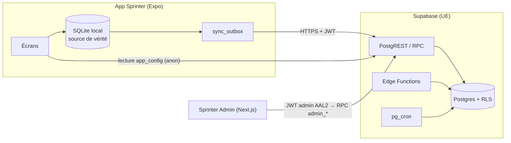

# Comptes, synchronisation et administration · guide technique

Référence fonctionnelle : [docs/specs/COMPTES_SYNC_ADMIN_v2_1.md](specs/COMPTES_SYNC_ADMIN_v2_1.md). Reconnaissance : [ACCOUNTS_RECON.md](ACCOUNTS_RECON.md). Ce guide décrit ce qui est livré, les commandes et les procédures d’exploitation. Il est mis à jour à chaque phase.

## 1. Architecture



- **Local-first** : l’app lit toujours SQLite ; le réseau n’est jamais sur le chemin critique d’une course.
- **Schémas** : `public` (seul exposé, RLS partout) · `private` (jamais exposé : annuaire, audit, agrégats, rôles admin) · `authz` (fonctions de contrôle appelées par les policies, sans table).
- **Contrôle d’accès aux données privées** : chaque policy compare `user_id` à `(select authz.active_uid())`, qui vaut l’utilisateur du JWT seulement si son compte est `active` dans `private.user_directory` **et** si la session du JWT existe encore dans `auth.sessions`. Un ancien JWT non expiré d’un compte désactivé, en cours de suppression ou dont la session a été révoquée ne lit donc rien.
- **Écritures** : par RPC `SECURITY DEFINER` (`search_path = ''`, `EXECUTE` accordé explicitement, jamais à `anon`), idempotentes.

## 2. Dépôt

```
supabase/
  config.toml           pile locale (seul public exposé, OTP 6 chiffres / 10 min, TOTP, liaison manuelle)
  migrations/           SQL versionné — jamais modifié après fusion
  tests/database/       pgTAP (000_helpers puis un fichier par domaine)
  seed.sql              données SYNTHÉTIQUES (2 000 comptes, ~21 000 courses)
src/account/            env, configuration distante, stockage local du module compte
scripts/check-no-secrets.cjs   garde anti-secrets (CI)
scripts/db-local/       banc d’essai SQL sans Docker (PostgreSQL éphémère + émulation Supabase)
```

`supabase/` est exclu de `tsconfig.json` et d’ESLint (Edge Functions en Deno).

## 3. Commandes

| Besoin | Commande |
|---|---|
| Vérification de l’app | `npm run check` (lint, types, garde anti-secrets, Vitest) puis `npx expo install --check` et `npx expo export --platform ios --platform web` |
| Base locale complète (Docker) | `supabase start` · `supabase db reset` · `supabase test db` · `supabase db lint --level warning` |
| Base sans Docker | `npm run test:db` (`--seed` pour charger la graine, `--seed-users 10000` pour le volume) — voir §5 |
| Garde anti-secrets seule | `npm run check:secrets` |
| Graine volumineuse (staging) | `psql "$DB_URL" -c "set sprinter.seed_users = 10000" -f supabase/seed.sql` |

## 4. Configuration distante et flags

`public.app_config` est la seule table lisible sans compte (valeurs `is_public`). L’app la lit **après** le démarrage (`startAppConfig` dans `App.tsx`), garde la dernière valeur connue dans `sprinter-account-v1.db`, relit en arrière-plan au-delà d’une heure (lancement, retour au premier plan) et **échoue en mode ouvert** : hors ligne, erreur ou réponse invalide, l’app fonctionne avec la valeur connue ou les défauts (tout éteint).

| Clé | Défaut | Phase |
|---|---|---|
| `accounts_enabled` | `false` | 1 |
| `sync_enabled` | `false` | 2 |

Une fonction dépendante n’est jamais active sans son socle (ex. `sync_enabled` ignoré si `accounts_enabled` est faux). Jusqu’à la page Config de l’admin (phase 4d), un flag se change dans l’éditeur SQL du projet, en tant que propriétaire :

```sql
update public.app_config set value = 'true'::jsonb where key = 'accounts_enabled';
```

**Retour arrière** : remettre le flag à `false` suffit ; aucune mise à jour de l’app n’est nécessaire.

## 5. Banc d’essai SQL sans Docker

`scripts/db-local/run.mjs` initialise un PostgreSQL 17 éphémère, applique `scripts/db-local/supabase-shim.sql` (rôles `anon`/`authenticated`/`service_role`, `auth.users`/`identities`/`sessions`, `auth.uid()`/`jwt()`, `storage.buckets`/`objects`), toutes les migrations, pgTAP, puis exécute `supabase/tests/database/*.sql` (une connexion par fichier, comme `pg_prove`).

Prérequis : `cd scripts/db-local && npm install`, puis `PG_BIN` (dossier contenant `initdb` et `postgres`) et `PGTAP_SRC` (sources pgTAP décompressées). Par défaut : `~/.local/opt/pg17/…/native/bin` et `~/.local/opt/pgtap-src`.

Limites : les migrations y tournent en superutilisateur et `pg_cron` est absent (les migrations qui l’utilisent le détectent). **La référence reste la CI** (`supabase test db`).

## 6. Environnements et procédures

| Env | Supabase | Données |
|---|---|---|
| local | `supabase start` | `seed.sql` |
| staging | projet `sprinter-staging` (UE) | graine synthétique uniquement |
| prod | projet `sprinter-prod` (UE, plan Pro) | réelles — jamais copiées ailleurs |

**Appliquer les migrations sur staging** (Flo) : `supabase link --project-ref <ref-staging>` puis `supabase db push`. Vérifier ensuite le Security Advisor du projet. La production suit la même procédure après recette.

**Secrets** : saisis directement dans les gestionnaires (Supabase › Edge Functions › Secrets, Vercel, EAS). Jamais dans un fichier du dépôt ni dans une conversation.

## 7. Variables d’environnement (Annexe A)

| Variable | Où | Public |
|---|---|---|
| `EXPO_PUBLIC_SUPABASE_URL`, `EXPO_PUBLIC_SUPABASE_PUBLISHABLE_KEY` | App (EAS env / `.env.local` non versionné) | oui |

Sans ces deux variables, aucune fonction en ligne n’existe dans l’app. L’URL doit être en HTTPS (HTTP accepté uniquement pour `localhost`/`127.0.0.1`).
