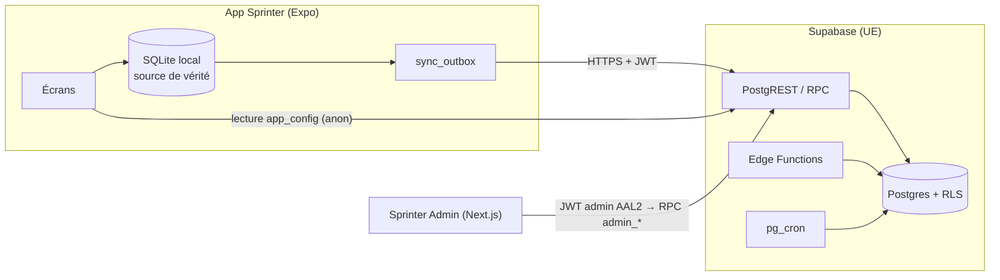

# Comptes, synchronisation et administration · guide technique

Référence fonctionnelle : [docs/specs/COMPTES_SYNC_ADMIN_v2_1.md](specs/COMPTES_SYNC_ADMIN_v2_1.md). Reconnaissance : [ACCOUNTS_RECON.md](ACCOUNTS_RECON.md). Ce guide décrit ce qui est livré, les commandes et les procédures d’exploitation. Il est mis à jour à chaque phase.

## 1. Architecture



- **Local-first** : l’app lit toujours SQLite ; le réseau n’est jamais sur le chemin critique d’une course.
- **Schémas** : `public` (seul exposé, RLS partout) · `private` (jamais exposé : annuaire, audit, agrégats, rôles admin) · `authz` (fonctions de contrôle appelées par les policies, sans table).
- **Contrôle d’accès aux données privées** : chaque policy compare `user_id` à `(select authz.active_uid())`, qui vaut l’utilisateur du JWT seulement si son compte est `active` dans `private.user_directory` **et** si la session du JWT existe encore dans `auth.sessions`. Un ancien JWT non expiré d’un compte désactivé, en cours de suppression ou dont la session a été révoquée ne lit donc rien.
- **Écritures** : par RPC `SECURITY DEFINER` (`search_path = ''`, `EXECUTE` accordé explicitement, jamais à `anon`), idempotentes.

## 2. Dépôt

```
supabase/
  config.toml           pile locale (seul public exposé, OTP 6 chiffres / 10 min, TOTP, liaison manuelle)
  migrations/           SQL versionné — jamais modifié après fusion
  tests/database/       pgTAP (000_helpers puis un fichier par domaine)
  seed.sql              données SYNTHÉTIQUES (2 000 comptes, ~21 000 courses)
src/account/            env, configuration distante, stockage local du module compte
scripts/check-no-secrets.cjs   garde anti-secrets (CI)
scripts/db-local/       banc d’essai SQL sans Docker (PostgreSQL éphémère + émulation Supabase)
```

`supabase/` est exclu de `tsconfig.json` et d’ESLint (Edge Functions en Deno).

## 3. Commandes

| Besoin | Commande |
|---|---|
| Vérification de l’app | `npm run check` (lint, types, garde anti-secrets, Vitest) puis `npx expo install --check` et `npx expo export --platform ios --platform web` |
| Base locale complète (Docker) | `supabase start` · `supabase db reset` · `supabase test db` · `supabase db lint --level warning` |
| Base sans Docker | `npm run test:db` (`--seed` pour charger la graine, `--seed-users 10000` pour le volume) — voir §5 |
| Garde anti-secrets seule | `npm run check:secrets` |
| Graine volumineuse (staging) | `psql "$DB_URL" -c "set sprinter.seed_users = 10000" -f supabase/seed.sql` |

## 4. Configuration distante et flags

`public.app_config` est la seule table lisible sans compte (valeurs `is_public`). L’app la lit **après** le démarrage (`startAppConfig` dans `App.tsx`), garde la dernière valeur connue dans `sprinter-account-v1.db`, relit en arrière-plan au-delà d’une heure (lancement, retour au premier plan) et **échoue en mode ouvert** : hors ligne, erreur ou réponse invalide, l’app fonctionne avec la valeur connue ou les défauts (tout éteint).

| Clé | Défaut | Phase |
|---|---|---|
| `accounts_enabled` | `false` | 1 — affiche Réglages › Compte et le bandeau « Sauvegardez vos courses » |
| `sync_enabled` | `false` | 2 — synchronisation des courses et des réglages |
| `routes_sync_enabled` | `false` | 3 — tracés GPS (choix explicite en plus) |

Une fonction dépendante n’est jamais active sans son socle (ex. `sync_enabled` ignoré si `accounts_enabled` est faux). Jusqu’à la page Config de l’admin (phase 4d), un flag se change dans l’éditeur SQL du projet, en tant que propriétaire :

```sql
update public.app_config set value = 'true'::jsonb where key = 'accounts_enabled';
```

**Retour arrière** : remettre le flag à `false` suffit ; aucune mise à jour de l’app n’est nécessaire.

## 5. Comptes (phase 1)

### 5.1 Côté app

| Élément | Fichier |
|---|---|
| Client Supabase unique, chargé à la demande | `src/account/supabaseClient.ts` |
| Session chiffrée (clé AES-256 dans le trousseau, session chiffrée dans `sprinter-account-v1.db`) | `src/account/secureSession.ts` |
| État du compte, connexion, liaison, export, suppression | `src/account/accountStore.ts` (logique testée) · `src/account/account.ts` (branchement) |
| Apple (nonce brut → Supabase, SHA-256 → Apple) et Google natifs | `src/account/providers.ts` |
| Garde-fous du code e-mail (renvoi 60 s, 5 essais puis 15 min) | `src/account/otpGuard.ts` |
| Écrans | `src/account/ui/` (feuille Compte ouverte depuis Réglages) |

Points d’accroche dans l’existant : une section « Compte » dans `Settings.tsx` (visible seulement si le backend est configuré **et** `accounts_enabled` est vrai), la feuille `account` dans `AppSheets.tsx`, deux `useEffect` dans `App.tsx`, le bandeau dans `RunSummary.tsx`, et `purgeLocalRuns` (effacement local explicite) dans le dépôt de courses.

**Démarrage** : la bibliothèque Supabase et les modules natifs de connexion ne sont jamais importés statiquement (test `tests/account-startup.test.ts`). Le bundle iOS passe de 4 054 832 à 4 871 309 octets de bytecode Hermes (+816 Ko, +20 %) ; ces modules ne sont pas évalués au démarrage. Mesure du temps de démarrage sur iPhone à faire en recette (avant/après, compte absent).

### 5.2 Côté serveur

| Edge Function | Rôle | JWT |
|---|---|---|
| `delete-account` | POST : suppression avec authentification réelle < 5 min (claim `amr`) · GET `?operation=` : statut | vérifié dans la fonction (CORS de la page web) |
| `process-deletions` | reprise planifiée des suppressions interrompues | en-tête `x-cron-secret` |
| `apple-link` | échange du code d’autorisation Apple, jeton de rafraîchissement chiffré (AES-GCM) | oui |
| `export-my-data` | archive ZIP lue avec le JWT de l’utilisateur (RLS) | oui |

RPC ajoutées (`0006_accounts.sql`) : `record_consent` (idempotent par `client_event_id`, rejet des décisions obsolètes), `my_consents`, `register_device` (session liée à l’appareil), `disconnect_device` (révoque la session de l’appareil), `touch_activity` (jour local borné à [hier, demain]), `my_data_summary`, et les fonctions `service_*` réservées aux Edge Functions.

**Secrets des Edge Functions** (Supabase › Edge Functions › Secrets, jamais dans le dépôt) : `APPLE_TEAM_ID`, `APPLE_KEY_ID`, `APPLE_BUNDLE_ID` (= `app.sprinter.running`), `APPLE_PRIVATE_KEY` (contenu de la clé `.p8`), `APPLE_TOKEN_KEY` (32 octets aléatoires en base64 : `openssl rand -base64 32`), `CRON_SECRET`, `PUBLIC_WEB_ORIGINS` (ex. `https://<domaine>`).

**Tâche planifiée** : Supabase › Integrations › Cron, toutes les 15 minutes, requête HTTP POST vers `/functions/v1/process-deletions` avec l’en-tête `x-cron-secret` (valeur stockée dans Vault).

### 5.3 Fournisseurs (staging puis production)

1. **E-mail** : SMTP personnalisé (Authentication › SMTP), longueur du code 6, expiration 600 s, renvoi 60 s ; recopier les modèles `supabase/templates/magic_link.html` et `confirmation.html` (ils affichent `{{ .Token }}`).
2. **Apple** : activer « Sign in with Apple » sur `app.sprinter.running` ; dans Supabase › Auth › Apple, ajouter `app.sprinter.running` aux Authorized Client IDs.
3. **Google** : clients OAuth Web (renseigné dans Supabase), iOS et Android ; ajouter les identifiants iOS/Android aux Authorized Client IDs ; activer « Skip nonce checks » (la bibliothèque native gratuite ne transmet pas de nonce, §6.2).
4. **App** (variables EAS) : `EXPO_PUBLIC_SUPABASE_URL`, `EXPO_PUBLIC_SUPABASE_PUBLISHABLE_KEY`, `EXPO_PUBLIC_GOOGLE_WEB_CLIENT_ID`, `EXPO_PUBLIC_GOOGLE_IOS_CLIENT_ID`, `EXPO_PUBLIC_GOOGLE_IOS_URL_SCHEME` (active le plugin Google au build), `EXPO_PUBLIC_SITE_URL` (liens CGU, confidentialité, suppression).
5. **Page web** : `web/supprimer-mon-compte/` (voir `web/README.md`).

Limite connue : le blocage après 5 codes faux est appliqué par l’app ; côté serveur, seule la limite par IP de Supabase (`token_verifications`) s’applique.

## 6. Synchronisation (phase 2)

**Local** (`sprinter-v1.db`, version 4) : `runs.updated_at`, `sync_outbox` (une entrée par élément, la dernière opération gagne, `version` incrémentée à chaque écriture, `parked` pour les écritures mises de côté), `sync_state` (`bound_user_id`, curseur, choix de sauvegarde, empreinte des réglages…), `sync_meta` (date serveur, validité). L’entrée d’outbox est écrite **dans la même transaction** que la course, la suppression ou les réglages, et seulement si l’appareil est lié à un compte.

**Moteur** (`src/sync/engine.ts`, testé de bout en bout avec SQLite réel et un faux serveur dans `tests/sync-engine.test.ts`) :
1. lie l’appareil au compte (un autre compte → « Appareil lié à un autre compte », scénario D) ;
2. réglages portables (`config`, `audioEnabled`, `hapticsEnabled`, `appearance`, `autoPauseEnabled`, `coaching`) en dernier écrit gagne ; `backgroundEnabled` reste local ;
3. si la sauvegarde des courses est confirmée : copie locale avant le premier import (`runs_backup`), mise en file des courses jamais synchronisées, réconciliation après 60 jours, envoi par lots de 20 (points GPS retirés par SQLite), puis réception par pages avec 5 minutes de chevauchement, page et curseur dans une même transaction ;
4. `report_sync`.

Déclencheurs : retour au premier plan, fin de course (3 s), retour du réseau (NetInfo), « Réessayer ». Aucun passage pendant une séance, même en pause. Erreurs : réseau → hors ligne ; 401 → un seul rafraîchissement puis « Reconnexion nécessaire » ; 429 → pause ; 5xx → reprise avec délai exponentiel (5 s → 15 min, gigue) ; après 5 échecs, l’élément est « bloqué » et visible dans Compte › Synchronisation.

**Serveur** (`0007_sync.sql`) : `sync_push_runs`, `sync_delete_runs`, `sync_pull`, `sync_list_ids`, `sync_push_preferences`, `sync_get_preferences`, `report_sync`, trigger `runs_before_write` (identité immuable, horodatages serveur, validité §9.1, meilleurs efforts plausibles), `private.storage_purge_queue`.

Flag : `sync_enabled` (sans effet si `accounts_enabled` est faux). Retour arrière : le remettre à `false` arrête toute synchronisation, les données restent sur les appareils.

## 7. Tracés GPS (phase 3)

- **Choix explicite** (§8.1) : demandé une fois quand la sauvegarde des courses est active et `routes_sync_enabled` vrai, deux boutons sans présélection ; modifiable dans Compte › Synchronisation. Arrêt : « Les conserver » ou « Supprimer aussi mes parcours en ligne ».
- **Envoi** (`src/sync/routes.ts`, extension du moteur) : seulement pour les courses déjà synchronisées, au repos, 5 par passage ; points en JSON compressé gzip (`fflate`), ≤ 8 Mo, déposés dans `run-tracks/<uid>/<base64url(run_id)>.json.gz`, puis `sync_register_route`. Aperçu : polyline ≤ 300 points **sans les 300 premiers et derniers mètres**.
- **Réception** : à la demande depuis le détail d’une course (`CloudRoutePanel`), préchargement des 5 dernières en Wi-Fi ; les points sont réintégrés localement sans rien renvoyer.
- **Serveur** (`0010_routes.sql`) : bucket privé (8 Mio, `application/gzip`), policies Storage par opération (dossier du titulaire, compte actif, envoi et remplacement seulement avec les deux sauvegardes et le flag, suppression toujours possible), `sync_register_route` (objet présent exigé), `sync_delete_routes`, file de purge + Edge Function `purge-storage` (quotidienne, `x-cron-secret`), `private.recompute_validity` pour les changements de `rules_version`.
- **Meilleurs efforts** : calculés à la fin de la course sur l’appareil (`records.ts`) ; le serveur ne conserve que les valeurs plausibles.
- Aucun accès admin aux tracés, aucun aperçu exposé ailleurs que pour le titulaire.

## 8. Sprinter Admin côté base (phases 4a à 4d)

Contrat consommé par le site : [specs/ADMIN_RPC_CONTRACT.md](specs/ADMIN_RPC_CONTRACT.md). Toutes les fonctions `admin_*` exigent un JWT **AAL2**, un rôle présent dans `private.admin_users` (jamais lu dans les métadonnées) et la capacité du rôle ; les actions sensibles exigent en plus une authentification réelle de moins de 5 minutes (`amr`). Chaque lecture ou action sensible écrit sa ligne d’audit dans la même transaction, sans e-mail ni texte de recherche.

| Migration | Contenu |
|---|---|
| `0009_admin_core` | `admin_whoami`, `assert_admin`, `admin_overview` (KPI §10.5, métriques quotidiennes Europe/Paris), `admin_list_audit`, job `daily-metrics` |
| `0011_admin_users` | `admin_search_users` (id court, préfixe/trigramme d’e-mail, nom sans accents, filtres en liste blanche, keyset), `admin_get_user` (motif obligatoire), `admin_authorize_user_action` + Edge Function `admin-user-action` |
| `0012_admin_rankings` | `admin_leaderboard` (agrégé / nominatif top 50), `admin_analytics` (k ≥ 10, « Autres » ≥ 10 ou absent), `admin_runs_stats`, vue matérialisée `private.leaderboard_stats` (job `refresh-rankings`) |
| `0013_admin_ops` | `admin_get_config` / `admin_set_config` (schéma validé, réauth, audit), **coupure côté serveur** des écritures de synchro par flag, `submit_support_request` (app) / `admin_list_support` / `admin_update_support`, `admin_quality`, `admin_export_aggregates` (CSV standard ou Excel FR), job `retention`, comptes inactifs (Edge Function `inactive-accounts`) |

**Premier administrateur** (Flo, une fois) : créer l’utilisateur dans Supabase › Authentication sans mot de passe, puis dans l’éditeur SQL :

```sql
insert into private.admin_users (user_id, role) select id, 'owner' from auth.users where email = '<EMAIL_DE_FLO>';
```

puis se connecter au site et enrôler le TOTP.

**Tâches planifiées** : pg_cron (`daily-metrics` 01:15 UTC, `refresh-rankings` 01:30, `retention` 02:45) ; Supabase Cron (HTTP, en-tête `x-cron-secret`) pour les Edge Functions `process-deletions` (15 min), `purge-storage` (quotidien) et `inactive-accounts` (hebdomadaire ; secrets `EMAIL_API_URL`, `EMAIL_API_KEY`, `EMAIL_FROM` — sans eux, aucun compte n’est supprimé).

**Budgets §10.6** : mesurés avec `scripts/db-local/perf-admin.sql` sur 10 001 comptes et 104 856 courses (voir les PR 4b et 4c).

**App** : formulaire « Contacter le support » (flag `support_enabled`), écran « Mise à jour requise » (version minimale valide connue, jamais pendant une course, `EXPO_PUBLIC_APP_STORE_ID` pour le lien App Store), avis de maintenance.

## 9. Banc d’essai SQL sans Docker

`scripts/db-local/run.mjs` initialise un PostgreSQL 17 éphémère, applique `scripts/db-local/supabase-shim.sql` (rôles `anon`/`authenticated`/`service_role`, `auth.users`/`identities`/`sessions`, `auth.uid()`/`jwt()`, `storage.buckets`/`objects`), toutes les migrations, pgTAP, puis exécute `supabase/tests/database/*.sql` (une connexion par fichier, comme `pg_prove`).

Prérequis : `cd scripts/db-local && npm install`, puis `PG_BIN` (dossier contenant `initdb` et `postgres`) et `PGTAP_SRC` (sources pgTAP décompressées). Par défaut : `~/.local/opt/pg17/…/native/bin` et `~/.local/opt/pgtap-src`.

Limites : les migrations y tournent en superutilisateur et `pg_cron` est absent (les migrations qui l’utilisent le détectent). **La référence reste la CI** (`supabase test db`).

## 10. Environnements et procédures

| Env | Supabase | Données |
|---|---|---|
| local | `supabase start` | `seed.sql` |
| staging | projet `sprinter-staging` (UE) | graine synthétique uniquement |
| prod | projet `sprinter-prod` (UE, plan Pro) | réelles — jamais copiées ailleurs |

**Appliquer les migrations sur staging** (Flo) : `supabase link --project-ref <ref-staging>` puis `supabase db push`. Vérifier ensuite le Security Advisor du projet. La production suit la même procédure après recette.

**Secrets** : saisis directement dans les gestionnaires (Supabase › Edge Functions › Secrets, Vercel, EAS). Jamais dans un fichier du dépôt ni dans une conversation.

## 11. Variables d’environnement (Annexe A)

| Variable | Où | Public |
|---|---|---|
| `EXPO_PUBLIC_SUPABASE_URL`, `EXPO_PUBLIC_SUPABASE_PUBLISHABLE_KEY` | App (EAS env / `.env.local` non versionné) | oui |
| `EXPO_PUBLIC_GOOGLE_WEB_CLIENT_ID`, `EXPO_PUBLIC_GOOGLE_IOS_CLIENT_ID`, `EXPO_PUBLIC_GOOGLE_IOS_URL_SCHEME`, `EXPO_PUBLIC_SITE_URL` | App | oui |
| `APPLE_*`, `APPLE_TOKEN_KEY`, `CRON_SECRET`, `PUBLIC_WEB_ORIGINS`, `ADMIN_ORIGINS`, `EMAIL_API_URL`, `EMAIL_API_KEY`, `EMAIL_FROM` | Secrets des Edge Functions | **non** |
| `EXPO_PUBLIC_APP_STORE_ID` | App (lien de mise à jour) | oui |
| `GOOGLE_MAPS_ANDROID_API_KEY` | Build EAS Android (clé restreinte) | non versionnée |

Sans ces deux variables, aucune fonction en ligne n’existe dans l’app. L’URL doit être en HTTPS (HTTP accepté uniquement pour `localhost`/`127.0.0.1`).

## 12. Profil personnalisé (phase 8, §17)

Surface distincte du profil de compte (§6.5), entièrement facultative, pilotée par `profiles_enabled` (puis `profile_studio_enabled`, `profile_sharing_enabled`, `theme_library_enabled`, `profile_cards_enabled`, tous dépendants de `profiles_enabled` côté app et côté serveur).

**8a · Profil privé**

- **Serveur** (`0015_profiles.sql`) : `public.profile_elements` — un enregistrement par élément (`identity`, `appearance`, `avatar`, `banner`, `about`, `status`, `layout`, `widget:<uuid>`), lecture du seul titulaire (RLS), écriture uniquement par `profile_save` (lot ≤ 40, `op_id` rejouable, `base_revision` : conflit si l’élément a changé entre-temps, `prev_op_id` pour éviter un faux conflit après une réponse perdue). Contenus validés par `private.profile_payload_error` (clés en liste blanche, textes bornés, aucun caractère de contrôle, identifiants de catalogue par motif). `profile_pull` relit la version privée. Coupure serveur : `feature_disabled` (pause de 30 min côté app, comme `sync_disabled`).
- **Médias** : bucket privé `profile-media`, chemin `<uid>/<media_id>.<ext>`. `profile_media_begin` réserve (id choisi par l’app, idempotent, ≤ 5 Mio, 20 médias actifs au plus) ; le dépôt n’est permis que pour une réservation en attente du titulaire ; la fonction `profile-media-commit` lit le fichier (rôle service), vérifie le type réel (octets magiques), les dimensions, l’animation et l’absence d’EXIF GPS, puis valide ou purge. Un élément qui cite un média non validé reste « deferred ». L’ancien média n’est libéré qu’après l’enregistrement de son remplaçant ; le job quotidien `profile-media` purge les réservations abandonnées (> 24 h) et les médias inutilisés (> 7 jours).
- **App** : base locale séparée `sprinter-profile-v1.db` (ouverte au premier usage, absente du web) avec `profile_saved`, `profile_draft` (brouillon écrit à chaque geste), `profile_outbox` (file transactionnelle), `profile_media` ; chaque ligne est rattachée au titulaire (`owner`). `ProfileSync` a son propre état et ne dépend pas de la sauvegarde des courses ; aucun appel pendant une course. Images : `expo-image-picker` puis réencodage JPEG par `expo-image-manipulator` (orientation corrigée, métadonnées retirées, 1 024 px pour l’avatar, 1 800 px pour la bannière).
- **Export / suppression** : `profile-page.json`, `profile-media.json` et `profile-media/` dans l’export ; suppression du compte → cascade SQL + purge du dossier `profile-media/<uid>` + effacement local du titulaire.
- **Entrée** : Réglages › Compte › Mon profil (flag `profiles_enabled`).
