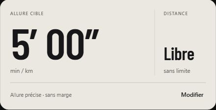

# Allure précise — 11 novembre 2026

Le départ simple utilise désormais une cible unique, par défaut 5′00″/km. L’allure se choisit dans Stats ou dans la préparation, avec le mode « Allure précise ». Le champ accepte 5:00 ou 5.00 ; le point sépare les minutes et les secondes.

Pour une cible de 5′00″ :

| Allure mesurée affichée | État | Signal prévu |
|---|---|---|
| 4′58″/km | Trop rapide | Deux impacts rapprochés : ralentir |
| 5′00″/km | Dans la cible | Aucune alerte d’écart |
| 5′02″/km | Trop lent | Une vibration système plus longue : accélérer |

Les cibles uniques ignorent la tolérance supplémentaire et l’hystérésis configurées pour les plages. La comparaison suit la seconde affichée : une estimation à 300,2 s/km affichée 5′00″ ne devient pas artificiellement « trop lente » à cause des décimales invisibles. Le journal d’allure utilise la même classification.

Le filtrage GPS, le lissage, la confirmation de l’écart (10 secondes par défaut), l’espacement des annonces et les contrôles de qualité restent actifs. Un seuil strict ne donne pas au GPS une précision physique de deux secondes par kilomètre et ne promet pas une vibration instantanée sur chaque mesure.

Les plages d’allure, objectifs chronométriques, plans par kilomètre et séances restent accessibles dans la préparation. Les anciennes activités gardent leurs cibles enregistrées.

Les vibrations restent soumises aux réglages de Sprinter et d’iOS et sont émises uniquement au premier plan dans cette version.

Vérifications : TypeScript et exports iOS/web réussis ; 31 tests ciblés du coach et du moteur réussis, dont les cas GPS simulés 4′58″ et 5′02″ malgré des marges de plage non nulles, et le calcul du temps en cible à 5′00″ avec bruit numérique. La saisie 5.00, la conservation du champ pendant une saisie incomplète et le retour vers l’accueil à 5′00″ sans marge ont été vérifiés dans le navigateur. Aucun essai physique iPhone effectué.
