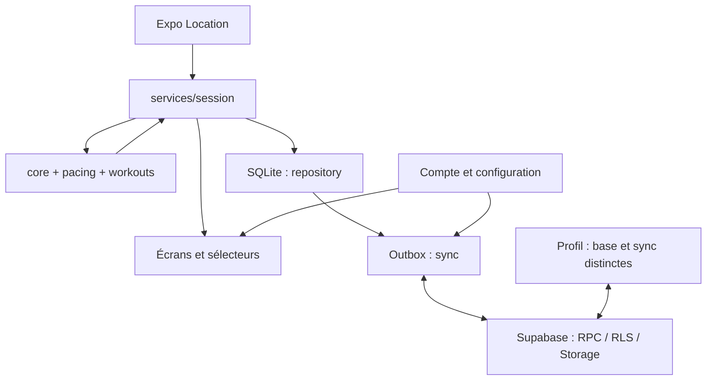

# Architecture générale

[Carte documentaire](../00-INDEX.md) · [Décisions](../decisions/README.md)

Sprinter associe une application Expo, des bases locales et un backend Supabase. Le compte contrôle l’accès à l’interface ; après restauration de session, le calcul sportif ne dépend pas d’une réponse réseau. Le site privé d’administration appartient à un autre dépôt : son interface n’est pas auditable ici.

## Démarrage et flux

[App.tsx](../../App.tsx) initialise session, progression, musique, séances, configuration distante, compte, sync et profil. [index.ts](../../index.ts) enregistre la tâche GPS avant le montage React. Le compte authentifié ouvre la navigation sur Courir ; une session absente ouvre `AccountGate`.

## Carte des responsabilités

| Dossier ou entrée | Responsabilité ; première lecture |
|---|---|
| [src/core/](../../src/core/) | Mesures, filtre GPS, horloges, pauses, coach ; `engine.ts`, `types.ts` |
| [src/services/](../../src/services/) | Cycle de course et adaptateurs système ; `session.ts`, `location.ts`, `background.ts` |
| [src/storage/](../../src/storage/) | Dépôt transactionnel, checkpoints et migrations d’activités |
| [src/pacing/](../../src/pacing/) | Cible au kilomètre, objectif chronométrique, écarts et capital |
| [src/workouts/](../../src/workouts/) | Définition, moteur, modèles, bibliothèque, persistance et file du coach |
| [src/coaching/](../../src/coaching/) | Préférences et annonces de progression ; sorties audio dans les services |
| [src/analysis/](../../src/analysis/) | Séries, records, comparaison, export GPX/CSV |
| [src/progression/](../../src/progression/) | Calendrier, plans, objectifs, journal, chaussures et exemples isolés |
| [src/routes/](../../src/routes/) | GPX, géométrie, validation, guidage et favoris |
| [src/sharing/](../../src/sharing/) | Masquage géographique et documents à partager |
| [src/tools/](../../src/tools/) | Météo, métronome, cadence et raccordement à la course |
| [src/apple/](../../src/apple/) | Bridge Santé, reprise d’export, Live Activity ; contrat Watch |
| [src/spotify/](../../src/spotify/) | Références, PKCE, API, état musical, UI et variantes web |
| [src/account/](../../src/account/) | Configuration, session sécurisée et parcours du compte |
| [src/sync/](../../src/sync/) | Outbox, conflits, réglages portables, documents et tracés cloud |
| [src/profile/](../../src/profile/) | Profil privé, studio, médias, sync distincte et publication |
| [src/community/](../../src/community/) | Classement facultatif, inscription et signalement |
| [src/navigation/](../../src/navigation/) | Pile native, onglets et feuilles ; [parcours UI](../design/interface.md) |
| [src/screens/](../../src/screens/), [src/ui/](../../src/ui/) | Écrans et composants sémantiques ; calculs sportifs hors des rendus |
| [modules/](../../modules/), [plugins/](../../plugins/) | Swift local et configuration native générée |
| [supabase/](../../supabase/) | Migrations, Deno, modèles e-mail, seed et tests SQL |
| [web/](../../web/), [integrations/](../../integrations/) | Pages statiques de suppression et de retour Spotify |
| [tests/](../../tests/), [scripts/](../../scripts/), [.github/workflows/](../../.github/workflows/) | Validation, outils et CI ; [limites des preuves](../quality/validation.md) |

## État et performances

Les stores utilisent abonnements et `useSyncExternalStore`. Les [sélecteurs de session](../../src/services/useSessionSelector.ts) séparent valeurs structurelles et données en direct ; les écrans masqués suspendent leurs abonnements rapides. Ne pas propager chaque point GPS dans toute la navigation. L’affichage du tracé est réduit sans réduire les points sauvegardés.

Les variantes `.web.ts(x)` remplacent les adaptateurs natifs : le navigateur ne reproduit pas les capacités du téléphone. Lire [le cycle de données](donnees-et-cycle-course.md) avant une écriture et [la synchronisation](../backend/synchronisation.md) avant une modification d’entité persistée.
