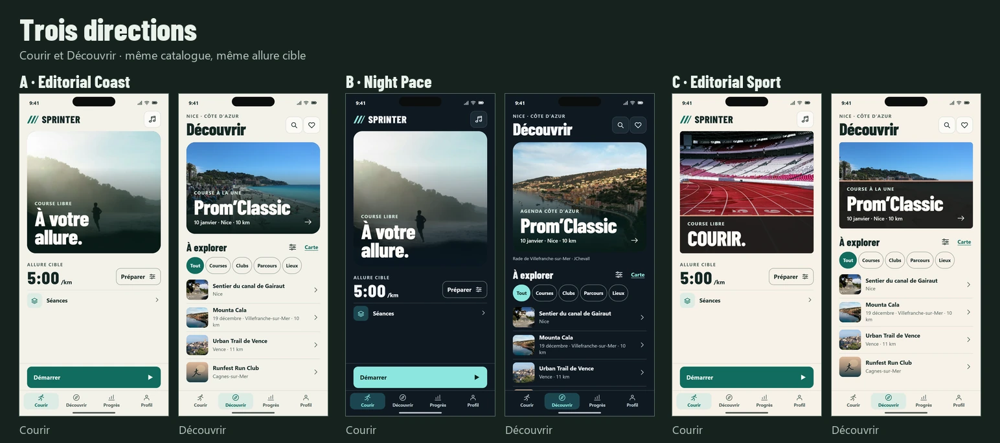
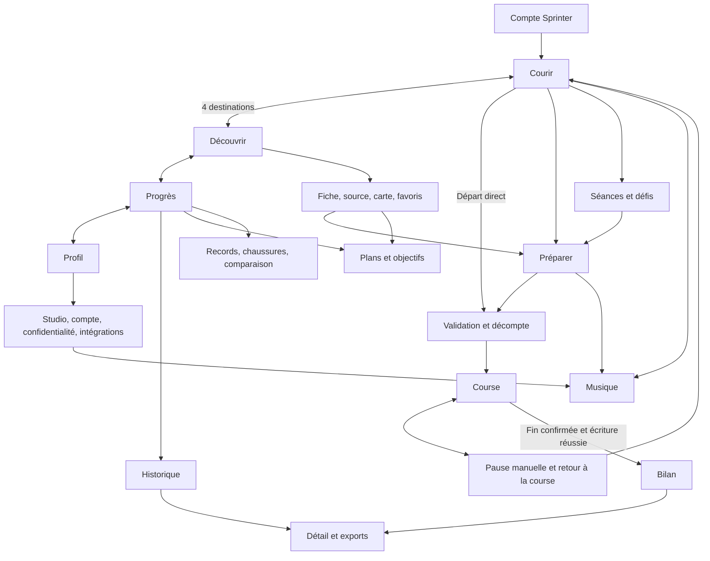

# Sprinter · Editorial Performance

[Prototype hors ligne](prototype/index.html) · [Maquettes](prototype/index.html#maquettes) · [Comparaison avant / après](prototype/index.html#comparatif) · [Aperçu des écrans](prototype/captures/apercu.webp) · [Interface actuelle](interface.md)

Ouvrir `docs/design/prototype/index.html` dans un navigateur depuis le dépôt. Les commandes à gauche ouvrent directement les maquettes. Les onglets, boutons, feuilles et retours du téléphone permettent de les parcourir comme une application. À droite, les scénarios changent l’état de départ. Le prototype simule le compte, la course, le catalogue et Spotify. La direction A est intégrée à l’application React Native : voir l’[interface actuelle](interface.md) et les [preuves de validation](../quality/validation.md#intégration-editorial-coast--16-novembre-2026).

## Audit avant intégration

Relevé du 15 novembre 2026 sur `b311a01`. Les captures **Avant** viennent de l’export web du dépôt exécuté dans Edge à 390 × 844 CSS et 2×, en thème sombre. Le compte est synthétique. Le serveur local restitue l’instantané public de Découvrir et le compte n’a ni sortie ni playlist. Les captures **Après** reprennent la taille, le thème, la cible de 5:00/km et l’état correspondant. La barre système de l’iPhone est dessinée dans la maquette. Le fond de carte web diffère du fournisseur natif.

Les sept paires couvrent Courir, Préparer, le début d’une course, Découvrir, la fiche événement, l’historique vide et la bibliothèque vide. Le départ actuel a été déclenché depuis l’application web avec une position simulée, puis mis en pause. [Écran d’entrée actuel](prototype/captures/avant/connexion.webp)

| Surface                       | Observation                                                                                                                                                                                                          | Décision                                                                                                                                                                                                                                                                                                                             |
| ----------------------------- | -------------------------------------------------------------------------------------------------------------------------------------------------------------------------------------------------------------------- | ------------------------------------------------------------------------------------------------------------------------------------------------------------------------------------------------------------------------------------------------------------------------------------------------------------------------------------ |
| Connexion                     | La restauration du compte affiche son état puis ouvre Courir. La page d’entrée propose connexion et inscription.                                                                                                     | Donner une place à l’image et annoncer le compte dès l’accueil. Réemployer la porte d’accès et éviter tout retard pour une session restaurée. [App.tsx](../../App.tsx) · [AccountGate.tsx](../../src/account/ui/AccountGate.tsx)                                                                                                     |
| Courir, au repos              | La distance nulle, l’horloge et la carte tiennent l’essentiel de l’écran. Démarrer reste identifiable. L’accès à Préparer est représenté par des icônes sur l’écran principal.                                       | Afficher une cible, un bouton Préparer libellé et un accès aux séances. Monter les surfaces de carte et d’instrumentation à l’usage. [Home.tsx](../../src/screens/Home.tsx)                                                                                                                                                          |
| Préparation                   | Allure, Distance, Séance et Musique sont présentées comme options avant un résumé global. Les options avancées existent déjà.                                                                                        | Lire la cible en premier et retrouver la valeur sur chaque ligne. Conserver le bouton de départ fixé en bas. [Preparation.tsx](../../src/screens/Preparation.tsx)                                                                                                                                                                    |
| Course, pause et bilan        | Les commandes de course, le chrono et la carte partagent l’écran avec des accès plus techniques. La fin possède déjà deux voies, maintien et confirmation accessible.                                                | Garder allure, état de cible, distance et temps au premier regard. Rendre le tracé repliable et les outils explicites. Conserver le maintien et la confirmation. [LiveRunMetrics.tsx](../../src/screens/LiveRunMetrics.tsx) · [HoldToFinish.tsx](../../src/ui/HoldToFinish.tsx) · [RunSummary.tsx](../../src/screens/RunSummary.tsx) |
| Découvrir                     | Le catalogue, ses sources et la carte sont raccordés. Plusieurs rangées de navigation et de filtres sollicitent l’attention autour de la course à la une.                                                            | Une photo située, une rangée de catégories et des accès explicites Carte et Filtres. Conserver recherche, agenda, favoris, filtres avancés et provenance. [DiscoveryHome.tsx](../../src/discovery/DiscoveryHome.tsx) · [DiscoveryDetail.tsx](../../src/discovery/DiscoveryDetail.tsx)                                                |
| Stats, historique, chaussures | Stats mélange les onglets Activités, Profil, Paires avec les réglages de course. À vide, les exemples sont une bonne porte de démonstration.                                                                         | Ouvrir Progrès sur la période et la dernière sortie. Grouper l’historique, les plans, les records et les chaussures. Donner une entrée volontaire vers les exemples. [StatsDashboard.tsx](../../src/screens/StatsDashboard.tsx) · [History.tsx](../../src/screens/History.tsx)                                                       |
| Spotify                       | Une destination entière, des accès depuis la course, un lecteur compact et des liens d’import. Sur un compte neuf, l’appel à importer est clair.                                                                     | Donner un accès visible à la bibliothèque depuis Courir, Préparer et Profil. Maintenir le lecteur à la sélection et le retour au contexte d’origine. [Music.tsx](../../src/screens/Music.tsx) · [components.tsx](../../src/spotify/components.tsx)                                                                                   |
| Profil et réglages            | Le profil local du tableau de bord et le studio de profil privé répondent à des usages distincts. Les réglages et le compte transitent par des feuilles.                                                             | Entrée Profil dédiée, avec studio, données, compte et communauté selon disponibilité. Accès sportif aussi depuis Préparer et les outils de course. [AppSheets.tsx](../../src/navigation/AppSheets.tsx) · [AccountSheet.tsx](../../src/account/ui/AccountSheet.tsx)                                                                   |
| Navigation et mouvement       | Quatre onglets dans l’ordre Découvrir, Courir, Stats, Spotify. `TabPane` conserve les panneaux, le dock mesure ses insets et la pile connaît les paramètres de détail. Des fondus et pressions courts existent déjà. | Faire évoluer le shell existant, lui confier les insets et étendre son langage de mouvement. Tester le suivi et le lecteur avec les panneaux conservés. [RunTabs.tsx](../../src/navigation/RunTabs.tsx) · [RootStack.tsx](../../src/navigation/RootStack.tsx) · [motion.tsx](../../src/ui/motion.tsx)                                |

## Direction retenue



| Direction               | Ce qu’on peut comparer dans Courir et Découvrir                                                                                                                                       | Compromis                                                                                                                                       |
| ----------------------- | ------------------------------------------------------------------------------------------------------------------------------------------------------------------------------------- | ----------------------------------------------------------------------------------------------------------------------------------------------- |
| **A · Editorial Coast** | Papier chaud, photographie côtière respirante, turquoise sobre. Dans Courir, la cible se lit sous le paysage. Dans Découvrir, la photo vient du catalogue et le lieu reste explicite. | La couverture pourrait évoquer une carte postale si l’action prend la seconde place. La grille garde l’allure et le départ proches de la photo. |
| **B · Night Pace**      | Ardoise bleue et image plus haute. Le panneau Découvrir utilise une vue régionale de Villefranche créditée. Le départ ressort davantage avec l’accent clair.                          | L’image consomme plus d’espace et le contraste ressenti dépend de la luminosité extérieure. Garder ce registre comme piste d’ambiance.          |
| **C · Editorial Sport** | Couverture de piste, titre en capitales, cartouche presque carré avec un filet terre cuite. Découvrir conserve le lieu de la course et reprend le cartouche.                          | La composition met l’accent sur l’effort. La couleur terre cuite reste une couleur d’édition, les zones du coach conservent leur sens.          |

**Direction A retenue**. Editorial Coast pour les destinations, clair et sombre, avec une surface instrumentale à contraste renforcé pendant la course. La photographie inspire l’avant-course et l’exploration. Le tracé enregistré devient le visuel du bilan et de l’historique.

### Lecture des références

- La planche d’essentiel relie accueil photographique, départ et instrument. Les rendus vectoriels exposent les limites de certaines couvertures et pictos. Le prototype réécrit les titres dans une grille fluide, donne des libellés aux gestes et réserve le tracé aux données effectivement disponibles.
- Les planches Explorer et progresser et Profil confirment la composition par page. Les lignes de séance et de musique sont plus compactes. Les miniatures d’historique et les couvertures de playlist adoptent des traitements différents pour identifier leur contenu.
- Le storyboard montre la continuité carte–fiche et le retour au point lu. Le prototype anime une couverture commune quand elle est visible et conserve la liste et ses filtres lors du retour.
- Les références yacht CIPHERSLAB et voyage Vestrahorn apportent les grands aplats et l’alternance couverture–fiche. L’écran de trajet de la référence voyage inspire l’aperçu du bilan. La course garde son propre instrument, avec l’allure et des commandes stables.
- Travel Mobile App et Wanderly aident à choisir un cadrage dominant. Path et Drift éclairent le passage du paysage au détail. HikeMate donne un repère pour les faits et le départ du parcours. [Travel Mobile App](https://dribbble.com/shots/24633852-Travel-Mobile-App) · [Wanderly](https://dribbble.com/shots/26081050-Wanderly-Travel-Mobile-App) · [Path](https://dribbble.com/shots/27777497) · [Drift](https://dribbble.com/shots/27856614) · [HikeMate](https://dribbble.com/shots/25932060--HikeMate-Hiking-App-UI)
- Runshift et Run Details lient carte, action et trois mesures. Running Tracker Widget aide à réduire le nombre d’informations critiques. Corsa éclaire la sélection de séance et Editorial Running App appuie la comparaison C. Les kits étudiés donnent un repère de couverture des états et de déclinaison clair/sombre. [Runshift](https://dribbble.com/shots/27834234-Runshift-Running-App-UI) · [Run Details](https://dribbble.com/shots/27011635-Run-Details-iOS-26-Running-App-Apple-Inspired-UI) · [Running Tracker Widget](https://dribbble.com/shots/27376685) · [Corsa](https://www.rasa.team/work/corsa) · [Editorial Running App](https://dribbble.com/shots/27136454-Editorial-Running-App)

Les 14 paires PNG/SVG, les 5 planches, les 6 illustrations et les 2 références fournies ont été ouvertes. La courbe de l’illustration alpine pourrait se lire comme un itinéraire. Elle reste une inspiration de composition. Les fiches éditoriales Dribbble ont servi au relevé textuel lorsque le rendu distant était bloqué. Certaines recherches Pinterest et un candidat Unsplash du brief étaient indisponibles.

## Navigation proposée



- **Destinations.** Courir s’ouvre après la connexion. Découvrir, Progrès et Profil gardent chacun le filtre, la position de lecture et leurs retours. Un détail possède une entrée explicite dans la pile. Les choix courts reviennent à leur écran déclencheur.
- **Course.** Les commandes de course restent visibles en activité et en auto-pause. En pause manuelle, l’accueil est accessible via Outils et présente « Revenir à la course ». La même action apparaît sur les autres destinations. La préparation d’une seconde activité est bloquée. Le cache de Découvrir reste consultable en pause manuelle dans le produit cible. Le suivi et la synchronisation restent sous l’autorité de l’état de session.
- **Découvrir.** « Préparer une sortie » transmet le départ public comme repère lorsqu’un itinéraire validé manque. Une course éligible mène au générateur de plan par le lien existant. Les autres cas ouvrent la préparation avec les paramètres disponibles. Le prototype montre le transfert du repère ou de l’objectif. Une fiche source reste consultable après un retour de préparation.
- **Musique.** Depuis Courir ou Préparer, ouvrir le même écran et revenir à la pile d’origine. Le lecteur compact signale la sélection. En course, accéder au lecteur via Outils. Conserver import, tri, gestion des références, restrictions par plateforme et OAuth.
- **Profil.** Le studio édite les données du compte dans son contexte privé. Le partage, la recherche, les visites et les classements dépendent des flags et de la confidentialité. Les réglages de course rejoignent Préparer. Le compte, les intégrations, l’assistance et les données personnelles sont accessibles depuis Profil.

| Entrée existante                                                        | Destination et garde à préserver                                                                                                                                                                                                                                |
| ----------------------------------------------------------------------- | --------------------------------------------------------------------------------------------------------------------------------------------------------------------------------------------------------------------------------------------------------------- |
| `sprinter://run`                                                        | Lever la pile et afficher Courir. Si une activité existe, présenter son état réel et l’accès à la reprendre.                                                                                                                                                    |
| `sprinter://playlist/<id>`, URL Spotify ou réception d’un lien d’import | Résoudre le lien existant, laisser `playlistImport` parvenir à Musique une fois, après la porte de compte. Contrôler les liens abrégés selon les règles actuelles. [links.ts](../../src/spotify/links.ts)                                                       |
| `app.sprinter.running://spotify-callback` et retour HTTPS               | Garder la session OAuth présente et son callback distinct de l’écran Musique. [Retour Spotify](../../integrations/spotify-callback/README.md)                                                                                                                   |
| `sprinter://profil?t=…`                                                 | Attendre la session et le flag, puis présenter la vue visiteur déjà contrôlée. Les routes de partage et de déconnexion gardent leur association au compte courant. [App.tsx](../../App.tsx)                                                                     |
| Découvrir → Plans, préparation ou séance                                | Garder `DiscoveryPreparation`, `DiscoveryWorkoutSuggestion` et `LinkedPlanDraft` typés. Préserver la garde de session, les favoris et le retour. [routes.ts](../../src/navigation/routes.ts) · [trainingLink.ts](../../src/discovery/trainingLink.ts)           |
| Historique → Détail, exemple, comparaison, GPX/CSV                      | Ouvrir par `runId` ou `id` d’exemple. Le détail résout la sortie au moment de l’affichage, expose le tracé validé et partage selon le contexte de données. [RootStack.tsx](../../src/navigation/RootStack.tsx) · [export](../../src/analysis/export/)           |
| Récupération, intégrations, juridique et administration                 | Récupérer une course en pause. Garder les gardes Apple, les écrans de mise à jour du compte, consentements, assistance, export/suppression et administration selon rôle. [AppSheets.tsx](../../src/navigation/AppSheets.tsx) · [Compte](../features/comptes.md) |

## Maquettes et scénarios

| Maquette                                      | Action à essayer                                                          | État à examiner                                                      |
| --------------------------------------------- | ------------------------------------------------------------------------- | -------------------------------------------------------------------- |
| [Bienvenue](prototype/index.html#bienvenue)   | Continuer puis ouvrir le compte de démo                                   | Conditions d’accès visibles dès l’introduction                       |
| [Courir](prototype/index.html#courir)         | Départ direct, Préparer, Séances ou Musique                               | Course à récupérer, photo indisponible, thème sombre                 |
| [Préparer](prototype/index.html#preparation)  | Choisir une plage, une distance et une playlist                           | GPS refusé, feuille annulée, retour avec valeurs                     |
| [Course](prototype/index.html#course)         | Pause, Outils, accueil en pause, reprise, maintien ou confirmation de fin | GPS imprécis, auto-pause, temps suspendu, erreur d’écriture          |
| [Bilan](prototype/index.html#bilan)           | Voir le détail puis exporter le GPX d’exemple                             | Départ sans trace, retour à Courir, historique                       |
| [Découvrir](prototype/index.html#decouvrir)   | Chercher Gairaut, filtrer, ouvrir Carte ou une fiche                      | Catalogue hors ligne, échec avec nouvel essai, photo de remplacement |
| [Parcours](prototype/index.html#parcours)     | Ouvrir le repère, enregistrer en favori, préparer                         | Tracé indisponible, source officielle et accès                       |
| [Événement](prototype/index.html#evenement)   | Ajouter aux favoris, exporter l’ICS, ouvrir la préparation                | Statut relevé, heure de Paris, lien officiel                         |
| [Progrès](prototype/index.html#progres)       | Changer de période et ouvrir la dernière sortie                           | Nouveau compte, exemple explicite, lecture du graphique              |
| [Séances](prototype/index.html#seances)       | Ouvrir le fractionné 10 × 400 m puis choisir                              | Filtrage, remplacement d’une séance, défi                            |
| [Historique](prototype/index.html#historique) | Afficher les sorties avec tracé puis une fiche                            | Aucun résultat, activité sans trace, comparaison                     |
| [Musique](prototype/index.html#musique)       | Choisir pour la sortie ou tester l’import d’un lien                       | Bibliothèque vide, format invalide, Spotify indisponible             |
| [Profil](prototype/index.html#profil)         | Modifier nom et bannière puis ouvrir les réglages                         | Édition locale, visibilité privée, compte vide                       |

Deux parcours de revue. **Préparer → choisir une séance ou une playlist → démarrer → annuler le décompte → démarrer → pause → reprendre → terminer → bilan.** **Découvrir → fiche Prom’Classic → favori et calendrier → préparer → revenir à la même fiche et au filtre d’origine.** Les raccourcis de revue permettent de charger des états intermédiaires. Un départ joué depuis Courir démarre avec 0 km et une allure indisponible. L’aperçu de course ouvert directement utilise les points fictifs des [exemples du dépôt](../../src/progression/exampleRuns.ts).

## Système visuel

### Rôles et mesures

| Rôle                             | Valeurs du prototype                                                                                                                                                                             | Intégration                                                                                                                                                                                       |
| -------------------------------- | ------------------------------------------------------------------------------------------------------------------------------------------------------------------------------------------------ | ------------------------------------------------------------------------------------------------------------------------------------------------------------------------------------------------- |
| Fond et surface Inspiration      | Clair `#F3F1E9` / `#FBFAF6`. Sombre `#101C1B` / `#172524`.                                                                                                                                       | Partir des rôles `background`, `surface` et `raised` de [tokens.ts](../../src/ui/tokens.ts). Ajouter les variantes éditoriales au thème central.                                                  |
| Texte et atténuation             | Clair `#152724` / `#4E615A`. Sombre `#F3F6ED` / `#B6C8BD`.                                                                                                                                       | Mapper sur `text`, `secondary` et `muted`. Tester texte secondaire sur cartes élevées dans chaque palette.                                                                                        |
| Actions éditoriales et sélection | Clair `#106C5E` / `#DCECE4`. Sombre `#9CDECA` / `#24443B`.                                                                                                                                       | Mapper sur `accent`, `accentInk`, `accentText` et `accentSoft`. Retester Tempo, Signal et Cobalt avant activation.                                                                                |
| Instrument et états              | Fond `#0C1615`. Cible `#19C7B0`, rapide `#D69005`, lent `#8B99F9` pour le repère. Libellé et pictogramme toujours présents.                                                                      | Reprendre `zone.on/fast/slow` et leurs tons de texte de [palettes.ts](../../src/ui/palettes.ts). Distinguer danger, manque de signal et allure indisponible.                                      |
| Typographie                      | Barlow Condensed ExtraBold pour les titres et mesures, 45 pour une page, 55 pour une couverture et 98 pour l’allure live au point de départ du test web. Texte système 14–16, sous-titres 12–14. | Conserver `SprinterDisplay` et `SprinterMetric`. Ajuster l’allure à 72–88 pt sur iPhone selon le cadre mesuré. Utiliser chiffres tabulaires et police système pour unités, instructions et menus. |
| Composition                      | Marges 20, 14 sur l’aperçu 320 px. Espacement de base 4, lignes à 8/12/16/24/32, rayons 12/18/23. Cibles minimales 44, bouton principal 56, pause 72.                                            | Faire correspondre aux tokens `spacing`, `radii` et `layout`. Mesurer le pied d’écran et la safe area. À grande taille de texte, les mesures passent en colonne et les libellés se replient.      |
| Photo et route                   | Couverture dominante unique, photos littoral avec sujet lisible, scrim local sous la légende. Rapports envisagés 3:4 pour l’entrée, 4:3 pour grande carte, cadrage 2× des vignettes.             | Utiliser `expo-image`, réserver le ratio et tester l’URL échue. Le graphique de route est un rendu des points, avec un état vide si le tracé manque.                                              |

### Bibliothèque cible

| Composant                           | Propriétés et variantes                                                                                                                       | Réemploi et garde                                                                                                                         |
| ----------------------------------- | --------------------------------------------------------------------------------------------------------------------------------------------- | ----------------------------------------------------------------------------------------------------------------------------------------- |
| `EditorialHero`, `ImageCard`        | Média, alt, point focal, ratio, mode illustration, chargement, erreur. Couverture env. 230–320 pt et miniature env. 56–140 pt selon la liste. | Depuis `expo-image` et les médias catalogue. Préserver le ratio et l’intitulé au repli, tester le texte sur zone claire et sombre.        |
| `PageHeading`, `SectionHeader`      | Titre, action unique, sous-titre utile, ligne courte qui s’étend si le texte augmente.                                                        | Adapter `Header`, `Copy` et `Label` de [components.tsx](../../src/ui/components.tsx).                                                     |
| `PrimaryAction`                     | Libellé, rôle, frappe, propriété `pending`, danger, position fixe ou en ligne.                                                                | Étendre `Button` et l’espace sûr de [layout.tsx](../../src/ui/layout.tsx). Employer l’état désactivé et le retour d’erreur du contrôleur. |
| `MetricBlock`                       | Valeur, unité, libellé, état connu/insuffisant/GPS imprécis. Vue instrument XL ou résumé.                                                     | Réutiliser les sélecteurs `LiveRunMetrics` et la mise en forme partagée. Couleurs de zone issues du thème.                                |
| `RouteThumbnail`                    | Tracé personnel ou de catalogue, point public seul, absence de géométrie, garde de confidentialité.                                           | Réutiliser `RouteMap`, `routeMapData` et les outils d’analyse. Servir une miniature bornée en mémoire pour la liste.                      |
| `CategoryChip`, `InformationNotice` | État sélectionné annoncé, notice hors ligne, permission, erreur et fraîcheur lisible.                                                         | Réemployer `controls.tsx` et les composants de Découvrir. Alternative clavier et VoiceOver pour la carte.                                 |
| `MusicMiniPlayer`                   | Référence active, lecture disponible, réduire/ouvrir, précédence de la pause.                                                                 | Reconfigurer `MusicDock` et la pile au lieu de monter un second lecteur. Vérifier les capacités avant d’exposer la lecture.               |
| `ContextSheet`                      | Titre, décision/choix court, mise au point, fermeture, portail et réduction des mouvements.                                                   | Réemployer `Sheet`, les confirmations existantes et le repli natif. Empêcher le focus sur la page derrière.                               |
| `ProfileCover`                      | Photo/preset, cadrage, état média, aperçu privé ou public conditionnel.                                                                       | Garder l’éditeur local, les règles de publication, consentements et contrôles serveur.                                                    |
| `TabBar`                            | Quatre destinations, icône + texte + sélection, hauteur mesurée et état restauré.                                                             | Étendre `BottomTabs` / `TabPane`. Masquer pendant le suivi actif, afficher un accès de retour si l’activité est en pause.                 |

Les composants et les rôles sont directement visibles dans [le HTML interactif](prototype/index.html). Les noms de composants natifs dans ce tableau expriment des responsabilités. Les classes, les variants CSS et les états du prototype servent d’exemples exécutables.

Exemple de raccordement cible dans `Home.tsx`. Le conteneur fournit au rendu la cible formatée, les états de départ et les commandes existantes.

```tsx
<Screen>
  <PageHeading title="Courir" action={{ label: 'Musique', onPress: onMusic }} />
  <EditorialHero media={editorialCover} title="À votre allure." />
  <MetricBlock label="Allure cible" value={formattedTarget} unit="/km" />
  <Button title="Préparer" onPress={onPrepare} />
  <PrimaryAction label="Démarrer" pending={starting} onPress={onStart} />
</Screen>
```

## Mouvements et gestes

| Contrat                                  | Tempo et repli                                                                                             | Déclencheur, interruption et garde                                                                                                                        |
| ---------------------------------------- | ---------------------------------------------------------------------------------------------------------- | --------------------------------------------------------------------------------------------------------------------------------------------------------- |
| M01 · Onglets                            | Fondu 150 ms, repère glissé 200 ms. Réduit immédiat.                                                       | Appui change la destination et restaure le scroll aussitôt. Un second appui remplace l’effet en cours.                                                    |
| M02 · Carte → fiche                      | Couverture partagée 280 ms et titre à +7 px. Pile native simple si la source est absente. Réduit immédiat. | Une seule image de même identité. Retour vers la carte si elle est visible, profondeur native avec geste Retour libre.                                    |
| M03 · Liste, carte et tracé              | Fondu 220 ms, sélection préservée.                                                                         | Garder filtre et repère. Afficher une liste accessible aux personnes qui évitent la carte interactive.                                                    |
| M04 · Feuille                            | Translation 20 px et fondu en 240 ms. Réduit immédiat.                                                     | Visibilité modale avant l’effet, focus sur le titre ou premier champ, fermeture par commande ou Échap. Rendre le focus au contrôle.                       |
| M05 · Filtrer                            | Réponse sélectionnée immédiate, fondu des résultats 140 ms.                                                | Annuler la révélation précédente sur une nouvelle sélection. L’annonce du filtre suffit en mode réduit.                                                   |
| M06 · Pression                           | Opacité 100 ms.                                                                                            | L’opération démarre à l’activation du contrôle. Mode réduit opacité directe.                                                                              |
| M07 · Favori                             | Icône 130 ms, possible haptique discret.                                                                   | Après mutation locale réussie, état annoncé et icône modifiée. Revenir immédiatement sur second appui.                                                    |
| M08/09 · Décompte                        | Feuille courte, trois temps visibles et annonçables, Annuler explicite.                                    | Reprendre `useRunStart` et les gardes de permission/lancement. Un retour ou une annulation interrompt le décompte et prévient le démarrage.               |
| M10 · Départ                             | Révélation 180 ms après validation.                                                                        | Le moteur démarre selon son contrat. Affichage immédiat avec mouvement réduit.                                                                            |
| M11 · Pause/reprise                      | Statut 120 ms. Grande commande à place fixe.                                                               | Agir sur la session d’abord. Le maintien de fin dure 1 s et s’annule au relâchement avant seuil. L’activation simple propose une confirmation accessible. |
| M12 · Bilan                              | Révélation du tracé 300 ms.                                                                                | Après résolution de l’enregistrement. Afficher l’attente ou l’échec et permettre la reprise ou le nouvel essai.                                           |
| M13/14 · Chargement, erreur, mise à jour | Squelette fixe de même ratio pendant une attente réelle. Indicateur natif au rafraîchissement.             | Distinguer demande en cours, cache et échec. Le bouton Réessayer illustre le scénario web. L’indicateur natif reste à recetter.                           |
| M15 · Musique                            | Entrée 240 ms et repli par fondu court.                                                                    | Depuis la préparation, le dock ou les outils. Préserver le retour et la sélection d’origine.                                                              |
| M16 · Graphique                          | Transition ponctuelle 300 ms lors d’un changement de période.                                              | Changer données et libellés ensemble. S’appuyer sur le texte pour annoncer les valeurs.                                                                   |
| M17 · Nouvelle bannière                  | Remplacer après chargement, maximum 170 ms lors de l’intégration native.                                   | Conserver ratio et sujet. La démo met à jour le preset dès Enregistrer.                                                                                   |
| M18 · Confirmation                       | Entrée de la notification 200 ms, message lisible et annoncé.                                              | Après résultat de la commande. La notification laisse accessibles les commandes.                                                                          |

Les effets du prototype fonctionnent en opacité et transformation. Le passage carte–fiche utilise la transition document du navigateur quand les deux surfaces sont disponibles. La pile native et `Animated` suffisent pour la première intégration. La navigation, le temps et les écritures ne dépendent pas d’un callback de fin d’animation. Les préférences de mouvement réduit et de transparence appartiennent au thème. Prévoir une mesure sur iPhone pour les transitions et le rendu GPS. [Guide Apple Motion](https://developer.apple.com/design/human-interface-guidelines/motion) · [Guide Apple des onglets](https://developer.apple.com/design/human-interface-guidelines/tab-bars) · [Critères Réduire les animations](https://developer.apple.com/help/app-store-connect/manage-app-accessibility/reduced-motion-evaluation-criteria/)

Reprendre `haptic.select` pour un changement utile et `haptic.success` après résultat, avec les gardes d’appareil, d’application active et de préférence. En direct, conserver les motifs du coach, les alertes et la priorité audio. La maquette vérifie la séquence et le mouvement visuel sur le web.

## Photos et données

| Média utilisé                           | Source, recadrage et attribution                                                                                                                                                                                                                                                                        |
| --------------------------------------- | ------------------------------------------------------------------------------------------------------------------------------------------------------------------------------------------------------------------------------------------------------------------------------------------------------- |
| `rive.webp`                             | Rhys Wang, silhouette au bord de l’eau. Photo d’ambiance générique pour Courir, WebP 1100 px, centre du sujet à droite du titre. Licence Unsplash relevée le 15 novembre 2026. [Photo](https://unsplash.com/photos/a-person-running-on-a-beach-near-the-water-44srkTfQraQ)                              |
| `aube.webp`                             | Kevin Bessat, course dans la brume à Ambérieu-en-Bugey. Couverture d’entrée, WebP 1024 px, mention du lieu dans l’inventaire. Licence Unsplash relevée le 15 novembre 2026. [Photo](https://unsplash.com/photos/man-running-through-a-misty-field-at-sunrise-RVV3BhlwNHY)                               |
| `piste.webp`                            | Anisa Ryanda Putri, piste d’athlétisme. Utilisée pour les séances et la direction C, WebP 900 px, cadrage sur les couloirs. Licence Unsplash relevée le 15 novembre 2026. [Photo](https://unsplash.com/photos/a-red-running-track-in-a-stadium-W3WeT8tnqn4)                                             |
| Promenade, Gairaut, Vence, Villefranche | WebP du catalogue actuel, recadrés dans l’interface. Sur les fiches, attribution au photographe et lien original selon le média. La photo de la Promenade situe l’épreuve. [Sources et licences](../features/decouvrir-nice.md#médias-et-carte)                                                         |
| Illustrations                           | Cinq illustrations originales du dossier fourni, converties en WebP. Couverture de secours, preset de profil et pochettes d’exemple. Le repli éditorial représente une ambiance.                                                                                                                        |
| Carte et traces                         | Contours simplifiés IGN de `nice-contours.json`, Licence Ouverte 2.0. Repères copiés de l’instantané de `catalogue.json`. Tracés des exemples générés de Sprinter, échantillonnés pour la miniature. [Catalogue](../../src/discovery/catalogue.json) · [Exemples](../../src/progression/exampleRuns.ts) |

Les photos Unsplash ont été choisies pour le cadrage et l’absence de visage lisible dans les compositions retenues. Le lot d’intégration maintiendra un manifeste média avec l’URL, les conditions de retrait, le lieu, le texte alternatif et l’attribution de chaque fichier. La licence et les droits associés devront être revus sur le cadrage final avant usage commercial. Les visuels des cas d’étude tiers restent consultables chez leurs auteurs. [Licence Unsplash](https://unsplash.com/license)

## Plan d’intégration

| Lot                      | Interventions et réemploi                                                                                                                                                                                                                                                          | Critère de passage                                                                                                                            |
| ------------------------ | ---------------------------------------------------------------------------------------------------------------------------------------------------------------------------------------------------------------------------------------------------------------------------------- | --------------------------------------------------------------------------------------------------------------------------------------------- |
| 0 · Accord de conception | Faire valider A, les destinations, la place de Musique et l’accès depuis la pause. Examiner les comparatifs et les cas dégradés.                                                                                                                                                   | Direction et parcours confirmés avant le chantier natif.                                                                                      |
| 1 · Fondations           | Compléter `tokens.ts`, `palettes.ts`, `theme.tsx`, `components.tsx` et `layout.tsx`. Extraire couverture, fiche, annonce et mesures.                                                                                                                                               | Contrastes clairs/sombres, grands textes, mode réduit et versions web/natives.                                                                |
| 2 · Shell et liens       | Faire évoluer `RunTabs`, `RootStack`, `AppSheets` et `routes.ts`. Raccorder l’entrée Profil et le retour Musique en isolant l’état des piles et des lecteurs. Garder les destinations actuelles utilisables durant l’intégration et retirer les doublons après contrôle de parité. | Lancement connecté, liens de playlist et de profil, sortie du compte, Retour Android et iOS, retour de feuille et scroll.                     |
| 3 · Avant le départ      | Scinder la présentation repos/effort dans `Home`. Recomposer `Preparation` et réutiliser `useRunSetup`, l’éditeur d’allure, les définitions de séance, le choix de chaussures et `useRunStart`.                                                                                    | Cible précise ou plage, distance libre, séance, GPS refusé, décompte annulé, réouverture en pause.                                            |
| 4 · Course et bilan      | Mettre en page `LiveRunMetrics`, `RunPauseButton`, `HoldToFinish`, `RunSummary` et le détail sur les sélecteurs existants. Isoler le tracé et remettre les outils derrière leur propre action.                                                                                     | GPS stable et faible, auto-pause, interruption, récupération en pause, échec d’écriture, reprise et exports GPX/CSV.                          |
| 5 · Progrès et catalogue | Recomposer `StatsDashboard` et `History`, agréger via `progression`, garder comparaison, calendrier, objectifs, records et chaussures. Recomposer `DiscoveryHome` et les fiches sur `DiscoveryProvider` et `trainingLink`.                                                         | Compte vide et historique long, fuseaux, cache daté, lien éligible vers plan, favoris et retrait de données périmées.                         |
| 6 · Musique et profil    | Reconstruire les surfaces sur `Music`, `MusicDock`, le store Spotify, le studio, le partage et le compte. Valider les médias et les états conditionnels Apple.                                                                                                                     | Retour OAuth, import et restrictions Spotify, coexistence audio/coach, visibilité privée, permissions et profils aux flags différents.        |
| 7 · Mouvement et recette | Raccorder les transitions courtes via `Animated` et la pile native. Mesurer et recetter les lots réunis, puis ajuster les effets coûteux ou gênants.                                                                                                                               | Cibles touch, VoiceOver et TalkBack, texte agrandi, petit écran, plein soleil, mémoire et régularité des images avec un enregistrement actif. |

Les modules `src/core/`, `src/pacing/`, `src/workouts/engine.ts`, `src/services/session.ts` et `src/services/location.ts` demeurent les propriétaires du calcul, du cycle de course, du stockage et du GPS. Les commits de présentation s’appuient sur leurs contrats. SQLite reste la source d’autorité et l’enregistrement transactionnel commande le passage au bilan. Les abonnements rapides sont limités à la surface visible. En course et pendant les pauses, respecter la suspension des flux réseau et de synchronisation prévue par le produit. [Architecture](../architecture/vue-ensemble.md) · [Données et cycle de course](../architecture/donnees-et-cycle-course.md) · [Synchronisation](../backend/synchronisation.md)

## Validation de la conception

- **Application actuelle, 15 novembre 2026.** `npm run check` réussi. 37 fichiers et 354 tests, lint sans erreur avec six avertissements déjà présents. 95,4 % de couverture des fonctions sur les cinq fichiers de synchronisation configurés. Export Expo web réussi avec le serveur de démonstration local.
- **Prototype dans Edge.** Treize écrans inspectés à 390 × 844 et à 320 × 650 avec le texte courant à 200 %. Les mesures de course se redimensionnent pour préserver leur visibilité. Les sept comparatifs et les trois directions sont consultables. Playwright a vérifié la navigation, l’annulation du décompte, la conservation de la pause, le bilan après écriture simulée, les retours de Découvrir, les exports de démonstration GPX/ICS, l’import local, l’édition privée, les états vides et les échecs. Contrôles ciblés axe sur Musique, Découvrir, la feuille de recherche et Profil agrandi sans violation détectée. Les scénarios testés s’ouvrent localement sans requête HTTP.
- **Préférences.** Les options « Texte agrandi », « Réduire les animations » et « Réduire la transparence » sont dans la colonne de droite du prototype ou sous le téléphone sur petit écran. Les captures comparatives et les maquettes figurent dans leurs onglets.
- **Recette matérielle à mener lors de l’intégration.** Petit iPhone et iPhone récent, Dynamic Type, VoiceOver, réduction des mouvements et de la transparence, GPS physique et arrière-plan, haptique, Spotify/callback, lisibilité en mouvement, carte native, Android et pertes réseau. Les chronos d’animation ci-dessus sont des cibles de design. [Recette iPhone](../quality/recette-course-iphone.md) · [Performance](../quality/performance.md)
