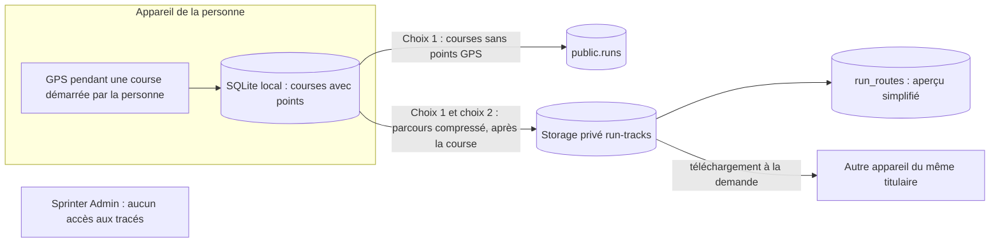

# Analyse d'impact relative à la protection des données (AIPD) · Sprinter

> **Brouillon de travail. Ce document n'est pas un avis juridique.**
> Il évalue d'abord si une AIPD est requise, puis en constitue la base. La conclusion et les niveaux de risque sont des propositions à valider par un juriste. Repères : **[À valider par un juriste]**, **[Décision de Flo]**, **[À vérifier]**. Champs à compléter : `<domaine>`, `<ÉDITEUR>`, `<ADRESSE>`, `<EMAIL_CONTACT_RGPD>`.

| | |
|---|---|
| Version | 0.1 (brouillon) · 14 novembre 2026 |
| Fondement | Article 35 du RGPD |
| Périmètre | Socle de lancement : comptes (T1, T2, T5), synchronisation des courses (T3), **sauvegarde des tracés GPS (T4)**, mesure d'usage (T6), administration (T9). Les phases 7 et 8 sont hors périmètre et déclenchent un réexamen (section 9) |
| Sources | Cahier des charges v2.1 (§0.2, §2, §5, §6, §7, §8, §9, §10, §13, §17) · `ADMIN_RPC_CONTRACT.md` v1 · [registre](registre-traitements.md) |
| Méthode | Méthode de la CNIL : description, nécessité et proportionnalité, risques (accès illégitime, modification non désirée, disparition), mesures. [AIPD (CNIL)](https://www.cnil.fr/fr/RGPD-analyse-impact-protection-des-donnees-aipd) · [Outil PIA (CNIL)](https://www.cnil.fr/fr/outil-pia-telechargez-et-installez-le-logiciel-de-la-cnil) |

## 1. Faut-il une AIPD ?

### 1.1 Liste de la CNIL

La liste française des traitements pour lesquels une AIPD est requise (délibération n° 2018-327) comprend quatorze types d'opérations. L'un d'eux vise les **traitements de données de localisation à large échelle**, avec cet exemple : « Application mobile permettant de collecter les données de géolocalisation des utilisateurs ». [Liste des traitements avec AIPD requise (CNIL)](https://www.cnil.fr/fr/analyse-dimpact-relative-la-protection-des-donnees-publication-dune-liste-des-traitements-pour) · [Liste des traitements sans AIPD requise (CNIL)](https://www.cnil.fr/fr/liste-traitements-aipd-non-requise)

Sprinter correspond à cet exemple dès qu'il reçoit des tracés. Le caractère « à large échelle » reste à apprécier : il dépend du nombre de personnes, du volume de données, de la durée et de l'étendue géographique.

### 1.2 Les neuf critères des lignes directrices européennes

Les lignes directrices du G29 sur l'AIPD (WP248), reprises par le CEPD, retiennent neuf critères. Un traitement qui en remplit au moins deux exige en général une AIPD. [Lignes directrices reprises par le CEPD](https://www.edpb.europa.eu/endorsed-wp29-guidelines_en)

| N° | Critère | Appréciation pour Sprinter | Rempli ? |
|---|---|---|---|
| 1 | Évaluation ou notation | Les règles de validité classent les courses (§9.1). Les classements d'administration et, plus tard, communautaires comparent des performances. Aucun effet sur la personne au-delà de l'éligibilité aux classements | Non, effet faible |
| 2 | Décision automatisée avec effet juridique ou similaire | La validité est informative. La suspension d'un compte est une décision humaine | Non |
| 3 | Surveillance systématique | La position est enregistrée sur l'appareil pendant les courses démarrées par la personne. Le serveur ne reçoit les tracés qu'après la course, sur choix explicite, et ne les analyse pas. Aucune position en direct | Non, mais proche : à motiver |
| 4 | Données sensibles ou à caractère hautement personnel | Les lignes directrices citent les **données de localisation** parmi les données à caractère hautement personnel. Les tracés révèlent domicile, habitudes et déplacements. Les données d'activité physique restent hors article 9 **[À valider par un juriste]** | **Oui** (T4) |
| 5 | Grande échelle | Faible au lancement. Croissance inconnue | Non au lancement, à surveiller |
| 6 | Croisement d'ensembles de données | Imports Apple Santé et GPX à l'initiative de la personne. Aucun croisement avec des sources externes | Non |
| 7 | Personnes vulnérables | Des mineurs de 16 et 17 ans peuvent créer un compte. La tranche d'âge `16-24` ne permet pas de les distinguer | **Partiellement** |
| 8 | Usage innovant | Technologies éprouvées (GPS, stockage en ligne) | Non |
| 9 | Exclusion du bénéfice d'un droit ou d'un contrat | Non | Non |

### 1.3 Conclusion proposée

Un critère est rempli (n° 4), un autre l'est partiellement (n° 7), et le type n° 14 de la liste de la CNIL vise précisément les applications qui collectent la géolocalisation, sous réserve d'échelle. En cas de doute, les lignes directrices recommandent de mener l'AIPD.

**Conclusion proposée** : mener l'AIPD (le présent document en constitue la base), la valider **avant d'activer `routes_sync_enabled` en production**, puis la réexaminer aux étapes listées en section 9. **[À valider par un juriste]**

## 2. Description du traitement

### 2.1 Finalités

- Permettre à la personne de retrouver ses parcours GPS sur un autre appareil (T4).
- Sauvegarder et synchroniser ses courses, sans points GPS (T3).
- Fonctions associées : compte (T1), choix (T5), mesure d'usage minimale (T6), administration et audit (T9).

### 2.2 Flux de données de localisation

| Étape | Description |
|---|---|
| Collecte | Sur l'appareil, pendant une course démarrée par la personne. L'autorisation système de localisation est distincte de tout envoi au serveur (§13.1) |
| Choix | Choix 1 : sauvegarde des courses. Choix 2 : sauvegarde des parcours, proposé une fois, sans présélection, possible seulement si le choix 1 est actif (décision 22) |
| Envoi | Au repos, jamais pendant une course. Fichier JSON compressé de 8 Mo au plus, puis enregistrement par `sync_register_route` |
| Stockage | Bucket privé en région UE. Chemin `<user_id>/<base64url(run_id)>.json.gz`. Aperçu simplifié (300 points au plus) en base |
| Utilisation | Téléchargement à la demande par le titulaire, à l'ouverture du détail d'une course sans points locaux |
| Accès | Le titulaire uniquement. Aucune RPC d'administration. Le serveur ne lit ni n'analyse les fichiers (§8.3) |
| Suppression | Par la personne (course, parcours en ligne, compte) · purge des fichiers orphelins chaque jour |

D'autres données ont une dimension géographique, plus grossière : le fuseau horaire IANA de chaque course (`tz`), le pays et la ville facultatifs du profil, et le nom d'itinéraire en texte libre (`routeName`).

### 2.3 Supports

Appareils iOS et Android (SQLite, SecureStore) · Supabase en région UE (Postgres, Storage, Edge Functions) · Vercel (`cdg1`) et Cloudflare Access pour l'administration, sans accès aux tracés · prestataire SMTP pour les e-mails.

### 2.4 Volumes estimés

| Indicateur | Estimation | Repère |
|---|---|---|
| Comptes la première année | `<ESTIMATION_COMPTES_AN_1>` | **[Décision de Flo]** |
| Part des comptes qui activent les tracés | `<ESTIMATION_PART_TRACÉS>` | **[Décision de Flo]** |
| Volume de tracés | Environ 1 fichier par course, 8 Mo au plus | §8 |
| Seuil de réexamen « grande échelle » | Proposition : 10 000 comptes avec tracés actifs | **[Décision de Flo]** |

## 3. Nécessité et proportionnalité

| Principe | Mesures | Appréciation |
|---|---|---|
| Finalité déterminée et légitime | Retrouver ses parcours, demandé par la personne | Satisfaisant |
| Base légale | Exécution du contrat sur choix explicite et distinct (§13.1). Alternative : consentement | **[À valider par un juriste]** |
| Minimisation | Courses synchronisées sans points GPS · tracés uniquement sur choix · aucune position en direct · aucune adresse, aucune date de naissance · aperçu limité à 300 points | Bon. Améliorations proposées : M1, M2, M3 (section 5) |
| Exactitude | Données issues de l'appareil · validité calculée par le serveur et affichée à titre d'information | Satisfaisant |
| Durées | Jusqu'à la suppression par la personne · tombstones 90 jours · inactivité 24 mois · sauvegardes 7 jours | Satisfaisant, durées à valider (§16 n° 4) |
| Information | Textes au moment du choix (§6.7), politique de confidentialité, « Pourquoi cette information ? » | Satisfaisant |
| Droits | Export complet, suppression des parcours en ligne, suppression du compte dans l'app et sur le web, changement de choix à tout moment | Satisfaisant |
| Protection par défaut (art. 25) | Aucune option présélectionnée · double choix · aucun accès administrateur | Satisfaisant |
| Sous-traitants et transferts | DPA, région UE, transferts encadrés (voir [sous-traitants](sous-traitants.md)) | À compléter à la souscription |

## 4. Risques

### 4.1 Sources de risque

Attaquant externe · autre utilisateur cherchant à lire les données d'autrui (IDOR) · erreur de configuration (RLS, policy Storage, bucket public) · régression de code · administrateur curieux ou erroné, y compris par la console Supabase · personnel ou sous-traitant ultérieur d'un prestataire · proche ayant accès à l'appareil (hors du contrôle de Sprinter pour les données locales).

### 4.2 Échelles

Gravité et vraisemblance de 1 à 4 : 1 négligeable, 2 limitée, 3 importante, 4 maximale.

### 4.3 Évaluation

| Réf. | Événement redouté | Impacts principaux | Gravité | Vraisemblance avant mesures | Mesures clés | Vraisemblance résiduelle | Niveau résiduel |
|---|---|---|---|---|---|---|---|
| R1 | **Accès illégitime aux tracés GPS** | Révélation du domicile et des habitudes horaires · risque de filature, de harcèlement ou de cambriolage pendant les sorties · risque accru pour les mineurs | 4 | 3 (erreur de policy ou bucket public, erreur fréquente) | Bucket privé · policies par dossier, avec compte actif · tests d'accès croisé · aucune RPC admin · opt-in double · M1, M4, M5, M6 | 1 à 2 | **À surveiller** : gravité maximale, vraisemblance faible |
| R2 | Accès illégitime aux données de compte et aux courses | Hameçonnage ciblé · révélation des horaires d'activité (dates, fuseau) | 2 à 3 | 2 | RLS testée par pgTAP · écritures par RPC · test d'IDOR · e-mails masqués · ancien JWT refusé après suppression ou désactivation | 1 | Acceptable |
| R3 | Rattachement de données au mauvais compte (intégrité et confidentialité) | Les courses de A visibles dans le compte B | 3 | 2 | Scénario D interdit sans choix explicite · `bound_user_id` · `user_id` forcé côté serveur · tests | 1 | Acceptable |
| R4 | Disparition de données serveur | Perte d'historique pour une personne qui a changé d'appareil | 2 | 2 | Local-first · sauvegardes quotidiennes · restauration testée · procédure de rejeu des suppressions | 1 | Acceptable |
| R5 | Usage excessif par l'éditeur | Consultation injustifiée de fiches · usage statistique non prévu | 2 | 1 | Capacités par rôle · motif obligatoire · audit en ajout seul · AAL2 · aucune lecture de tracé · M4, M9 | 1 | Acceptable |
| R6 | Réidentification par les statistiques | Isolement d'une personne dans une ventilation fine | 2 | 2 | k ≥ 10, regroupement et masquage, totaux non renvoyés si une cellule masquée devient déductible | 1 | Acceptable |
| R7 | Fuite de la base exposant `preview_polyline` | Départ et arrivée visibles, sans accès au bucket | 3 | 1 | Accès à la base limité · M1 réduit l'impact | 1 | Acceptable après M1 |

## 5. Mesures

### 5.1 Mesures prévues par le cahier des charges

- Choix explicites, distincts et sans présélection pour les courses et les tracés (décisions 10 et 22, §8).
- Aucune synchronisation et aucun envoi pendant une course (§7.1).
- Courses synchronisées sans points GPS (§5.2, `payload` sans `points`).
- Storage privé, policies par dossier, contrôle du compte actif et de l'opération (§5.5).
- Aucun accès administrateur aux tracés, aucune position en direct, aucune carte de suivi, aucun export de données personnelles (§0.2, §10.2).
- RLS sur toutes les tables, tests pgTAP, test d'IDOR, test d'accès croisé à Storage (§12.1, §13.5).
- MFA TOTP obligatoire, Cloudflare Access, motif d'accès, audit en ajout seul (§10.2).
- Seuil k ≥ 10 sur les ventilations (§10.4).
- Aucun SDK d'analytique ou de publicité, aucun suivi inter-apps (§0.2).
- Suppression dans l'app et à distance, révocation Apple, purge Storage (§6.6).

### 5.2 Mesures complémentaires proposées

| Réf. | Mesure | Risques réduits | Priorité | Repère |
|---|---|---|---|---|
| M1 | Rogner le départ et l'arrivée de `preview_polyline` (par exemple 200 m), ou appliquer les zones de masquage existantes de `src/sharing/privacy.ts` | R1, R7 | Haute | **[Décision de Flo]** |
| M2 | Retirer ou tronquer `healthKit.sourceName` du `payload` synchronisé (nom d'appareil contenant souvent un prénom) | R2 | Moyenne | **[Décision de Flo]** |
| M3 | Soumettre la synchronisation des itinéraires (phase 2b, `SavedRoute.segments`) au choix `cloud_sync_routes` et aux mêmes règles d'accès, ou ne pas les synchroniser | R1 | Haute si la phase 2b est livrée | **[Décision de Flo]** |
| M4 | Discipline d'accès à la console Supabase : double authentification, organisation limitée à Flo, aucune requête sur les données des utilisateurs hors incident consigné, vérification de la traçabilité des accès à la console | R1, R5 | Haute | **[À vérifier]** |
| M5 | Coupure immédiate côté serveur : RPC et policies refusent les écritures quand `sync_enabled` ou `routes_sync_enabled` est éteint, sans attendre le cache de 24 heures de l'app | R1, R2 | Haute | **[À vérifier]** |
| M6 | Test automatique en CI qui échoue si le bucket `run-tracks` devient public, en plus du test d'accès croisé | R1 | Haute | — |
| M7 | Réglage d'opposition à la mesure d'usage | Droits | Moyenne | **[Décision de Flo]** |
| M8 | Chiffrement de bout en bout des tracés (backlog §15 n° 6) | R1, R7 | À étudier | **[Décision de Flo]** |
| M9 | Exclure les comptes de test et les courses issues d'Apple Santé des statistiques d'administration | R5 | Moyenne | **[Décision de Flo]** |
| M10 | Exercice de gestion de violation avant lancement, avec export des journaux | R1, R2 | Haute | [Procédure violation](procedure-violation.md) |
| M11 | Android : exclure de la sauvegarde automatique la session, `device_id` et l'état de synchronisation | R2, R3 | Moyenne | **[À vérifier]** en phase 5 |
| M12 | Si le téléchargement des tracés passe par des URL signées : durée de validité très courte, jamais d'URL publique | R1 | Haute | **[À vérifier]** |
| M13 | Avant toute fonction sociale (phases 7 et 8c), distinguer les 16-17 ans : la tranche `16-24` ne le permet pas. Par exemple, demander « J'ai 18 ans ou plus » à l'inscription aux fonctions sociales, ou scinder la tranche | Personnes vulnérables | Avant la phase 7 | **[Décision de Flo]** |

## 6. Avis des personnes concernées

**[Décision de Flo]** Recueillir l'avis des testeurs du test fermé Google Play (12 personnes au moins) et de la recette TestFlight par un court questionnaire : comprennent-ils la différence entre « sauvegarder mes courses » et « sauvegarder mes parcours » ? Savent-ils comment supprimer leurs parcours en ligne ? Consigner les réponses en annexe.

Aucun délégué à la protection des données n'est désigné (voir le [registre](registre-traitements.md), section 1).

## 7. Plan d'action

| Mesure | Responsable | À faire avant | Statut |
|---|---|---|---|
| M4, M5, M6, M10, M12 | Flo, équipe technique | Activation de `routes_sync_enabled` en production | [ ] |
| M1 | Équipe technique | Activation de `routes_sync_enabled` en production | [ ] |
| M2, M9, M11 | Équipe technique | Phase 6, ou phase 5 pour M11 | [ ] |
| M3 | Équipe technique | Livraison de la phase 2b | [ ] |
| M7 | Flo | Lancement, ou réponse motivée à toute opposition | [ ] |
| M8 | Flo | Décision après le lancement | [ ] |
| M13 | Flo | Phase 7 | [ ] |

## 8. Validation

| | |
|---|---|
| Risques résiduels | Acceptables sous réserve des mesures M1, M4, M5, M6, M10 et M12 avant l'activation des tracés. R1 reste à surveiller, car sa gravité est maximale |
| Consultation préalable de la CNIL (art. 36) | Non nécessaire si le risque résiduel n'est pas élevé **[À valider par un juriste]** |
| Validation du responsable du traitement | `<ÉDITEUR>` · date : ____ · signature : ____ |
| Avis du conseil juridique | `<CONTACT_JURISTE>` · date : ____ · avis : ____ |

## 9. Réexamen

Réexaminer et mettre à jour cette AIPD :
- avant l'activation de la phase 7 (classement communautaire) ;
- avant l'activation de la phase 8c (partage, recherche, modération), qui ajoute des contenus publiés, de la présence et des signalements ;
- avant la synchronisation des itinéraires (phase 2b) ;
- en cas d'ajout d'une nouvelle donnée (fréquence cardiaque, poids, position en direct…) ;
- en cas de changement de prestataire ou de région ;
- au franchissement du seuil d'échelle retenu (section 2.4) ;
- après toute violation de données ;
- au moins une fois par an.
