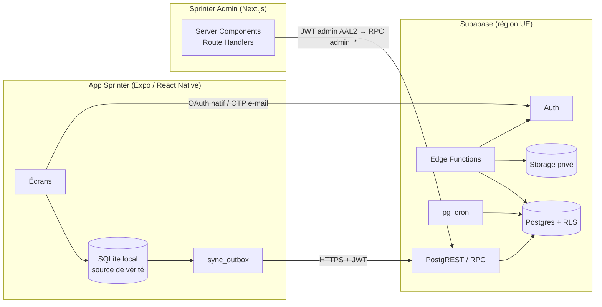

# Sprinter

**Cahier des charges · Comptes, synchronisation, administration et personnalisation des profils**

| | |
|---|---|
| Version | 2.1 · 13 novembre 2026 |
| Propriétaire produit | Flo |
| Destinataire | Agent de développement, dont Claude Fable 5.2 |
| Dépôts prévus | `Flombt/Sprinter` pour l’app et `supabase/` · `Flombt/sprinter-admin` pour le site privé |
| Document de départ | `SPRINTER_COMPTES_SYNC_ADMIN_v2.md` · la v1 (`sprinter-admin.md`) reste la référence de vision |
| Statut | Cahier des charges à mettre en œuvre. Les observations de la v2 sur le dépôt figurent au §3 et sont à confirmer en phase 0. |

Sprinter doit permettre d’enregistrer et de consulter ses courses sur son appareil, y compris hors ligne. Le compte facultatif permet d’activer la sauvegarde et la synchronisation, puis de personnaliser un espace personnel. Le lancement du socle couvre aussi le portage Android et Sprinter Admin, le site privé de gestion.

## Sommaire

| | |
|---|---|
| Commencer | [Mission et règles](#0-à-lire-en-premier-agent-dexécution) · [Feuille de route](#1-résumé-exécutif) · [Décisions](#2-décisions-figées) · [Phases et recette](#14-phases-et-critères-dacceptation) |
| Construire le socle | [État du dépôt](#3-état-du-dépôt-observé-le-13112026--à-revérifier) · [Architecture](#4-architecture) · [Modèle de données](#5-modèle-de-données-supabase--postgres) · [Comptes](#6-comptes-et-authentification-app) · [Synchronisation](#7-synchronisation) |
| Compléter le produit | [Tracés GPS](#8-tracés-gps-dans-le-cloud) · [Classements](#9-validité-des-courses-et-classements) · [Sprinter Admin](#10-sprinter-admin-site-web-privé) · [Android](#11-android) · [Personnalisation des profils](#17-personnalisation-avancée-des-profils) |
| Préparer la mise en service | [Qualité et CI](#12-qualité--tests-ci-observabilité) · [Conformité](#13-conformité-et-actions-manuelles) · [Backlog](#15-backlog-didées-hors-périmètre-immédiat) · [Décisions ouvertes](#16-décisions-ouvertes-défaut-appliqué-en-attendant) |
| Annexes | [Variables d’environnement](#annexe-a--variables-denvironnement) · [Gabarit de PR](#annexe-b--gabarit-de-description-de-pr) · [Prompts d’exécution](#annexe-c--prompts-à-copier-coller-pour-lagent) |

---

## 0. À lire en premier (agent d'exécution)

### 0.1 Mission

Livrer le socle par phases vérifiables (§14). La progression couvre les comptes **optionnels**, la synchronisation **local-first** entre appareils, la sauvegarde des tracés GPS **sur choix explicite**, le site privé **Sprinter Admin**, le portage **Android** et la recette de lancement. La personnalisation des profils prolonge ce socle (§17).

L'app doit rester **pleinement utilisable sans compte** et **aussi fluide qu'aujourd'hui** : aucune régression au démarrage, ni pendant l'enregistrement d'une course.

### 0.2 Règles non négociables

1. **Local-first.** SQLite reste la source de vérité de l'app. Le réseau n'est jamais sur le chemin critique d'une course (démarrage, GPS, fin de course, affichage).
2. **Aucun secret dans le dépôt ni dans le bundle mobile.** Dans l'app : uniquement l'URL Supabase et la clé publique (`EXPO_PUBLIC_*`). Jamais de clé secrète/`service_role`, de clé `.p8` Apple ou de secret OAuth. La CI échoue si ces motifs apparaissent (gitleaks + garde `grep`, §12).
3. **RLS activée sur toute table du schéma `public`**, avec tests pgTAP. Aucune donnée utilisateur lisible sans policy testée.
4. **Le site admin n'utilise jamais `service_role` pour lire des données utilisateur.** Il appelle des fonctions `admin_*` avec le JWT de l'administrateur (AAL2). L'autorisation et l'audit vivent dans la base.
5. **Pas d'accès admin aux tracés GPS, pas de position en direct, pas d'export massif de données personnelles.**
6. **Pas de SDK d'analytique ou de publicité tiers.** La mesure d'usage se limite à `activity_days` (§5).
7. **Respecter l’identité visuelle de Sprinter.** Réutiliser `src/ui/tokens.ts` et les composants existants. Le style choisi par l’utilisateur s’applique à la surface de son profil (§17). La refonte de l’application suit son propre chantier sur `codex/refonte-ui`.
8. **Gérer les dépendances natives ensemble.** Tout ajout passe par `npx expo install`, avec versions épinglées et alignées sur le SDK Expo confirmé en phase 0.
9. **Consulter la documentation officielle à jour** (Supabase, Expo, Apple, Google, Next.js) avant chaque brique : noms d'options et limites évoluent. En cas d'écart avec ce document, suivre la doc et le noter dans la PR.
10. **Textes de l'app en français, vouvoiement** (cohérent avec l'existant). Identifiants de code en anglais.
11. **Toute écriture client → serveur est idempotente** : rejouer une requête 3 fois = même état final.
12. **Aucune donnée de production** dans les démos, tests, captures d'écran ou logs.

### 0.3 Méthode de travail

- Une branche et une **PR draft** par phase/sous-phase (`feat/p1-auth`, `feat/p2-sync`…). Ne jamais pousser sur `main`. Ne jamais fusionner ni rebaser `codex/refonte-ui`.
- Nouveaux fichiers dans des dossiers dédiés (`src/account/`, `src/sync/`, `supabase/`). Ne modifier l'existant (`App.tsx`, navigation, réglages) que par de **petits points d'accroche**.
- Commits atomiques (Conventional Commits). Chaque PR : description, preuves (sorties de tests, captures), liste des écarts à la spec (gabarit en Annexe B).
- **Définition de « terminé »** commune : `npm run check` vert (lint, typecheck, suite existante confirmée en phase 0 et nouveaux tests) · `npx expo install --check` · `npx expo export --platform ios --platform web` · tests SQL verts · `docs/ACCOUNTS.md` à jour · aucun TODO bloquant.
- **Environnement de Flo** · Windows, iPhone réel pour la recette iOS. Prévoir un client de développement EAS (`development`) et le lancement via `npm run start:dev`. Ce build sert à tester Google natif et les identifiants Apple du bundle Sprinter. [Google avec Expo](https://docs.expo.dev/guides/google-authentication/) · [Apple Authentication avec Expo](https://docs.expo.dev/versions/latest/sdk/apple-authentication/)

### 0.4 S'arrêter et demander (en tête de réponse ou dans la PR) si…

- une **action manuelle de Flo** (§13.3) bloque la suite ;
- un choix touche la sécurité ou la vie privée et reste à trancher après lecture des §2, §16 et §17 ;
- Docker / Supabase local n'est pas disponible → écrire migrations et tests, **ne rien déployer**, demander à Flo de les appliquer en staging ;
- il faudrait modifier des écrans en cours de refonte au-delà d'un point d'accroche.

---

## 1. Résumé exécutif

### 1.1 Roadmap

| Phase | Contenu | Livrable principal | Dépend de |
|---|---|---|---|
| **0** | Fondations : reconnaissance du code, Supabase (local/staging/prod), CI, schéma de base + tests RLS, flags | `supabase/`, `docs/ACCOUNTS_RECON.md` | — |
| **1** | Comptes : Apple / Google / e-mail OTP, profil minimal, consentements, « Mes données », export, suppression | Écran **Compte** dans l'app | 0 |
| **2** | Synchro des courses + réglages portables, rattachement des courses locales, multi-appareils | Moteur `src/sync/` | 1 |
| **3** | Tracés GPS cloud (opt-in), best efforts, règles de validité | Stockage privé + UI | 2 |
| **4** | **Sprinter Admin** : 4a socle + vue d'ensemble · 4b utilisateurs + recherche · 4c classements + analyses · 4d qualité + support + config + exports | Site `admin.<domaine>` | 2 (4a), 3 (4c) |
| **5** | Android : portage, GPS arrière-plan, tests croisés iOS↔Android | Build Android | 2 |
| **6** | Vérification & lancement : sécurité, RGPD, conformité stores | Checklists validées | 1–5 |
| **7** | Classement communautaire facultatif, sur inscription explicite | Classement dans l’app | 6 |
| **8a** | Profil privé et éditeur essentiel | Réglages › Compte › Mon profil | 1, 2, 5, 6 |
| **8b** | Studio avancé, widgets, configurations et animations | Studio de personnalisation complet | 8a |
| **8c** | Partage, recherche de profils et modération | Profils partageables après la recette du §17.10 | 8a, 4d |
| **8d** | Évolutions sociales facultatives, dont la bibliothèque de thèmes | Catalogue communautaire et options de partage avancées | 8b, 8c |

Ordre conseillé pour le socle · 0 → 1 → 2 → 4a → 3 → 4b → 5 → 4c → 4d → 6. Les phases 4 et 5 peuvent avancer en parallèle à partir de la phase 2. Une fois le socle lancé, la phase 7 et le chantier profils progressent indépendamment. Après 8a, 8b et 8c peuvent avancer en parallèle. La phase 8c couvre également les éléments de 8b dès qu’ils deviennent partageables.

### 1.2 Acquis de la v2 et ajout de la v2.1

- **Compte facultatif**, app local-first (la v1 laissait la question ouverte).
- **Profil minimal** : `display_name` au lieu de nom + prénom ; tranche d'âge facultative ; ni date de naissance, ni adresse postale.
- **Admin sans `service_role`** : fonctions SQL `admin_*` + audit append-only ; e-mails masqués dans les listes ; **aucune lecture de tracés** ; seuil de confidentialité k ≥ 10 sur les ventilations.
- **Mesure d'usage minimale** (`activity_days`, une ligne par utilisateur et par jour) à la place d'événements génériques.
- **Synchro robuste** : outbox atomique, écritures par RPC validées, ids texte `(user_id, id)`, curseur keyset avec chevauchement, tombstones, rattachement des courses locales existantes.
- **Règles de validité des courses** et d'éligibilité aux classements définies (§9).
- **Nouveautés** : `app_config` (version minimale, maintenance, flags), support minimal, export et suppression de compte, jobs de rétention, Cloudflare Access, déploiement progressif par flags.
- **Phases réordonnées** : Phase 0 (fondations), Android = phase propre, admin découpé en 4a–4d.
- **KPI et classements définis précisément** (§10.5, §9).
- **Profil personnalisable en v2.1** · L’espace privé et son éditeur arrivent après le socle. La recherche et le partage ont leurs propres réglages et une recette dédiée (§17).

---

## 2. Décisions figées

| # | Sujet | Décision | Pourquoi |
|---|---|---|---|
| 1 | Compte | **Facultatif.** L'app marche sans ; le compte sert à sauvegarder et synchroniser | Moins de friction, moins de surface RGPD, course hors-ligne |
| 2 | Backend | **Supabase** (Auth, Postgres + RLS, Storage, Edge Functions, pg_cron), **région UE** | Un seul service managé, adapté à un développeur solo |
| 3 | Connexion | Apple, Google (natifs, ID token), **e-mail par code OTP à 6 chiffres**. Aucun mot de passe | L'OTP marche d'un appareil à l'autre sans deep link |
| 4 | Liaison d’identités | Parcours manuel dans Réglages › Compte. La liaison automatique par Supabase se limite aux identités éligibles selon le §6.4 | Sécurité |
| 5 | Profil de compte | `display_name`, `country_code`, `city`, `age_band`, tous facultatifs. Le profil personnalisable s’ajoute en phase 8 (§17) | Minimisation |
| 6 | Âge minimum | **16 ans**, déclaré par case à cocher à la création du compte, non stocké comme date | À valider juridiquement (§16) |
| 7 | Ids de course | **Texte**, clé primaire `(user_id, id)` | Les ids actuels ne sont pas tous des UUID (ex. `healthkit:<uuid>`) ; évite toute collision inter-utilisateurs |
| 8 | Écritures de synchronisation | RPC validées (`sync_push_*`). Sur `runs`, le rôle client dispose uniquement des droits de lecture autorisés | Colonnes dérivées et validité contrôlées côté serveur |
| 9 | Suppression de compte | Demande irréversible depuis l’app ou à distance. Réauthentification récente dans l’app, retrait des accès à la validation et nettoyage reprenable (§6.6) | Apple 5.1.1(v), Google Play |
| 10 | Tracés GPS | Cloud **opt-in explicite** (choix demandé une fois, **aucune option pré-sélectionnée**), Storage privé | Demande v1 |
| 11 | Accès admin | Site séparé · MFA TOTP **obligatoire** (AAL2) · table `private.admin_users` · RPC `SECURITY DEFINER` · audit append-only | §10.2 |
| 12 | Données admin | Agrégats par défaut · fiche individuelle minimale · e-mail masqué en liste · **aucun accès aux tracés** · k ≥ 10 | Vie privée |
| 13 | Mesure d'usage | `activity_days` uniquement | Minimisation |
| 14 | Rétention | Voir §5.7 | RGPD |
| 15 | Stack mobile | Expo SDK 58 et `expo-sqlite` selon la v2, avec `@supabase/supabase-js` à intégrer | Confirmer la version et les dépendances en phase 0 |
| 16 | Stack admin | Next.js (App Router, TS strict), Tailwind, shadcn/ui, TanStack Table + Query, Recharts, `motion`, cmdk, `@supabase/ssr` | §10.1 |
| 17 | Hébergement admin | Vercel, fonctions épinglées en Europe (Paris/Francfort) ; **Cloudflare Access** devant le sous-domaine (recommandé) | Couche d'accès supplémentaire |
| 18 | Dépôts | App + `supabase/` dans `Flombt/Sprinter` ; admin dans un dépôt séparé | Ne pas mêler Next.js à Metro |
| 19 | E-mails | **SMTP personnalisé** (jamais le SMTP par défaut de Supabase), SPF/DKIM/DMARC | Le SMTP par défaut est limité et réservé aux tests |
| 20 | Environnements | local → staging → prod, projets Supabase distincts | Tests sans risque |
| 21 | Déploiement | Tout nouveau comportement derrière des **flags** `app_config` (`accounts_enabled`, `sync_enabled`…) | Activer progressivement et pouvoir couper une fonctionnalité |
| 22 | Activation des sauvegardes | Choix distincts pour les courses et leurs tracés. L’envoi des tracés exige l’activation des deux sauvegardes (§6.5 et §8) | Maîtrise des données en ligne |
| 23 | Profil personnalisable | Privé par défaut. Publication, visibilité des éléments et apparition dans la recherche relèvent de choix distincts (§17.7) | Confidentialité |
| 24 | Périmètre de personnalisation | L’apparence, les contenus et les widgets s’affichent dans le profil. Le studio et ses fonctions sociales se déploient après le socle | Enregistrement des courses prioritaire |

---

## 3. État du dépôt (observé le 13/11/2026 — à revérifier)

Relevé transmis dans la v2 pour `Flombt/Sprinter` sur `main` (`83dbb86`). La v2 indique que `codex/refonte-ui` est en avance. Le rapport de reconnaissance de phase 0 confirme le commit de référence, la stack, les tests et les points d’accroche.

| Sujet | Observation | Conséquence |
|---|---|---|
| Stack | Expo SDK 58, React Native 0.88, React 19.3, `@react-navigation/native-stack`, TypeScript, Vitest (15 fichiers, 164 tests), ESLint | Utiliser les mêmes outils |
| Réseau / backend | **Aucun** compte ni backend. Données locales. Spotify/Strava : OAuth préparatoire | Première couche réseau du projet : l'isoler dans `src/account/` et `src/sync/` |
| Stockage | `expo-sqlite`. Base `sprinter-v1.db` : `runs(id TEXT PK, started_at REAL, payload TEXT)`, `draft`, `draft_points`, `draft_archives`, `settings(slot=1, payload)`. Autres bases : workouts, routes, progression, apple, music | Brancher l'outbox **dans la même transaction** que les écritures de `RunRepository` |
| Modèle de course | `RunRecord` (`src/core/types.ts`) : `id`, `startedAt` (ms), `endedAt`, `activeSeconds`, `distanceMeters`, `reliableSeconds`, `bestPace`, `points: TrackPoint[]` (GPS **embarqué**), `splits`, `workout`, `pacing`, `healthKit`, `shoeId`, `routeId`, `plannedEntryId`, `dataVersion: 3` ; `migrateActivity` gère v1→v3 | Les points sont lourds : les séparer du reste pour la synchro |
| Ids | `healthkit:<uuid>` pour les imports Santé. Autres : **vérifier** le générateur (constructeur du moteur, `src/core/engine.ts`) | Si non collision-résistant → `Crypto.randomUUID()` pour les nouvelles courses, sans toucher aux ids existants |
| Références | Une course référence `shoeId`, `plannedEntryId`, `routeId`, un snapshot de séance | Entités à synchroniser plus tard (§7.9) ; en attendant, **références orphelines sans crash** |
| Confidentialité | Zones de masquage 300 m pour le partage (`src/sharing/privacy.ts`), export GPX/CSV, import GPX, sauvegardes de récupération | Réutiliser pour « Mes données » ; sauvegarde locale avant le premier import |
| Records | `src/analysis/records.ts` calcule meilleurs segments / records sur distances standard | Calculer les `best_efforts` **sur l'appareil**, pas côté serveur |
| Natif iOS | `modules/sprinter-apple` (HealthKit, Live Activity), `expo-widgets`, `expo-glass-effect`, `expo-symbols`, `@expo/ui` | Garde-fous `Platform.OS` requis (Phase 5) |
| Workflow | Expo Go par défaut (`npm start`) ; `start:dev` et EAS `development` disponibles ; bundle id `app.sprinter.running` (iOS et Android) | Client de développement du bundle Sprinter pour la recette des connexions |
| CI | `.github/workflows/verify.yml` (check, `expo install --check`, export iOS + web), `ios-ipa.yml` | Étendre `verify.yml` (jobs SQL, gitleaks) |
| Réglages | `Settings` : config d'allure, audio, haptique, `backgroundEnabled`, thème, auto-pause, coaching | Séparer réglages portables / propres à l'appareil (§7.5) |
| Android | `app.json` : permissions de base ; pas de `FOREGROUND_SERVICE_LOCATION`, pas d'option arrière-plan Android | Phase 5 |

---

## 4. Architecture

### 4.1 Vue d'ensemble



### 4.2 Environnements

| Env | App | Supabase | Admin |
|---|---|---|---|
| local | client de dev Expo | `supabase start` (Docker) | `next dev` |
| staging | build EAS `preview` | projet `sprinter-staging` + seed **synthétique** | preview Vercel derrière Access |
| prod | build EAS `production` | projet `sprinter-prod` — **plan Pro** (sauvegardes, pas de mise en pause) | `admin.<domaine>` |

### 4.3 Organisation des dépôts

```
Flombt/Sprinter
├─ supabase/
│  ├─ config.toml
│  ├─ migrations/          # SQL versionné, jamais réécrit après fusion
│  ├─ functions/           # Edge Functions (Deno) : delete-account, export-my-data, apple-link, admin-user-action, purge-storage…
│  ├─ tests/               # pgTAP
│  └─ seed.sql             # données SYNTHÉTIQUES uniquement
├─ src/account/            # client Supabase, auth, profil, consentements
├─ src/sync/               # outbox, push/pull, réconciliation
├─ src/screens/Account*.tsx
└─ docs/{specs,ACCOUNTS.md,ACCOUNTS_RECON.md,rgpd/}

Flombt/sprinter-admin
├─ app/(auth)/login · app/(admin)/{overview,users,rankings,analytics,runs,quality,support,audit,settings}
├─ components/ · lib/{supabase,format,rpc}/ · e2e/
```

⚠ Exclure `supabase/` du `tsconfig.json` racine et d'ESLint (les Edge Functions sont du Deno, `tsc --noEmit` échouerait). Le script `lint` actuel ne cible que `App.tsx src`.

### 4.4 Coûts indicatifs (à vérifier)

Ordres de grandeur budgétaires repris de la v2. Revalider l’offre, la devise, les taxes et les limites avant chaque souscription. [Tarifs Supabase](https://supabase.com/pricing) · [Tarifs Vercel](https://vercel.com/pricing) · [Apple Developer Program](https://developer.apple.com/programs/enroll/) · [Offres Cloudflare Zero Trust](https://www.cloudflare.com/plans/zero-trust-services/)

| Poste | Ordre de grandeur |
|---|---|
| Supabase Pro | ≈ 25 $/mois |
| Vercel | Hobby = usage **non commercial** uniquement ; sinon Pro ≈ 20 $/mois |
| SMTP (Resend, Brevo, Postmark…) | palier gratuit suffisant au début |
| Domaine | ≈ 10–15 €/an |
| Apple Developer Program | 99 $/an |
| Google Play Console | 25 $ une fois |
| Cloudflare Access | gratuit jusqu'à 50 utilisateurs |
| Sentry (optionnel) | palier gratuit |

---

## 5. Modèle de données (Supabase / Postgres)

### 5.1 Conventions

- Deux schémas : `public` (exposé par l'API) et `private` (**jamais exposé** ; seules des fonctions `SECURITY DEFINER` y accèdent).
- Horodatages en `timestamptz` (UTC). Unités SI : mètres, secondes, secondes/km.
- Pour chaque fonction `SECURITY DEFINER`, fixer `search_path = ''`, qualifier les objets et retirer les droits d’exécution implicites. Accorder `EXECUTE` uniquement aux rôles prévus par le contrat de la fonction. Les fonctions internes restent accessibles aux seuls rôles de service prévus.
- Policies : `to authenticated`, avec `(select auth.uid())` (évalué une fois par requête).
- Migrations en SQL pur dans `supabase/migrations/`, **jamais modifiées après fusion** (nouvelle migration à la place). Types TypeScript générés par `supabase gen types typescript`.

### 5.2 Schéma (à découper en migrations ordonnées)

La phase 0 prépare les fondations (`0001`), le schéma utilisateur (`0002`), les tables privées (`0003`), les droits et policies (`0004`), puis les triggers de base et la configuration initiale (`0005`). Les migrations des phases suivantes livrent les fonctions métier, les buckets et les jobs au moment où leurs parcours entrent en service. Les extraits des §5.2 à §5.5 sont des exemples de la v2. Les règles écrites et les tests de la phase concernée définissent leur version livrable.

```sql
-- 0001 — fondations
create schema if not exists private;
revoke all on schema private from public, anon, authenticated;
create extension if not exists pg_trgm with schema extensions;

create function private.set_updated_at() returns trigger language plpgsql as $$
begin new.updated_at := now(); return new; end $$;

-- 0002 — données utilisateur (public)
create table public.profiles (
  user_id      uuid primary key references auth.users(id) on delete cascade,
  display_name text check (char_length(display_name) between 1 and 50),
  country_code text check (country_code ~ '^[A-Z]{2}$'),
  city         text check (char_length(city) <= 80),
  age_band     text check (age_band in ('16-24','25-34','35-44','45-54','55+')),
  created_at   timestamptz not null default now(),
  updated_at   timestamptz not null default now()
);
create index profiles_name_trgm on public.profiles using gin (display_name extensions.gin_trgm_ops);

create table public.user_preferences (
  user_id        uuid primary key references auth.users(id) on delete cascade,
  data           jsonb not null default '{}'::jsonb check (octet_length(data::text) <= 65536),
  schema_version int   not null default 1,
  client_updated_at timestamptz not null default now(),
  updated_at     timestamptz not null default now()
);

create table public.consent_log (          -- journal append-only des choix et acceptations
  id         bigint generated always as identity primary key,
  user_id    uuid not null references auth.users(id) on delete cascade,
  purpose    text not null check (purpose in ('terms','privacy_policy','cloud_sync_runs','cloud_sync_routes','community_leaderboard')),
  version    text not null,
  granted    boolean not null,
  created_at timestamptz not null default now()
);
create index on public.consent_log (user_id, purpose, created_at desc);

create table public.runs (
  user_id           uuid not null references auth.users(id) on delete cascade,
  id                text not null check (char_length(id) between 1 and 100),
  source            text not null default 'sprinter' check (source in ('sprinter','healthkit','gpx')),
  started_at        timestamptz not null,
  ended_at          timestamptz,
  tz                text,                         -- fuseau IANA de l'appareil (jour local)
  active_s          integer not null check (active_s >= 0),
  total_s           integer check (total_s >= 0),
  distance_m        numeric(10,1) not null check (distance_m >= 0),
  reliable_s        integer check (reliable_s >= 0),
  best_pace_s_km    numeric(7,2),                 -- vérifier l'unité de RunRecord.bestPace
  ascent_m          numeric(7,1),
  session_type      text,                         -- 'free' ou type de séance (issu de payload.workout)
  platform          text check (platform in ('ios','android')),
  app_version       text,
  best_efforts      jsonb,                        -- {"1000":241,"5000":1290} calculé sur l'appareil, plausibilité vérifiée serveur
  payload           jsonb not null check (octet_length(payload::text) <= 524288),  -- RunRecord SANS `points`
  has_route         boolean not null default false,
  validity          text not null default 'valid' check (validity in ('valid','suspect','invalid')),
  validity_reasons  text[] not null default '{}',
  rules_version     int  not null default 1,
  client_updated_at timestamptz not null,
  server_updated_at timestamptz not null default now(),
  created_at        timestamptz not null default now(),
  deleted_at        timestamptz,                  -- tombstone
  primary key (user_id, id)
);
create index runs_user_started_idx on public.runs (user_id, started_at desc) where deleted_at is null;
create index runs_sync_idx         on public.runs (user_id, server_updated_at, id);
create index runs_started_idx      on public.runs (started_at) where deleted_at is null;   -- agrégats admin

create table public.run_routes (
  user_id          uuid not null,
  run_id           text not null,
  storage_path     text not null,                 -- <user_id>/<base64url(run_id)>.json.gz dans le bucket run-tracks
  points_count     integer not null check (points_count >= 0),
  bytes            integer not null check (bytes > 0),
  preview_polyline text,                          -- polyline simplifiée (≤ 300 pts) pour listes/cartes
  created_at       timestamptz not null default now(),
  primary key (user_id, run_id),
  foreign key (user_id, run_id) references public.runs(user_id, id) on delete cascade
);

create table public.user_devices (
  user_id uuid not null references auth.users(id) on delete cascade,
  device_id uuid not null,                         -- généré à l'installation, stocké localement
  platform text not null check (platform in ('ios','android')),
  os_version text, app_version text,
  last_seen_at timestamptz not null default now(),
  last_sync_at timestamptz,
  last_sync_status text check (last_sync_status in ('ok','partial','error')),
  last_sync_error_code text,
  created_at timestamptz not null default now(),
  primary key (user_id, device_id)
);

create table public.activity_days (                -- seule « analytique » : 1 ligne / utilisateur / jour
  user_id uuid not null references auth.users(id) on delete cascade,
  day date not null,                               -- jour local de l'appareil
  runs_count integer not null default 0,
  primary key (user_id, day)
);

create table public.app_config (                   -- lisible par tous, modifiable via RPC admin uniquement
  key text primary key, value jsonb not null, updated_at timestamptz not null default now()
);

create table public.support_requests (
  id uuid primary key default gen_random_uuid(),
  user_id uuid not null references auth.users(id) on delete cascade,
  category text not null check (category in ('account','sync','bug','data_request','other')),
  message text not null check (char_length(message) between 1 and 4000),
  platform text, app_version text,
  status text not null default 'open' check (status in ('open','in_progress','resolved','closed')),
  internal_note text check (char_length(internal_note) <= 2000),
  created_at timestamptz not null default now(),
  updated_at timestamptz not null default now(),
  closed_at timestamptz
);

-- 0003 — administration et agrégats (private)
create table private.admin_users (
  user_id uuid primary key references auth.users(id) on delete cascade,
  role text not null check (role in ('owner','support','analyst')),
  created_at timestamptz not null default now()
);

create table private.admin_audit_logs (
  id bigint generated always as identity primary key,
  at timestamptz not null default now(),
  admin_id uuid,                                   -- sans FK : l'historique survit aux suppressions
  action text not null,                            -- 'user.view','user.disable','leaderboard.view_nominative','export.aggregates','config.write'…
  target_user_id uuid,                             -- sans FK
  reason text check (char_length(reason) <= 500),
  metadata jsonb not null default '{}'::jsonb      -- JAMAIS d'e-mail ni de texte de recherche brut
);
create index on private.admin_audit_logs (at desc);
create index on private.admin_audit_logs (target_user_id, at desc);

create function private.audit_immutable() returns trigger language plpgsql as $$
begin
  if tg_op = 'DELETE' and current_setting('private.purging_audit', true) = 'on' then return old; end if;
  raise exception 'admin_audit_logs is append-only';
end $$;
create trigger audit_append_only before update or delete on private.admin_audit_logs
  for each row execute function private.audit_immutable();   -- la purge de rétention positionne private.purging_audit

create table private.daily_metrics (
  day date not null, metric text not null, dim text not null default '', value numeric not null,
  primary key (day, metric, dim)                    -- ex. ('2026-11-12','signups','provider:apple')
);

create table private.user_directory (               -- copie minimale pour la recherche admin
  user_id uuid primary key references auth.users(id) on delete cascade,
  email_norm text,                                  -- lower(email) ; peut être un relais Apple
  providers text[] not null default '{}',
  status text not null default 'active' check (status in ('active','disabled')),
  signed_up_at timestamptz not null,
  last_active_day date
);
create index user_directory_email_trgm on private.user_directory using gin (email_norm extensions.gin_trgm_ops);
-- alimentée par triggers sur auth.users et auth.identities
```

### 5.3 RLS et privilèges

```sql
alter table public.runs enable row level security;
create policy runs_select_own on public.runs for select to authenticated
  using (user_id = (select auth.uid()));
revoke insert, update, delete on public.runs from authenticated, anon;   -- écritures par RPC uniquement
```

| Table | SELECT | INSERT | UPDATE | DELETE |
|---|---|---|---|---|
| `profiles` | propriétaire | trigger de création du compte | propriétaire, champs de profil autorisés | — (cascade) |
| `user_preferences` | propriétaire | RPC | RPC | — |
| `consent_log` | propriétaire | écriture validée pour le propriétaire (ajout idempotent) | — | — |
| `runs`, `run_routes` | propriétaire | RPC | RPC | RPC (tombstone) |
| `user_devices` | propriétaire | RPC `register_device` | RPC `report_sync` | RPC (déconnecter un appareil) |
| `activity_days` | propriétaire | RPC `touch_activity` | RPC | — |
| `app_config` | `anon` + `authenticated` | RPC admin | RPC admin | — |
| `support_requests` | projection des seuls champs destinés au propriétaire | propriétaire, champs de création autorisés | — | — |
| `private.*` | **aucun accès direct** | | | |

Créer le profil vide par trigger `AFTER INSERT ON auth.users` (`private.handle_new_user`, `SECURITY DEFINER`). La règle RLS limite les lignes, et les privilèges de colonnes ou la projection API limitent les champs de `support_requests`. Les notes internes et les écritures de statut sont réservées au support autorisé. `app_config` constitue l’exception de lecture anonyme pour ses valeurs publiques, dont la liste est validée.

Pour toute donnée privée, vérifier que le compte existe, qu’il est actif et que sa session est autorisée. Appliquer ce contrôle aux lectures, écritures et opérations Storage. Le test de suppression, de désactivation et de révocation doit inclure une tentative avec un ancien JWT dont la date d’expiration est encore future. [RLS Supabase](https://supabase.com/docs/guides/database/postgres/row-level-security) · [Privilèges de colonnes Supabase](https://supabase.com/docs/guides/database/postgres/column-level-security) · [Gestion des utilisateurs Supabase](https://supabase.com/docs/guides/auth/managing-user-data)

### 5.4 Fonctions et triggers

| Objet | Rôle |
|---|---|
| `public.sync_push_runs(p_runs jsonb)` | ≤ 50 courses/appel. Vérifie la sauvegarde active et le contrat de données sans points GPS, dérive les colonnes scalaires depuis `payload`, **force `user_id := auth.uid()`**, upsert LWW. Retourne `[{id, status: applied\|ignored_stale\|ignored_deleted\|rejected, reason?, server_updated_at}]` |
| `public.sync_delete_runs(p_ids text[])` | Tombstone : `deleted_at = now()`, vide `payload`, `best_efforts`, lien tracé |
| `public.sync_pull(p_after_ts timestamptz, p_after_id text, p_limit int default 200)` | Courses modifiées après le curseur `(server_updated_at, id)`, tombstones incluses, ordre croissant, réponse < 4 Mo |
| `public.sync_list_ids(p_after text, p_limit int)` | Ids des courses non supprimées (réconciliation) |
| `public.sync_push_preferences(p_data jsonb, p_client_updated_at timestamptz)` | LWW sur le blob de réglages portables |
| `public.sync_register_route(...)` | Vérifie les choix de sauvegarde et l’objet du propriétaire, puis enregistre le tracé après l’envoi Storage (§8) |
| `public.register_device(...)` · `public.report_sync(...)` | Appareils, version, statut de dernière synchro |
| `public.touch_activity(p_day date)` | Upsert `activity_days` (`p_day` ∈ [hier, demain]) + `last_seen_at` |
| trigger `runs_before_write` | `user_id` immuable · `server_updated_at := now()` · `client_updated_at := least(…, now())` · validité (§9) |
| `private.assert_admin(p_capability text)` | Exige `auth.jwt()->>'aal' = 'aal2'` **et** rôle admin **et** capacité (§10.2) |
| `public.admin_*` | Voir §10.4 ; chacune appelle `assert_admin` puis journalise |
| `private.compute_daily_metrics(p_day date)` | Idempotent (upsert), jours calendaires `Europe/Paris` |

Squelette de référence :

```sql
create or replace function public.sync_push_runs(p_runs jsonb) returns jsonb
language plpgsql security definer set search_path = '' as $$
declare v_uid uuid := (select auth.uid()); v_item jsonb; v_out jsonb := '[]'::jsonb;
begin
  if v_uid is null then raise exception 'unauthenticated' using errcode = '28000'; end if;
  if jsonb_typeof(p_runs) <> 'array' or jsonb_array_length(p_runs) > 50 then raise exception 'bad_batch'; end if;
  for v_item in select * from jsonb_array_elements(p_runs) loop
    -- 1) valider types/bornes  2) dériver les scalaires depuis v_item->'payload'
    -- 3) insert … on conflict (user_id, id) do update … where public.runs.client_updated_at < excluded.client_updated_at
    --    et public.runs.deleted_at is null (la suppression l'emporte)
    -- 4) ajouter {id, status, server_updated_at} à v_out
  end loop;
  return v_out;
end $$;
revoke execute on function public.sync_push_runs(jsonb) from public, anon;
grant  execute on function public.sync_push_runs(jsonb) to authenticated;
```

### 5.5 Storage

```sql
insert into storage.buckets (id, name, public, file_size_limit, allowed_mime_types)
values ('run-tracks','run-tracks', false, 8388608, array['application/gzip']) on conflict do nothing;

create policy run_tracks_owner on storage.objects for all to authenticated
  using      (bucket_id = 'run-tracks' and (storage.foldername(name))[1] = (select auth.uid())::text)
  with check (bucket_id = 'run-tracks' and (storage.foldername(name))[1] = (select auth.uid())::text);
```

**Supprimer les fichiers via l’API Storage** depuis la fonction serveur prévue. Compléter l’exemple de policy avec la vérification d’un compte actif et une autorisation distincte par opération. L’envoi et le remplacement exigent l’opt-in GPS en vigueur (§8). Le propriétaire peut supprimer un fichier conservé en ligne, même si la sauvegarde des tracés est en pause.

### 5.6 Jobs planifiés (pg_cron — planification en UTC — ou Edge Functions)

| Job | Fréquence | Action |
|---|---|---|
| `daily-metrics` | quotidien 01:15 UTC | Calcule J-1 et recalcule J-2 (rattrapage) |
| `purge-tombstones` | quotidien | Supprime les courses `deleted_at` > 90 jours ; met les fichiers en file de purge |
| `purge-storage` (Edge) | quotidien | Supprime les fichiers orphelins via l'API Storage |
| `inactive-accounts` (Edge) | hebdomadaire | Avertit par e-mail à 23 mois d'inactivité, supprime à 24 mois |
| `purge-audit` | mensuel | Journal admin > 12 mois (positionne `private.purging_audit`) |
| `purge-activity` | mensuel | `activity_days` > 25 mois |
| `refresh-rankings` | quotidien | Rafraîchit les vues matérialisées de classement (§9) |

### 5.7 Rétention (valeurs par défaut — à valider, §16)

| Donnée | Durée |
|---|---|
| Compte, profil de compte, courses, réglages et tracés | Durée du compte ou jusqu’à la suppression du contenu. La validation de la fermeture du compte bloque les accès et lance l’effacement (§6.6) |
| Contenus, configurations et médias du profil personnalisé | Jusqu’à suppression par le titulaire ou fermeture du compte. Les modalités propres aux brouillons, publications et signalements sont au §17.9 |
| Tombstones de courses | 90 jours |
| Compte inactif | 24 mois (avertissement 30 jours avant) |
| `activity_days` | 25 mois glissants |
| Journal d'administration | 12 mois |
| Demandes de support | 12 mois après clôture (supprimées avec le compte) |
| Logs techniques / Sentry | ≤ 30 jours / ≤ 90 jours, **sans PII** |
| `daily_metrics` | Illimité (agrégats non personnels) |

---

## 6. Comptes et authentification (app)

### 6.1 Parcours

1. **Point d'entrée : Réglages › Compte.** Aucun onboarding forcé. Après la 3ᵉ course terminée, bandeau discret « Sauvegardez vos courses » (fermable, ne réapparaît pas avant 30 jours).
2. **Se connecter** · Continuer avec Apple, avec Google ou avec une adresse e-mail. Afficher Apple au moins aussi clairement que Google sur iOS. Présenter les liens CGU et confidentialité. La création du compte exige la case **« J’ai 16 ans ou plus »** avant activation du compte.
3. **E-mail** : saisie → « Recevoir un code » → 6 chiffres (`textContentType="oneTimeCode"`, `autoComplete="one-time-code"`, focus automatique) ; renvoi possible après 60 s ; 5 essais maximum puis délai.
4. **Première connexion** · Écran « Votre profil » avec champs facultatifs et bouton « Passer ». Lorsque le flag de synchronisation est actif, l’écran « Sauvegarde » propose de conserver une copie en ligne des courses (§6.5). Le choix concernant les tracés suit dès que les deux fonctions sont disponibles (§8). Après activation de la phase 8, le studio se découvre depuis Compte › Mon profil.
5. **Écran Compte** : identité, méthodes de connexion (+ ajouter), appareils, synchronisation (état, éléments en erreur, « Réessayer »), **Mes données** (exporter, supprimer), consentements, déconnexion.

### 6.2 Fournisseurs

| Fournisseur | Implémentation | Pièges à traiter |
|---|---|---|
| **Apple** | `expo-apple-authentication` → `supabase.auth.signInWithIdToken({provider:'apple', token, nonce})`. Nonce brut généré (`expo-crypto`), **SHA-256 envoyé à Apple**, brut envoyé à Supabase | Le nom complet peut être disponible uniquement à la première autorisation. Le proposer comme valeur modifiable du profil privé, à enregistrer si l’utilisateur le valide. L’adresse e-mail peut être une adresse de relais. Ajouter le bundle id aux « Authorized Client IDs » du fournisseur Apple dans Supabase |
| **Google** | Bibliothèque native (ex. `@react-native-google-signin/google-signin`) → `signInWithIdToken({provider:'google', token})` | Exige un client de dev (pas Expo Go). Si le SDK iOS ne permet pas de fournir un nonce : option « Skip nonce checks » du fournisseur Google dans Supabase (compromis à documenter) — **vérifier** la doc Supabase « Login with Google » pour React Native |
| **E-mail OTP** | `signInWithOtp({email, options:{shouldCreateUser:true}})` puis `verifyOtp({email, token, type:'email'})` | **Modifier les deux modèles d'e-mail** (« Magic Link » pour un compte existant, « Confirm signup » pour un nouveau) pour afficher `{{ .Token }}` ; longueur du code 6 ; expiration courte (≈ 10 min, **vérifier** le réglage) ; SMTP personnalisé (décision 19) |

Si un e-mail est envoyé à une adresse relais Apple (support, avertissement d'inactivité), enregistrer le domaine d'envoi auprès d'Apple (Private Email Relay).

### 6.3 Client, session, sécurité mobile

- Fichier unique `src/account/supabase.ts` : client singleton (`persistSession`, `autoRefreshToken`, `detectSessionInUrl: false`).
- **Stockage de session** : ne pas écrire la session brute dans `expo-secure-store` (limite historique ≈ 2 Ko par valeur — **vérifier**) ; schéma recommandé par les docs Supabase/Expo : **clé de chiffrement dans SecureStore, session chiffrée dans SQLite/AsyncStorage**.
- `AppState` : `startAutoRefresh()` au premier plan, `stopAutoRefresh()` en arrière-plan (doc Supabase React Native).
- `device_id` : UUID généré à la première ouverture, stocké localement, envoyé à `register_device`.
- **Ne jamais bloquer le démarrage** sur le réseau ou le rafraîchissement du jeton : session « périmée » = fonctionnement local normal, synchro suspendue.
- Variables : `EXPO_PUBLIC_SUPABASE_URL`, `EXPO_PUBLIC_SUPABASE_PUBLISHABLE_KEY` (nom de la clé publique **à vérifier** selon la version du projet), injectées via `app.config.js` (existe déjà). Elles sont publiques par construction.

### 6.4 Liaison d'identités

- Écran « Méthodes de connexion » : liste, « Ajouter Google / Apple / e-mail ». Liaison via les API de liaison d'identité de Supabase après **ré-authentification récente** (< 5 min).
- Supabase documente une liaison automatique pour les identités éligibles partageant une **même adresse vérifiée**. Vérifier ce comportement avec les fournisseurs configurés en staging. Une adresse de relais Apple différente emprunte le parcours de liaison manuelle. [Liaison des identités Supabase](https://supabase.com/docs/guides/auth/auth-identity-linking)
- Retirer une méthode n'est possible que s'il en reste au moins une.
- **Jamais de fusion de comptes sur la base de nom, ville ou autres similarités.**

### 6.5 Profil, consentements, « Mes données »

- Le **profil de compte** contient le nom affiché, le pays (liste ISO), la ville et la tranche d’âge. Chaque champ reste facultatif, avec « Pourquoi cette information ? ». Expliquer l’usage statistique agrégé et les accès limités, motivés et audités de la fiche admin (§10.4). Le profil personnalisable du §17 utilise ses propres champs de présentation et choix de visibilité.
- La **sauvegarde des courses** commence après un choix explicite du titulaire. Tant que l’option reste désactivée, l’enregistrement local continue et la synchro des courses et des tracés reste en pause. La valeur du compte est la référence pour les appareils et le serveur. Une demande de désactivation suspend immédiatement les envois de l’appareil concerné et s’applique aux autres appareils dès confirmation du serveur. Réactiver la sauvegarde exige un nouveau choix confirmé. Les réglages portables et la suppression des données en ligne restent disponibles dans leur propre parcours.
- Le **journal `consent_log`** garde une entrée datée pour les acceptations versionnées des CGU et de la politique de confidentialité, ainsi que pour les activations et retraits des sauvegardes et des fonctions communautaires. Rejouer une même action ne produit qu’une entrée. La dernière décision confirmée côté serveur fait foi.
- **Mes données** regroupe le nombre de courses et de tracés, la taille en ligne, la liste des appareils (« Déconnecter cet appareil »), l’historique des choix, **Exporter** et **Supprimer mon compte**. Le profil personnalisé rejoint l’export et la suppression dès son activation (§17.9).

### 6.6 Suppression et export

**Suppression** (Edge Function `delete-account`, appelée avec le JWT de l'utilisateur) :

1. Vérifier l’identité via `auth.getUser` et exiger une réauthentification réelle de moins de 5 minutes. Un rafraîchissement de JWT ne vaut pas réauthentification.
2. Dès validation de la demande, suspendre les accès au compte et révoquer les sessions. Retirer immédiatement les publications associées dès la phase 8c. En cas d’interruption, les tâches de nettoyage reprennent sans réactiver le compte.
3. Pour une identité Apple, révoquer le jeton via le service Apple. Prévoir `apple-link` pour l’échange de l’`authorizationCode` et la conservation chiffrée du jeton de rafraîchissement. Vérifier l’intégration Apple/Supabase au moment de la phase 1. [Suppression de compte et révocation Apple](https://developer.apple.com/support/offering-account-deletion-in-your-app/)
4. Supprimer les objets `run-tracks/<uid>/` via l’API Storage et, dès la phase 8, les médias du profil (§17.9).
5. Appeler `auth.admin.deleteUser(uid)` et laisser les cascades retirer les données relationnelles du compte. Inscrire l’action, sa date et l’identifiant technique de l’opération dans l’audit système. La reprise et le rejeu aboutissent au même état final.
6. Une fois la suppression achevée, l’app efface la session et les données locales propres au compte, dont les brouillons de profil en phase 8. Les courses restent disponibles en mode invité, sauf choix explicite de les effacer. En cas de traitement encore en cours, l’interface affiche cet état jusqu’à la confirmation.

La page publique `https://<domaine>/supprimer-mon-compte` identifie Sprinter et donne directement accès à la demande à distance, y compris après désinstallation. Elle indique aussi le parcours dans l’app. Le support vérifie l’identité, puis traite la demande via `process_deletion` (§10.4). Objectif opérationnel de réponse et de traitement sous un mois calendaire. [Suppression de compte sur Google Play](https://support.google.com/googleplay/android-developer/answer/13327111) · [Délais d’exercice des droits](https://www.cnil.fr/fr/cnil-direct/question/exercice-des-droits-informatique-et-libertes-dans-quel-delai-doit-me-repondre)

**Export** via `export-my-data`, après vérification de l’identité. L’archive ZIP inclut `profile.json`, `preferences.json`, `consents.json`, `devices.json`, l’activité et les données de support destinées à la personne, `runs/<id>.json` et les tracés `.json.gz` conservés en ligne. Dès la phase 8, ajouter les données de personnalisation et les médias appartenant au titulaire (§17.9). L’interface rappelle l’export GPX/CSV par course.

### 6.7 Textes prêts à l'emploi (FR, vouvoiement)

| Où | Texte |
|---|---|
| Écran Compte (vide) | « Sprinter fonctionne sans compte. Créez-en un si vous souhaitez sauvegarder vos courses et les retrouver sur un autre appareil. » |
| Sauvegarde des courses | « Souhaitez-vous sauvegarder vos courses en ligne pour les retrouver sur vos appareils ? Vous pourrez modifier ce choix dans les réglages. » · **Sauvegarder mes courses** / **Les garder sur cet appareil** |
| Choix des tracés | « Sauvegarder aussi vos parcours GPS ? Ils sont stockés de façon privée, visibles de vous seul. Vous pouvez changer d'avis à tout moment. » — boutons : **Sauvegarder les parcours** / **Les garder sur cet appareil** |
| Âge / ville | « Ces champs sont facultatifs et restent privés. Ils servent à produire des statistiques agrégées. Les accès autorisés dans Sprinter Admin sont limités et journalisés. » |
| Suppression | « Votre compte et toutes vos données stockées en ligne seront supprimés définitivement. Vos courses restent sur cet appareil. Cette action est irréversible. » |
| Déconnexion (non synchronisé) | « N éléments ne sont pas encore synchronisés. Ils resteront sur cet appareil. » |
| Appareil lié à un autre compte | « Cet appareil contient les données d'un autre compte. Pour continuer, effacez-les ou annulez. » |

---

## 7. Synchronisation

### 7.1 Principes

1. **Local-first** : l'UI lit toujours SQLite. La synchro est un processus d'arrière-plan **jamais bloquant**.
2. **Outbox transactionnelle** : toute écriture métier (`finish`, `deleteRun`, `saveSettings`) insère l'entrée d'outbox **dans la même transaction SQLite** (`RunRepository`, base `sprinter-v1.db`).
3. **Idempotence** : id de course stable ; le serveur ignore ce qu'il a déjà. **Réception et envoi sont rejouables à volonté.**
4. **Aucune synchro pendant une session de course active** (batterie, CPU, GPS). Reprise à la fin.
5. **Lecture seule côté serveur pour les valeurs dérivées** (validité, scalaires) : le client ne les impose pas.
6. **Un message d'erreur utilisateur n'est jamais le seul état** : tout échec est visible dans Compte › Synchronisation avec « Réessayer ».

### 7.2 Tables locales (SQLite, même base que `runs`)

```sql
ALTER TABLE runs ADD COLUMN updated_at REAL;          -- = started_at pour l'existant ; mis à jour à chaque modification
CREATE TABLE IF NOT EXISTS sync_outbox (
  seq INTEGER PRIMARY KEY AUTOINCREMENT,
  entity TEXT NOT NULL CHECK (entity IN ('run','settings','route')),
  entity_id TEXT NOT NULL,
  op TEXT NOT NULL CHECK (op IN ('upsert','delete')),
  created_at REAL NOT NULL,
  attempts INTEGER NOT NULL DEFAULT 0,
  next_attempt_at REAL NOT NULL DEFAULT 0,
  last_error TEXT,
  UNIQUE (entity, entity_id)                          -- coalescence : la dernière opération gagne
);
CREATE TABLE IF NOT EXISTS sync_state (key TEXT PRIMARY KEY, value TEXT NOT NULL);
-- clés : bound_user_id, device_id, pull_cursor_ts, pull_cursor_id, last_full_reconcile_at, route_sync ('unset'|'on'|'off')
CREATE TABLE IF NOT EXISTS sync_meta (
  entity TEXT NOT NULL, entity_id TEXT NOT NULL, server_updated_at TEXT, synced_at REAL,
  PRIMARY KEY (entity, entity_id)
);
```

Respecter le mécanisme de version de schéma existant (`PRAGMA user_version`, garde contre les rétrogradations). **Tester la migration sur des fixtures** contenant des courses `dataVersion` 1, 2, 3 et des imports `healthkit:`.

### 7.3 Contrat de données

Envoi (un élément de `sync_push_runs`) :

```json
{
  "id": "<RunRecord.id>", "source": "sprinter", "client_updated_at": "2026-11-13T10:12:00Z",
  "platform": "ios", "app_version": "1.0.0", "tz": "Europe/Paris", "has_route": false,
  "best_efforts": { "1000": 241, "5000": 1290 },
  "payload": { "...": "RunRecord sans `points`" }
}
```

Réception (`sync_pull`) :

```json
{ "items": [ { "id": "…", "deleted": false, "server_updated_at": "…", "source": "sprinter",
               "has_route": true, "payload": { } } ],
  "next_cursor": { "ts": "…", "id": "…" } }
```

- `source` : `sprinter`, `healthkit` (id `healthkit:<uuid>`), `gpx`.
- Nouveaux champs **optionnels** du `RunRecord` (pas de bump de `dataVersion`) : `tz`, `bestEfforts`.
- Une course sans `points` locaux (course venue d'un autre appareil sans tracé, ou import Santé) doit s'afficher normalement : l'UI le gère déjà pour `healthKit`.

### 7.4 Algorithme

```
sync(trigger)        # triggers : retour au premier plan, fin de course (debounce 3 s), retour du réseau, bouton « Réessayer »
  si !flags.sync_enabled ou pas de session ou session de course active → return
  mutex (un seul sync à la fois)
  1. push réglages portables si modifiés
  2. push outbox : ≤ 50 entrées dues → RPC → statut par élément
       applied | ignored_* → retirer de l'outbox + écrire sync_meta
       rejected            → last_error, attempts++ ; après 5 échecs : état « bloqué » visible dans Compte
  3. pull : boucle sync_pull(curseur − 5 min de chevauchement) jusqu'à next_cursor == null
       une transaction SQLite par page, application idempotente
       conflit local : si une entrée d'outbox existe pour l'id, garder le plus récent (client_updated_at)
  4. report_sync(ok | partial | error, code)
```

- **Choix de sauvegarde** · Le moteur traite les opérations courses et tracés uniquement si les options correspondantes sont activées. Une option inconnue ou en attente de confirmation garde ces envois en pause. Les changements de consentement obsolètes sont rejetés et le titulaire confirme de nouveau toute réactivation. Une reprise après une longue absence applique d’abord le §7.7.
- **Chevauchement du curseur (5 min)** · Reculer de cinq minutes une fois au début de la récupération pour revoir les écritures serveur confirmées tardivement. Poursuivre avec le curseur retourné à chaque page. Valider l’application de la page et la progression du curseur dans la même transaction locale. Le rejeu doit préserver les modifications locales encore en attente.
- **Écriture locale pendant un envoi** · À la réception du statut serveur, retirer seulement la version de l’entrée d’outbox qui a été envoyée. Une modification locale plus récente reste à traiter.
- Backoff exponentiel avec gigue : 5 s → plafond 15 min. 401 → rafraîchir le jeton **une fois**, sinon inviter à se reconnecter **sans perte de données**. 429 → respecter `Retry-After`. Autres 4xx → pas de nouvelle tentative automatique.
- Détection réseau : `@react-native-community/netinfo` (via `npx expo install`).
- Budget : un pull de 200 courses < 2 s en 4G ; l'**import initial de 500 courses locales** s'exécute en arrière-plan en lots de 20, **reprenable après arrêt de l'app**, sans geler l'UI.

### 7.5 Réglages : portables vs propres à l'appareil

| Synchronisés (portables) | Jamais synchronisés (propres à l'appareil) |
|---|---|
| `config` d'allure par défaut, `audioEnabled`, `hapticsEnabled`, `appearance`, `autoPauseEnabled`, préférences de coaching | `backgroundEnabled` (dépend de la permission système), reçus/état Apple Santé, jetons et état Spotify, état de l'appareil musical, tout drapeau dépendant d'une permission |

Conflit : **dernier écrit gagne** sur le blob portable (`client_updated_at` borné à `now()`). Faible enjeu, assumé.

### 7.6 Scénarios (chacun doit avoir un test)

| # | Situation | Comportement |
|---|---|---|
| A | Appareil sans compte, courses locales → 1ʳᵉ connexion, compte neuf | Lier l’appareil (`bound_user_id`). Après activation de la sauvegarde des courses, faire la sauvegarde locale, puis importer les courses en arrière-plan |
| B | Nouvel appareil vide → compte existant | Appliquer les choix confirmés du compte. Si la sauvegarde est active, récupérer les courses par pages, avec affichage dès la première. Tracés à la demande et préchargement des cinq derniers en Wi-Fi, selon le choix GPS |
| C | Appareil avec courses locales jamais liées → compte existant | Une fois la sauvegarde active, sauvegarde locale puis **union par id**. Signaler les doublons probables (début ±2 min et distance ±2 %) et laisser le choix à l’utilisateur |
| D | Appareil lié au compte A, connexion avec le compte B | **Interdit sans choix explicite** : « Effacer les données de cet appareil » ou « Annuler ». Les données de A ne vont jamais dans B |
| E | Déconnexion | §7.8 |
| F | Suppression de compte | §6.6 |
| G | Hors-ligne > 60 jours | Réconciliation complète des ids au retour (§7.7) |
| H | Suppression d'une course sur l'appareil 1 | Tombstone → disparaît de l'appareil 2 au pull suivant |
| I | Course en cours d'enregistrement | Aucune synchro |
| J | Import Santé identique sur deux iPhone du même compte | Même id `healthkit:<uuid>` → une seule course |

### 7.7 Suppressions, conflits, réconciliation

- **La suppression l'emporte** : un envoi concernant un id supprimé est ignoré (`ignored_deleted`). Pas de résurrection ; l'utilisateur peut réimporter un GPX.
- Courses : LWW par `client_updated_at` (borné à `now()` côté serveur).
- **Réconciliation complète** · Après plus de 60 jours depuis la dernière synchronisation réussie ou à la demande, comparer les ids via `sync_list_ids` avant d’envoyer les modifications locales. Les courses déjà synchronisées (`sync_meta`) et absentes du serveur sont considérées comme supprimées ailleurs, y compris après la purge d’un tombstone. Mettre de côté leurs écritures en attente pour éviter leur réapparition. Au-delà de 10 courses ou 20 % d’écart, suspendre leur suppression locale jusqu’au choix explicite de l’utilisateur. Les nouvelles courses locales restent à sauvegarder.

### 7.8 Déconnexion

- Par défaut, **les données restent sur l'appareil** (mode invité, local-first), liées à l'ancien compte (`bound_user_id`) pour éviter toute fuite vers un autre compte (scénario D).
- Si des éléments ne sont pas synchronisés : proposer « Synchroniser maintenant » ou « Se déconnecter quand même ».
- Option explicite, **désactivée par défaut** : « Effacer aussi les courses de cet appareil ».

### 7.9 Entités secondaires (Phase 2b, après la synchro des courses)

Les courses référencent `shoeId`, `plannedEntryId`, `routeId` et un snapshot de séance. Table générique, **à créer seulement en P2b** :

```sql
create table public.synced_documents (
  user_id uuid not null references auth.users(id) on delete cascade,
  kind text not null check (kind in ('workout','route','shoe','plan')),
  id text not null,
  payload jsonb not null check (octet_length(payload::text) <= 262144),
  client_updated_at timestamptz not null,
  server_updated_at timestamptz not null default now(),
  deleted_at timestamptz,
  primary key (user_id, kind, id)
);
```

Avant la P2b, l'UI gère les références orphelines (chaussure inconnue, séance introuvable) **sans plantage**, avec un libellé neutre.

---

## 8. Tracés GPS dans le cloud

1. Proposer le choix GPS **une seule fois** quand la sauvegarde des courses est activée et la fonction GPS disponible. Les deux réponses restent sans présélection (§6.7). La dernière décision confirmée du compte figure dans `consent_log` (`cloud_sync_routes`) et alimente la copie locale `sync_state.route_sync`. Le choix est modifiable dans Compte › Synchronisation. Une valeur inconnue suspend l’envoi.
2. Si les deux sauvegardes sont actives, attendre la synchronisation de la course puis compresser les `points` (JSON → gzip, ex. `fflate`, via `npx expo install` si disponible sinon version épinglée) **hors du chemin critique** (au repos, jamais pendant une course), taille maximale 8 Mo, puis téléverser `run-tracks/<uid>/<base64url(run_id)>.json.gz` (`upsert: true`) → `sync_register_route(run_id, path, points_count, bytes, preview_polyline)`.
3. Le serveur **ne lit ni n'analyse jamais** le contenu des tracés (fichiers opaques). Les **best efforts** viennent de l'appareil (`src/analysis/records.ts`), le serveur vérifie la plausibilité (un effort sur *d* mètres exige `distance_m ≥ d` et une vitesse ≤ 12,5 m/s).
4. Téléchargement **à la demande** à l'ouverture du détail d'une course sans points locaux (barre de progression), puis réintégration dans le `payload` local.
5. Passer à `off` suspend les nouveaux envois. Proposer « Supprimer aussi mes parcours en ligne » ou « Les conserver ». La suppression retire les objets Storage et leurs références serveur, y compris les aperçus, dès traitement. Les parcours conservés restent privés, consultables à la demande et supprimables à tout moment par leur propriétaire. Le préchargement suit le réglage de sauvegarde actif, comme les nouveaux envois.
6. L’accès aux tracés est réservé à leur propriétaire actif via les droits serveur et Storage. Les interfaces admin et les profils partageables n’exposent aucun tracé, extrait de parcours ou aperçu de carte.

---

## 9. Validité des courses et classements

### 9.1 Règles de validité (fonction `private.run_validity`, version `rules_version = 1`)

La phase 2 applique ces règles dès les premières écritures de courses. Les KPI de la phase 4a disposent ainsi de la validité avant l’arrivée du GPS cloud. La phase 3 ajoute les contrôles des meilleurs efforts et le job de recalcul des règles versionnées.

| Règle | Résultat |
|---|---|
| `ended_at` nul | `invalid` · `unfinished` |
| `distance_m < 100` ou `active_s < 30` | `invalid` · `too_short` |
| `started_at` > maintenant + 1 jour, ou < 2000-01-01 | `invalid` · `bad_date` |
| Vitesse moyenne `distance_m / active_s` > 12,5 m/s | `invalid` · `vehicle_speed` |
| Allure moyenne < 120 s/km sur ≥ 1 000 m | `invalid` · `superhuman_pace` |
| Allure moyenne < 150 s/km sur ≥ 1 000 m | `suspect` · `very_fast` |
| `reliable_s / active_s` < 0,6 (source `sprinter`) | `suspect` · `low_gps_reliability` |
| Chevauchement temporel avec une autre course du même utilisateur | `suspect` · `overlap` (la plus récente) |

Les seuils sont des constantes **versionnées** : changer une règle = nouvelle `rules_version` + job de recalcul. Le client voit la validité de ses courses (information, pas sanction) ; **il ne peut pas la modifier**.

### 9.2 Quelles courses comptent où

| Usage | Filtre |
|---|---|
| KPI de volume (courses, km, temps) | `deleted_at is null` et `validity <> 'invalid'` |
| Classements comparatifs (admin et communauté) | `source = 'sprinter'`, `validity = 'valid'`, `distance_m ≥ 1000`, `active_s ≥ 300` |
| Meilleurs efforts | idem + effort présent dans `best_efforts` |

### 9.3 Métriques de classement

| Métrique | Définition |
|---|---|
| `runs_count` | Nombre de courses éligibles sur la période |
| `distance_total` | Somme de `distance_m` (km) |
| `longest_run` | Plus grande `distance_m` sur une course |
| `active_days` | Jours locaux (fuseau `tz`) avec ≥ 1 course |
| `active_weeks` | Semaines ISO avec ≥ 1 course |
| `best_effort_{1k,5k,10k,21k}` | Plus petit temps pour la distance standard (`best_efforts`) |

Période : semaine, mois, année, toujours. Égalités : départagées par la date la plus ancienne. Mode **nominatif** soumis à capacité + audit (§10.2) ; mode **agrégé** (distributions, centiles) par défaut.

---

## 10. Sprinter Admin (site web privé)

### 10.1 Stack et principes

| Brique | Choix |
|---|---|
| Framework | Next.js (App Router), TypeScript strict, déploiement Vercel (fonctions en Europe) |
| UI | Tailwind CSS, shadcn/ui (Radix), `lucide-react`, polices **Geist** via `next/font` (auto-hébergées : aucune requête vers Google Fonts) |
| Données | `@supabase/ssr` (session par cookie), TanStack Query (client), TanStack Table + Virtual, `zod` (validation des entrées **et** des sorties de RPC), `nuqs` (filtres dans l'URL) |
| Graphiques | Recharts (chargement dynamique) |
| Animation | `motion` (ex-framer-motion), `MotionConfig reducedMotion="user"` |
| Recherche globale | `cmdk` (palette ⌘K) |
| Tests | Vitest, Playwright + axe |
| Versions | Épinglées ; vérifier les dernières versions stables à l'implémentation |

Principes : Server Components pour l'ossature et les premières données ; composants client pour filtres et graphiques ; **l'URL porte l'état** (filtres, tri, période : partageable) ; mutations via Route Handlers/Server Actions ; **aucun cache partagé** (`Cache-Control: private, no-store` ; pas d'ISR/CDN sur les données admin) ; cache client TanStack Query (`staleTime` 60 s) ; texte de l'interface en français, formats `fr-FR` (espaces insécables en milliers, allure `m:ss /km`, km à 1 décimale).

### 10.2 Sécurité

**Authentification**

1. Connexion : e-mail + code OTP, avec `shouldCreateUser: false` (le site **ne crée jamais** de compte).
2. **Enrôlement TOTP obligatoire** à la première connexion, puis défi TOTP à chaque session → niveau **AAL2**.
3. Après connexion : RPC `admin_whoami()` ; si l'utilisateur n'est pas dans `private.admin_users` → déconnexion + message générique « Accès refusé ».
4. Middleware : toute route `(admin)` exige session **et** AAL2 **et** rôle. Les RPC revérifient l'AAL2 dans SQL (`assert_admin`) — la défense ne repose jamais sur le seul middleware.

**Sessions** : inactivité 30 min → déconnexion ; durée absolue 12 h ; **ré-authentification < 5 min** exigée pour : désactivation/réactivation, suppression demandée, modification de configuration, mode nominatif des classements. (Les réglages « time-box »/inactivité de Supabase peuvent dépendre du plan : **implémenter aussi côté site**.)

**Amorçage du premier administrateur** (runbook, à exécuter une fois par Flo) :

```sql
-- 1) Créer l'utilisateur dans Supabase (Authentication › Add user), sans mot de passe.
-- 2) Exécuter :
insert into private.admin_users (user_id, role)
select id, 'owner' from auth.users where email = '<EMAIL_DE_FLO>';
-- 3) Se connecter au site → enrôler le TOTP.
```

**Capacités par rôle** (table `role → capacité` dans une fonction SQL ; seul `owner` est utilisé au départ, la structure prévoit `support` et `analyst`)

| Capacité | owner | support | analyst |
|---|:-:|:-:|:-:|
| `overview.read`, `quality.read` | ✔ | ✔ | ✔ |
| `analytics.read`, `leaderboard.aggregate`, `export.aggregates` | ✔ | | ✔ |
| `leaderboard.nominative` | ✔ | | |
| `users.search`, `users.read_profile` | ✔ | ✔ (champs limités) | |
| `runs.read_summary` (agrégats d'un utilisateur) | ✔ | ✔ | |
| `users.manage` (désactiver, révoquer, suppression demandée) | ✔ | | |
| `support.manage` | ✔ | ✔ | |
| `config.write`, `audit.read`, `admins.manage` | ✔ | | |

**Motif d'accès** : toute ouverture de fiche utilisateur et tout affichage nominatif exigent un motif (liste : *support · demande d'accès/suppression · anomalie technique · autre* + texte facultatif), mémorisé pour la session.

**Défense en profondeur** : Cloudflare Access (ou équivalent) devant `admin.<domaine>` · HSTS · CSP stricte (aucun script tiers) · `frame-ancestors 'none'` · `Referrer-Policy: no-referrer` · cookies `HttpOnly; Secure; SameSite=Lax` · `X-Robots-Tag: noindex` · limitation de débit (connexion : 5 tentatives/15 min par IP+e-mail ; recherche : 60 req/min par admin ; via règles Cloudflare ou Upstash Ratelimit — un seul mécanisme) · aucune donnée personnelle dans les logs (`pino` avec redaction) · pages d'erreur sans détail technique.

**Audit** (`private.admin_audit_logs`, append-only) : chaque RPC sensible écrit **dans la même transaction** que la lecture/l'action. Actions : `user.view`, `user.search` (types de filtres seulement), `user.disable`, `user.enable`, `user.revoke_sessions`, `user.process_deletion`, `leaderboard.view_nominative`, `export.aggregates`, `config.write`, `support.update`. **Jamais** d'e-mail ni de texte de recherche dans `metadata`. Consultable (lecture seule) dans la page Journal.

**Interdits** : `service_role` pour lire des données dans Next.js · accès aux tracés · export massif de données personnelles · afficher des mots de passe, jetons, secrets · carte de suivi des utilisateurs · données de production dans les démos (la démo = **staging + seed synthétique**).

### 10.3 Design system et mouvement

Direction : **premium, minimaliste, dense en information mais calme**. Thème sombre par défaut, clair disponible (`prefers-color-scheme` + bascule manuelle).

| Token | Sombre | Clair |
|---|---|---|
| `--bg` | `#101011` | `#FAFAF8` |
| `--surface` / `--surface-2` | `#17171A` / `#1E1E22` | `#FFFFFF` / `#F3F3F0` |
| `--border` | `#2A2A30` | `#E4E4DF` |
| `--text` / `--text-muted` | `#F2F2F0` / `#9A9AA2` | `#141416` / `#62626A` |
| `--accent` | **accent de l'app : lire `src/ui/tokens.ts` — ne pas inventer** | idem |
| séries de graphiques | `#E69F00 #56B4E9 #009E73 #F0E442 #0072B2 #D55E00 #CC79A7` (palette Okabe-Ito, sûre pour le daltonisme) ; période de comparaison = gris, pointillé | |

Valeurs provisoires : si la palette de l'app évolue, **seules les variables CSS changent**.

- **Typographie** : Geist Sans (+ Mono pour ids), `font-variant-numeric: tabular-nums` sur tous les chiffres, échelle 12/13/14/16/20/24/32.
- **Mise en page** : barre latérale 240 px (repliable 64 px), barre supérieure 56 px (⌘K, période, thème, menu compte), contenu ≤ 1 440 px, grille 12 colonnes, espacements 4/8/12/16/24/32, rayons 8/12, bordures 1 px, ombres minimales.
- **Composants** : `KpiCard`, `DataTable` (tri, colonnes, densité), `FilterBar` (puces combinables, « Réinitialiser »), `PeriodPicker` (aujourd'hui · 7 j · 30 j · 90 j · année · personnalisé, + comparaison), graphiques (ligne, barres, histogramme, heatmap de cohortes), `Drawer` de détail, `CommandPalette`, `ConfirmDialog` (confirmation **typée** pour les actions destructives).
- **États soignés partout** : chargement (squelettes aux dimensions finales, **zéro décalage de mise en page**) · vide · aucun résultat (suggère de retirer des filtres) · erreur (message + « Réessayer » + identifiant de corrélation) · « non disponible » (indicateur non mesuré — **ne jamais inventer de donnée**) · succès (toast discret) · confirmation.
- **Responsive** : ≥ 1024 px barre latérale ; 640–1023 px rail 64 px ; < 640 px navigation basse, tableaux en cartes empilées.
- **Accessibilité** : WCAG 2.2 AA · clavier complet (⌘K, `/` focus recherche) · focus visible · `aria-live="polite"` sur le nombre de résultats · tables sémantiques · contraste ≥ 4,5:1 · couleur jamais seule · **alternative tabulaire** à chaque graphique (« Voir en tableau »).

| Élément | Animation | Durée / courbe |
|---|---|---|
| Changement de page | fondu + translation 8 px | 180 ms, ease-out |
| Cartes KPI à l'arrivée | apparition échelonnée (40 ms) | 220 ms |
| Valeurs KPI | interpolation numérique | 400 ms, **seulement au changement de période** |
| Graphiques | tracé progressif à la **première** apparition | 500 ms |
| Lignes de tableau | aucune (survol : 100 ms) | — |
| Panneau de détail | glissement | 200 ms |
| Palette ⌘K | fondu + échelle 0,98 → 1 | 150 ms |

Aucune animation > 600 ms. `prefers-reduced-motion` : transitions instantanées, pas d'interpolation.

### 10.4 Pages et contrats

| Page | Route | RPC | Capacité |
|---|---|---|---|
| Vue d'ensemble | `/overview` | `admin_overview(p_from, p_to, p_compare)` | `overview.read` |
| Utilisateurs | `/users` | `admin_search_users(p_q, p_filters, p_sort, p_cursor, p_limit)` | `users.search` |
| Fiche utilisateur | `/users/[id]` | `admin_get_user(p_user_id, p_reason)` | `users.read_profile` |
| Actions sur un compte | — | Edge Function `admin-user-action` `{disable, enable, revoke_sessions, process_deletion}` | `users.manage` |
| Classements | `/rankings` | `admin_leaderboard(p_metric, p_period, p_filters, p_mode)` | `leaderboard.aggregate` / `.nominative` |
| Analyses | `/analytics` | `admin_analytics(p_view, p_from, p_to, p_filters)` | `analytics.read` |
| Courses (agrégats) | `/runs` | `admin_runs_stats(p_from, p_to, p_filters)` | `analytics.read` |
| Qualité de service | `/quality` | `admin_quality(p_from, p_to)` | `quality.read` |
| Support | `/support` | `admin_list_support(...)`, `admin_update_support(...)` | `support.manage` |
| Config de l'app | `/settings/app` | `admin_set_config(p_key, p_value)` | `config.write` |
| Journal | `/audit` | `admin_list_audit(p_cursor, p_filters)` | `audit.read` |
| Paramètres | `/settings` | — | compte admin, MFA, thème, densité, période par défaut |

**Recherche globale (⌘K) et filtres**

- Palette : ≥ 2 caractères (3 pour un e-mail), debounce 200 ms, 8 résultats max, groupes *Utilisateurs · Pages · Actions*.
- Analyse de la saisie : UUID/hex ≥ 8 → préfixe d'id · contient `@` → e-mail (préfixe/trigramme) · sinon `display_name` (trigramme, sans accents/casse via `unaccent`).
- Résultats : id court (8 car.), `display_name`, **e-mail masqué** (`f***@gmail.com`), fournisseur(s), statut. L'ouverture de la fiche déclenche motif + audit.
- **Filtres combinables** (AND, JSON validé par `zod` côté serveur) : `signup_from/to` · `last_active_from/to` · `status[]` · `provider[]` · `platform[]` · `app_version[]` · `country[]` · `city[]` (liste contrôlée) · `runs_min/max` · `km_min/max`. **Aucun filtre** sur l'âge exact, l'adresse ou une position GPS.
- Tri sur liste blanche (`signed_up_at`, `last_active_day`, `display_name`, `runs_count`, `distance_km`), **pagination keyset** (50 lignes).
- Affichage : nombre de résultats (exact jusqu'à 10 000, « 10 000+ » au-delà), puces des filtres appliqués, « Réinitialiser », état conservé dans l'URL et pendant la navigation.

**Fiche utilisateur** (et rien d'autre) : en-tête (nom affiché, id court, statut, méthodes de connexion, inscription, dernière activité) · identité minimale (**e-mail complet uniquement ici**, pays/ville si renseignés ; tranche d'âge masquée pour `support`) · appareils (plateforme, version, dernière synchro et statut) · activité **agrégée** (nombre de courses, km cumulés, jours actifs sur 30 j, date de dernière course — **pas de détail de course, pas de tracé**) · états de consentement · demandes de support · actions (désactiver/réactiver, révoquer les sessions, traiter une suppression avec **confirmation typée** `SUPPRIMER <id court>`, note interne courte, sans PII superflue).

**Page Utilisateurs / Courses / Classements / Analyses** : voir §9 (classements), §10.5 (KPI). **Analyses** : courbes d'inscriptions et d'activité · histogrammes de distance, durée, fréquence · cohortes de rétention · comparaison de deux périodes et iOS/Android · tableaux filtrables (total, moyenne, médiane, tendance) · clic sur un point → détail **agrégé**. Pour les analyses ventilées par `country`, `city` ou `age_band`, compter les comptes distincts et regrouper dans « Autres » les cellules de moins de 10 comptes. Masquer aussi ce regroupement s’il reste inférieur à 10 et vérifier que les totaux, comparaisons et exports ne permettent pas de déduire une cellule masquée.

**Qualité de service** : échecs de synchro par code d'erreur et par version (`user_devices`), adoption des versions, appareils jamais synchronisés, lien vers l'outil de crashs si installé, sinon « non disponible ». **Support** : liste, statuts, note interne ; réponse par e-mail depuis la messagerie de Flo (pas d'envoi depuis l'admin en v1). **Config** : version minimale iOS/Android, message de maintenance, flags (`accounts_enabled`, `sync_enabled`, `leaderboard_enabled`), validés par schéma, audités ; l'app lit `app_config` au lancement (cache 24 h) et **échoue en mode ouvert** (hors-ligne ou erreur = l'app fonctionne ; jamais de blocage dû à l'indisponibilité du serveur). **Exports** : CSV d'agrégats uniquement, période ≤ 366 jours, audité ; deux formats (standard ; Excel FR : `;` + BOM UTF-8). Aucun export de données personnelles.

À partir de la phase 8c, la modération des profils ajoute une file de signalements au support. Elle porte uniquement sur les éléments partagés qui sont concernés par un signalement et suit les capacités, motifs d’accès et règles d’audit du §17.9.

### 10.5 KPI : définitions (à afficher en infobulle)

| KPI | Définition |
|---|---|
| Comptes créés / inscriptions | Lignes de `private.user_directory` par `signed_up_at` (jour `Europe/Paris`) ; variation vs période précédente de même durée (base 0 → « n/d ») |
| Répartition des connexions | Comptes par fournisseur (un compte multi-fournisseurs compte dans chacun, indiqué) |
| Utilisateur actif (jour J) | ≥ 1 ligne `activity_days` pour J (app ouverte connecté, ou course synchronisée). **Les utilisateurs sans compte ne sont pas mesurés** — limite assumée et affichée |
| DAU / WAU / MAU | Actifs distincts sur 1 / 7 / 30 jours glissants · **Stickiness** = DAU ÷ MAU |
| Activation | % des comptes créés sur la période avec ≥ 1 course `validity <> 'invalid'` dans les 7 jours suivant l'inscription |
| Rétention J1 / J7 / J30 | % d'une cohorte d'inscription active **exactement** le jour n |
| Rétention hebdo S1…S8 | % de la cohorte active au moins un jour de la semaine n |
| Courses, distance cumulée | Règle §9.2 (volume) ; km = Σ `distance_m` ÷ 1000 |
| Allure moyenne | **Σ temps actif ÷ Σ distance** (jamais la moyenne des allures) ; médiane affichée à côté |
| Courses par actif | Courses de la période ÷ actifs de la période |
| Conversion invité → compte | Non mesurable → « non disponible » |
| Succès de synchro | Part des appareils vus sur la période avec `last_sync_status = 'ok'` |
| Adoption des versions | Répartition des appareils actifs par `app_version` |

Chaque KPI affiche : valeur, variation, mini-courbe, définition, **période et date de dernière mise à jour**. « Aujourd'hui » est calculé en direct ; les jours passés viennent de `daily_metrics`.

### 10.6 Budgets de performance

- Vue d'ensemble : LCP < 1,5 s (bureau, fibre) · INP < 200 ms · JS initial ≤ 200 Ko gz par route (graphiques en import dynamique).
- Recherche rapide : p95 < 300 ms côté serveur pour 10 000 comptes ; vérifier les plans de requête (`EXPLAIN`) sur le seed de 10 000 comptes / 100 000 courses.
- Listes · Pagination keyset, virtualisation au-delà de 200 lignes, une RPC agrégée par page. Le survol peut préparer l’interface et les données déjà autorisées dans la liste. Charger la fiche individuelle après validation du motif d’accès.
- Séries : ≤ 500 points par graphique (sous-échantillonnage serveur).
- Passage à l'échelle (dizaines → milliers d'utilisateurs) : index déjà prévus (§5.2) ; vues matérialisées pour classements/cohortes dès qu'elles dépassent 500 ms.

---

## 11. Android

| Sujet | À faire |
|---|---|
| Garde-fous plateforme | `Platform.OS` / fichiers `.android.ts` pour `modules/sprinter-apple` (HealthKit, Live Activity), `expo-widgets`, `expo-glass-effect`, `expo-symbols`, parties SwiftUI de `@expo/ui`. Équivalent ou **masquage propre** (réglages Apple Santé et Live Activity absents sur Android) |
| Localisation en arrière-plan | Options Android du plugin `expo-location` (arrière-plan, service au premier plan — **vérifier** les noms) ; ajouter `FOREGROUND_SERVICE_LOCATION` ; notification persistante pendant la course ; `POST_NOTIFICATIONS` à l'exécution (Android 13+) ; tester Android 14 et 15 |
| Batterie / constructeurs | Écran d'aide « Autoriser Sprinter en arrière-plan » ; trou de trace → états de continuité existants (`gpsReacquisition`) |
| Cartes | `react-native-maps` : fournisseur Google sur Android → clé API Maps **restreinte** (package + SHA-1), jamais committée |
| Audio / haptique | `expo-audio` : focus et ducking Android ; vibrations à retester |
| Spotify | `<queries>` Android à la place de `LSApplicationQueriesSchemes` |
| Connexion | Google natif : client OAuth **Android** (package + SHA-1 de la clé de signature EAS) · e-mail OTP. **Apple n'est pas proposé sur Android en v1** : l'écran « Méthodes de connexion » (iOS) invite à ajouter Google ou e-mail avant un changement de plateforme ; l'écran Android explique la marche à suivre (§16) |
| Builds | Profils EAS Android `development` / `preview` / `production` (AAB), clé de signature gérée par EAS |
| Google Play | Fiche, Data Safety, déclaration de localisation en arrière-plan, page de suppression de compte (§6.6), politique de confidentialité, **test fermé requis pour les nouveaux comptes développeur** (vérifier le nombre de testeurs et la durée pour le compte concerné) |
| UI | Identité existante conservée ; adapter geste retour, barres système, tailles de police ; **pas de refonte graphique** |

---

## 12. Qualité : tests, CI, observabilité

### 12.1 Matrice de tests

| Couche | Outil | Exigence |
|---|---|---|
| Logique pure (synchro, mapping, validité, outbox) | Vitest (app) | Couverture ≥ 90 % des fonctions pures du moteur de synchro ; **les 164 tests existants restent verts** |
| SQL / RLS | pgTAP (`supabase test db`) | `anon` limité à la lecture de `app_config` · accès entre comptes limité aux données publiées et aux opérations admin autorisées · écritures directes sur `runs` refusées · admin sans AAL2 refusé · rôle `support` limité · aucune table `public` sans RLS |
| Edge Functions | Deno test | `delete-account` (Apple / Google / e-mail), `export-my-data`, `admin-user-action` |
| App (parcours) | `docs/RECETTE_COMPTES.md` (manuel guidé, appareils réels) + Maestro si praticable | Connexion, synchro, suppression, changement d'appareil |
| Admin (parcours) | Playwright | Login + TOTP (mocké), recherche, filtres, export, accessibilité (axe) sur chaque page |
| Performance | Lighthouse CI + requêtes sur seed volumineux | Budgets §10.6 |
| Sécurité | gitleaks, `npm audit`, script d'IDOR (A accède aux ids de B), vérification des en-têtes | Zéro secret, zéro fuite inter-utilisateur |
| Synchro (robustesse) | Test de rejeu (même lot ×3), coupure réseau, kill de l'app pendant l'import | État final identique |
| Personnalisation des profils | Recette iOS/Android, tests d’accès et de modération, lecteur d’écran | Scénarios par étape au §17.10, dont mode invité et enregistrement d’une course |

### 12.2 CI

- `verify.yml` (app) : conserver l'existant + job `db` (Supabase CLI : démarrer, `supabase db lint`, `supabase test db`) + job `secrets` (gitleaks).
- **Garde anti-secrets** `scripts/check-no-secrets.cjs` : échoue si `src/`, `app.config.js`, `app.json` ou `eas.json` contiennent `service_role`, `sb_secret_`, `SUPABASE_SECRET`, `BEGIN PRIVATE KEY`, ou une clé `.p8`.
- Dépôt admin : lint, typecheck, Vitest, build, Playwright contre la pile locale.

### 12.3 Observabilité et logs

- Journaux et rapports **sans PII** : pas d'e-mail, pas de coordonnées ni de traces dans Sentry/logs (`sendDefaultPii: false`, `beforeSend` qui nettoie). Tester qu'un événement d'erreur ne contient aucune coordonnée.
- Sentry (région UE) **facultatif** ; à défaut, rapports de plantage App Store Connect / Play Console.
- Surveillance de disponibilité (UptimeRobot / Better Stack) sur le site admin et sur l'API.

---

## 13. Conformité et actions manuelles

> Les éléments ci-dessous sont des **brouillons de travail**, pas un avis juridique. Faire relire par un juriste ou s'appuyer sur les ressources de la CNIL avant lancement.

### 13.1 Finalités et bases légales (proposition)

| Traitement | Finalité | Base légale proposée | Durée |
|---|---|---|---|
| Compte (e-mail, identité du fournisseur) | Authentifier, sécuriser | Exécution du contrat (CGU) | Durée du compte |
| Profil facultatif | Personnaliser ; statistiques agrégées | Consentement (champs facultatifs) | Durée du compte |
| Courses et réglages | Sauvegarde et synchro demandées | Exécution du contrat | Durée du compte |
| Tracés GPS cloud | Retrouver ses parcours sur un autre appareil | Exécution du contrat, sur **choix explicite** de l’utilisateur | Jusqu’au choix de suppression des tracés ou à la fermeture du compte (§8) |
| `activity_days` | Mesure d'usage minimale, rétention, support | Intérêt légitime (première partie, minimisé) | 25 mois |
| Journal d'administration | Sécurité, traçabilité | Intérêt légitime / obligation de sécurité | 12 mois |
| Support | Répondre aux demandes | Exécution du contrat / intérêt légitime | 12 mois après clôture |
| Classement communautaire (Phase 7) | Fonction sociale facultative | Consentement | Jusqu’au retrait |
| Profil personnalisé privé (phase 8a) | Créer et synchroniser l’espace personnel demandé | Exécution du service demandé, à valider | Selon le §17.9 |
| Publication, recherche et modération (phase 8c) | Partage à l’audience choisie et traitement des abus | Choix explicite de publication. Bases légales du partage et de la modération à valider séparément | Publication jusqu’au retrait. Durée des signalements à fixer avant ouverture |

L'autorisation de localisation donnée au système d'exploitation est **distincte** de ces bases : elle n'autorise pas, à elle seule, l'envoi de données vers le serveur.

### 13.2 Magasins d'applications

**Apple (App Store)**

- [ ] Capacité « Sign in with Apple » sur `app.sprinter.running`, suppression de compte dans l’app et révocation du jeton Apple.
- [ ] Étiquettes App Privacy conformes aux traitements activés, `PrivacyInfo.xcprivacy` à jour, textes de permission de localisation cohérents et lien vers la politique de confidentialité.
- [ ] Absence de suivi inter-apps vérifiée.
- [ ] Notes App Review décrivant le parcours sans compte et donnant un moyen de tester les fonctions de compte avec des données de test. [App Review Guidelines](https://developer.apple.com/app-store/review/guidelines/)

**Google Play**

- [ ] Formulaire Data Safety, politique de confidentialité et déclaration de localisation en arrière-plan, avec vidéo si demandée.
- [ ] Suppression accessible dans l’app et à distance via l’URL web (§6.6). [Exigences de suppression de compte](https://support.google.com/googleplay/android-developer/answer/13327111)
- [ ] Test fermé si le compte développeur personnel est concerné. Revalider les conditions applicables au compte de Flo. [Accès à la production Google Play](https://support.google.com/googleplay/android-developer/answer/14151465)

À la phase 8c, actualiser les déclarations de confidentialité pour les usages effectivement activés et appliquer la recette de modération du §17.10 avant publication. [App Review Guidelines](https://developer.apple.com/app-store/review/guidelines/) · [Contenu généré par les utilisateurs sur Google Play](https://support.google.com/googleplay/android-developer/answer/9876937)

### 13.3 Actions manuelles de Flo (l'agent ne peut pas les faire)

| # | Action | Où | Phase |
|---|---|---|---|
| 1 | Créer les projets `sprinter-staging` et `sprinter-prod` (région UE ; plan Pro pour la prod) | Supabase | 0 |
| 2 | Saisir les secrets **directement** dans les gestionnaires (Supabase secrets, Vercel, EAS) — **jamais dans le chat ni dans un fichier** | — | toutes |
| 3 | Activer « Sign in with Apple » pour `app.sprinter.running` ; créer une clé `.p8` (révocation) ; noter Team ID et Key ID | Apple Developer | 1 |
| 4 | Projet Google Cloud : écran de consentement ; clients OAuth iOS (bundle id), Android (package + SHA-1) et Web (pour Supabase) | Google Cloud | 1 (iOS), 5 (Android) |
| 5 | Domaine, DNS, sous-domaine admin ; adresses `support@` et `privacy@` ; SPF/DKIM/DMARC | Registrar / DNS | 1 |
| 6 | Compte SMTP (Resend, Brevo, Postmark…) et configuration dans Supabase Auth | SMTP / Supabase | 1 |
| 7 | Premier build de développement iOS (`eas build --profile development`) installé sur iPhone | EAS | 1 |
| 8 | Projet Vercel + Cloudflare Access pour `admin.<domaine>` | Vercel / Cloudflare | 4a |
| 9 | Exécuter le runbook de création du premier admin (§10.2) et enrôler le TOTP | Supabase / site admin | 4a |
| 10 | Clé API Google Maps restreinte (package + SHA-1) | Google Cloud | 5 |
| 11 | Compte Google Play Console | Google | 5 |
| 12 | Relire/valider CGU, politique de confidentialité, mentions légales ; renseigner l'éditeur | — | 6 |
| 13 | Fiches App Store / Play : étiquettes de confidentialité, Data Safety | Stores | 6 |

### 13.4 Documents à produire (dossier `docs/rgpd/`, brouillons FR en langage clair)

`registre-traitements.md` (art. 30) · `politique-confidentialite.md` · `cgu.md` · `mentions-legales.md` · `durees-conservation.md` · `procedure-droits.md` (accès, rectification, effacement, portabilité : réponse **≤ 1 mois**) · `procedure-violation.md` (notification à la CNIL si la violation présente un risque, si possible dans les 72 h suivant le constat) · `sous-traitants.md` (Supabase, Vercel, Cloudflare, SMTP, Sentry éventuel ; région, accord de traitement, transferts hors UE) · `analyse-aipd.md` (évaluer les critères applicables au traitement de la géolocalisation à grande échelle et motiver la conclusion). [Notification de violation à la CNIL](https://www.cnil.fr/fr/services-en-ligne/notifier-une-violation-de-donnees-personnelles)

### 13.5 Sécurité avant lancement

- [ ] Security/Performance Advisor de Supabase sans alerte critique ; RLS sur toutes les tables.
- [ ] Revue manuelle de **chaque** fonction `SECURITY DEFINER` (`search_path`, droits d'exécution, usage de `auth.uid()`).
- [ ] Test d'IDOR automatisé vert ; tenter de se déclarer admin via `user_metadata` ou en forgeant `aal2` : **échoue** (le rôle vient de `private.admin_users`).
- [ ] Aucun secret dans l'historique git (gitleaks sur tout l'historique) ; clés d'API restreintes.
- [ ] En-têtes de sécurité et CSP validés ; Cloudflare Access actif ; limitations de débit actives.
- [ ] Sauvegardes Supabase actives et **restauration testée** une fois.
- [ ] Journaux sans PII vérifiés.
- [ ] Retour arrière : `accounts_enabled` et `sync_enabled` désactivables **sans mise à jour de l’app**.
- [ ] `npm audit` : aucune vulnérabilité haute non justifiée.

---

## 14. Phases et critères d'acceptation

### Phase 0 — Fondations

**Tâches**
1. **Reconnaissance** → `docs/ACCOUNTS_RECON.md` (≤ 2 pages) : génération des ids de course · points d'accroche de l'outbox (`RunRepository.finish`, `deleteRun`, `saveSettings`) · points d'insertion navigation/Réglages · autres bases locales et leur schéma de migration · code iOS-only à garder (Phase 5) · écarts avec §3.
2. `supabase/` : `config.toml` (seul `public` exposé · OTP 6 chiffres, expiration courte · MFA TOTP activé · liaison d'identités manuelle), migrations 0001→0005 (§5), tests pgTAP, `seed.sql` **synthétique** (≥ 2 000 comptes, ≥ 20 000 courses réalistes).
3. CI : jobs `db` et `secrets`, garde anti-secrets, exclusions `tsconfig`/ESLint.
4. Flags : `app_config` + client `src/account/config.ts` (lecture au lancement, cache 24 h, **échec ouvert**) ; `accounts_enabled=false`, `sync_enabled=false`.
5. `docs/ACCOUNTS.md` (architecture, commandes, runbooks).

**Acceptation**
- [ ] `supabase db reset` reproductible ; pgTAP vert en CI.
- [ ] `app_config` consultable sans compte. Données utilisateur et notes internes protégées par les droits et policies décrits au §5.3.
- [ ] Test automatique : aucune table `public` sans RLS ; aucune fonction `SECURITY DEFINER` exécutable par `anon`.
- [ ] `npm run check`, `expo install --check`, export iOS + web **verts et inchangés**.
- [ ] **Aucun changement de comportement de l'app** (flags éteints).
- [ ] `ACCOUNTS_RECON.md` relu par Flo.

*Hors périmètre* : écrans, authentification.

### Phase 1 — Comptes

**Tâches** : client Supabase + stockage de session chiffré (§6.3) · Apple, Google, e-mail OTP (modèles d'e-mail, SMTP) · écrans Se connecter, Profil, Compte, Méthodes de connexion, Mes données, consentements (§6) · `consent_log`, `register_device`, `touch_activity` · `delete-account` + `apple-link` (révocation Apple) · `export-my-data` · page web de suppression · flag `accounts_enabled` · documentation.

**Acceptation**
- [ ] Sur **iPhone réel** : Apple, Google et e-mail → même `user_id` pour une même identité après déconnexion/reconnexion.
- [ ] OTP : 5 mauvais codes → blocage temporaire ; renvoi après 60 s ; code expiré refusé.
- [ ] Liaison d'une 2ᵉ méthode après ré-authentification ; retrait de la dernière méthode impossible ; **aucune fusion automatique** sur similarité (test : deux comptes de même `display_name` restent distincts).
- [ ] Suppression · Données du compte et fichiers effacés, révocation Apple confirmée et audit système minimal. Un ancien JWT encore valide ne donne accès à aucune donnée privée. Un échec de nettoyage simulé reprend sans rouvrir les accès. Les courses locales sont conservées selon le choix du titulaire.
- [ ] Export : contient toutes les données serveur de l'utilisateur et **rien** d'un autre.
- [ ] Sans compte : app **identique** ; démarrage non ralenti (mesure avant/après documentée).
- [ ] Aucun secret dans le bundle (garde CI) ; logs/Sentry sans PII.
- [ ] `accounts_enabled=false` → aucun écran de compte visible.

*Hors périmètre* : synchronisation des courses.

### Phase 2 — Synchronisation

**Tâches** : migration locale (§7.2) · outbox dans les transactions de `RunRepository` · RPC (§5.4) · moteur `src/sync/` (§7.4) · contrôle de validité (§9.1) · réglages portables (§7.5) · rattachement des courses locales, scénarios A→J (§7.6) · **sauvegarde locale avant import** · Compte › Synchronisation (état, erreurs, « Réessayer ») · réconciliation (§7.7) · flag `sync_enabled` · **2b** entités secondaires (§7.9) si le temps le permet.

**Acceptation**
- [ ] Avant activation de la sauvegarde, trois courses restent sur l’appareil. Une fois la sauvegarde activée, la reconnexion après un passage en mode avion crée exactement trois lignes serveur, y compris après rejeu du lot trois fois.
- [ ] Import initial de 500 courses : arrière-plan, **reprenable après arrêt de l'app**, 0 doublon, UI jamais gelée (aucune image perdue > 100 ms mesurée sur appareil).
- [ ] Deux appareils : suppression sur l'un → disparaît sur l'autre au pull suivant ; la suppression l'emporte sur une modification tardive.
- [ ] Scénario D : impossible d'importer les données du compte A dans le compte B.
- [ ] Pendant une course : **0 appel réseau de synchro** (test avec session simulée).
- [ ] Réconciliation avant envoi après 60 jours hors ligne. Une modification en attente d’une course supprimée reste suspendue après la purge du tombstone. Au-delà du seuil de 10 courses ou 20 % d’écart, la décision de suppression locale attend la confirmation.
- [ ] Seuls les réglages portables sont synchronisés (test sur la liste §7.5).
- [ ] Jeton expiré : un seul rafraîchissement, puis invitation à se reconnecter, **aucune perte**.
- [ ] Migration SQLite validée sur fixtures v1/v2/v3 + imports `healthkit:` ; les 164 tests existants verts.
- [ ] pgTAP : écriture directe sur `runs` refusée ; `sync_push_runs` ne peut écrire pour aucun autre `user_id`, même en le forçant dans le payload.

*Hors périmètre* : tracés cloud.

### Phase 3 — Tracés GPS cloud

**Tâches** : écran de choix (§8) · compression, téléversement, `sync_register_route` · téléchargement à la demande · `best_efforts` (via `src/analysis/records.ts`) · contrôles de plausibilité et job de recalcul (§9) · purge Storage (Edge) · « Supprimer mes parcours en ligne » · documentation.

**Acceptation**
- [ ] Aucun choix présélectionné. Le choix est journalisé une seule fois et s’applique au second appareil. Un envoi direct ou retardé est refusé si l’une des deux sauvegardes est désactivée.
- [ ] Un utilisateur ne peut ni lire ni écrire le dossier Storage d'un autre (test automatisé).
- [ ] Course de 10 km : téléversée **après** la course, jamais pendant ; fichier ≤ 8 Mo.
- [ ] Nouvel appareil : tracé téléchargé à l'ouverture du détail ; carte identique à l'original.
- [ ] Un test par règle de validité du §9.1 ; un client ne peut pas imposer `validity`.
- [ ] Passage à `off` + « supprimer mes parcours » → fichiers et lignes `run_routes` supprimés.

### Phase 4 — Sprinter Admin (livrée en 4 sous-phases)

**4a · Socle + Vue d'ensemble** — Tâches : dépôt `sprinter-admin` · design system (§10.3) · login OTP + TOTP + AAL2 · middleware · `admin_whoami`, `assert_admin` · shell (barre latérale, barre supérieure, ⌘K de base) · Vue d'ensemble (§10.5) · `daily_metrics` + job · Journal (lecture) · Cloudflare Access (documenté) · seed volumineux · CI.
- [ ] Utilisateur non admin → « Accès refusé » ; admin sans TOTP → bloqué ; session AAL1 → RPC refusée (pgTAP + e2e).
- [ ] `service_role` absent du code du site (garde CI).
- [ ] Toutes les périodes et la comparaison fonctionnent ; « non disponible » pour tout indicateur non mesuré ; date de mise à jour affichée.
- [ ] Chaque KPI vérifié contre une requête SQL de référence sur le seed (tests).
- [ ] Budgets §10.6 tenus ; axe sans violation critique ; `prefers-reduced-motion` respecté.
- [ ] Chaque RPC sensible écrit une ligne d'audit ; la table refuse UPDATE/DELETE.

**4b · Utilisateurs + recherche** — Tâches : triggers `user_directory` · `admin_search_users` · palette ⌘K · page Utilisateurs (filtres, tri, keyset) · fiche · actions · motif · e-mails masqués.
- [ ] Recherche par e-mail complet, préfixe d'e-mail, nom partiel et id court : bons résultats (jeu de tests) ; p95 < 300 ms sur 10 000 comptes.
- [ ] E-mail complet visible **uniquement** dans la fiche.
- [ ] Filtres combinés (ex. inscrits ce mois + Android + ≥ 5 courses) : résultats identiques au SQL de référence ; nombre de résultats, puces, réinitialisation, URL partageable.
- [ ] Aucun filtre ni colonne sur âge exact / adresse / GPS (l'API refuse le paramètre).
- [ ] Fiche impossible sans motif ; audit créé ; `support` ne voit pas la tranche d'âge.
- [ ] Désactivation → connexion impossible ; réactivation OK ; confirmation typée + ré-authentification < 5 min.

**4c · Classements + analyses** — Tâches : `admin_leaderboard` (agrégé + nominatif) · `admin_analytics` · `admin_runs_stats` · vues matérialisées · cohortes · k-anonymat · explications de méthode.
- [ ] Éligibilité §9.2 appliquée (tests avec courses valid/suspect/invalid et imports).
- [ ] Mode nominatif : capacité + motif + ré-authentification + audit ; top ≤ 50 ; ni e-mail ni tracé.
- [ ] Ventilations pays, ville et tranche d’âge conformes au seuil du §10.4, y compris pour « Autres » et les exports.
- [ ] Chaque graphique a sa vue tableau, ses infobulles, un clic → détail agrégé.
- [ ] Méthode de calcul visible pour les allures et les courses incomplètes.

**4d · Qualité + support + config + exports** — Tâches : page Qualité · Support (+ formulaire in-app « Contacter le support ») · Config (flags, version minimale, maintenance) + lecture par l'app + écran « Mise à jour requise » · exports CSV agrégés audités · jobs de rétention · Paramètres.
- [ ] App en dessous de la version minimale → écran de mise à jour ; serveur injoignable → l'app **fonctionne** (échec ouvert).
- [ ] Export CSV : période ≤ 366 j, audité, aucune donnée personnelle.
- [ ] Jobs de rétention exécutés sur staging (comptes inactifs simulés, tombstones, journal).
- [ ] Demande de support créée dans l'app, visible dans l'admin, avec note interne et statuts.

### Phase 5 — Android

**Tâches** : voir §11.

**Acceptation**
- [ ] Course de 30 min écran verrouillé sur Android 14 et 15 : trace continue, notification persistante, aucune coupure.
- [ ] Scénarios croisés : courses iOS visibles sur Android et inversement · réglages portables identiques · suppression propagée · import Santé visible sans tracé.
- [ ] Aucun plantage lié aux modules iOS-only ; fonctions Apple masquées proprement.
- [ ] Connexion Google et e-mail OK ; message clair pour un compte créé avec Apple.
- [ ] Tests existants + nouveaux verts ; `expo export --platform android` ajouté à la CI.
- [ ] Permissions Android conformes (localisation, service au premier plan, notifications).

### Phase 6 — Vérification et lancement

**Tâches** : revue de sécurité (§13.5) · dossier RGPD (§13.4) · stores (§13.2) · recette complète (inscription, connexion, suppression, changement d'appareil, iOS↔Android) · plan de retour arrière.
**Acceptation** : toutes les cases du §13 cochées + recette signée par Flo dans `docs/RECETTE_COMPTES.md`.

### Phase 7 — Optionnel : classement communautaire

Opt-in explicite (ligne `consent_log` `community_leaderboard`) · `public_handle` unique (pseudo, jamais le nom réel) · classement hebdomadaire sur courses éligibles §9.2 · **aucun parcours GPS, aucun lieu, aucun nom réel** · signalement/masquage de pseudos · retrait **immédiat** · RPC `public_leaderboard(scope, period)` ne renvoyant que les inscrits · flag `leaderboard_enabled`. La visibilité d’un profil est réglée séparément (§17.7).

### Phase 8 — Personnalisation des profils

Livrer le profil privé (8a), le studio avancé (8b) et le partage avec modération (8c). Les évolutions communautaires sont facultatives (8d). Le périmètre fonctionnel et les critères d’acceptation de chaque étape figurent aux §17.1 et §17.10.

---

## 15. Backlog d'idées (hors périmètre immédiat)

1. Digest e-mail quotidien pour Flo (inscriptions, erreurs, versions).
2. Vues enregistrées de filtres dans l'admin.
3. Annotations de versions sur les graphiques (« v1.2 publiée »).
4. Notifications push (rappels de séance, objectifs).
5. Rôles `support` et `analyst` activés + gestion des administrateurs.
6. Chiffrement de bout en bout des tracés (clé dérivée d'un secret utilisateur).
7. Import automatique Strava/Garmin (OAuth) avec dédoublonnage.
8. Partage d'une course par lien public (avec les zones de masquage existantes).
9. Clubs et défis entre amis, sur invitation.
10. Version web en lecture seule de l'historique.
11. Détection d'anomalies (pic d'erreurs → alerte).
12. Rapport mensuel automatique (PDF) pour le fondateur.
13. Accès exceptionnel à un tracé **sur demande écrite de l’utilisateur** · idée à requalifier par une décision produit et confidentialité distincte. Les accès admin aux tracés restent interdits dans le périmètre actuel.

---

## 16. Décisions ouvertes (défaut appliqué en attendant)

| # | Question | Défaut appliqué | À trancher avant |
|---|---|---|---|
| 1 | Domaine et sous-domaine admin | `<domaine>` · `admin.<domaine>` (placeholders) | 4a (prod), 6 |
| 2 | Éditeur (particulier / micro-entreprise) et adresse de contact RGPD | — | 6 (mentions légales, fiches stores) |
| 3 | Âge minimum 16 ans | Appliqué | Validation juridique avant lancement |
| 4 | Durées de rétention (§5.7) | Valeurs par défaut | 6 |
| 5 | Apple sur Android | Non proposé (§11) | 5 |
| 6 | Compte obligatoire plus tard (monétisation, communauté) | Non | Si Phase 7 |
| 7 | Hébergement admin (Vercel Pro ou autre) | Vercel | 4a (prod) |
| 8 | Sentry ou seulement les rapports des stores | Rapports des stores | 6 |
| 9 | Classement communautaire | Phase 7 optionnelle | Après lancement |
| 10 | Seuil de confidentialité k | 10 | 4c |
| 11 | Synchro des entités secondaires (séances, itinéraires, chaussures, plan) | P2b, après les courses | Fin de la Phase 2 |
| 12 | Imports Santé / GPX dans les classements | Exclus (§9.2) | 4c |
| 13 | Limites des profils et compatibilité des animations | Valeurs initiales au §17.8 | 8a pour les images, 8b pour les animations |
| 14 | Organisation, délai et conservation de la modération | File dédiée, accès motivés et audités (§17.9) | Avant toute publication en 8c |
| 15 | Accès au profil sur le web sans compte et indexation | Partage entre membres connectés (§17.7) | Avant une éventuelle ouverture web en 8d |

---

## 17. Personnalisation avancée des profils

Le profil Sprinter est un espace personnel où chacun peut présenter son univers et, s’il le souhaite, mettre en valeur quelques objectifs ou accomplissements. L’inspiration Discord Nitro porte sur les avatars, bannières, décorations et statuts. Le studio ajoute des widgets, des dispositions personnalisables et des configurations réutilisables. Un thème prêt à l’emploi donne un résultat en quelques gestes. Les réglages avancés laissent ensuite affiner chaque élément à l’intérieur du profil.

### 17.1 Périmètre et ordre de livraison

| Étape | Périmètre | Point d’entrée ou résultat |
|---|---|---|
| **8a · Essentiel** | Profil privé, identité de présentation facultative, avatar et bannière statiques, thèmes intégrés, présentation, statut texte ou emoji, widgets de base, aperçu, brouillon, sauvegarde et synchronisation | Réglages › Compte › Mon profil |
| **8b · Avancé** | Studio complet, palettes et typographies, médias animés et effets, badges et décorations, mises en page, widgets avancés, statuts réutilisables, configurations enregistrées | Mon profil › Modifier |
| **8c · Partage et découverte** | Publication volontaire, visibilité par élément, lien révocable, recherche facultative, aperçu visiteur, signalement, blocage et modération | Mon profil › Visibilité et partage |
| **8d · Évolutions facultatives** | Bibliothèque communautaire, cartes et liens personnalisés, signatures, thèmes saisonniers et profils évolutifs | Activation par fonctionnalité après recette |

Le compte reste facultatif et chaque champ du profil l’est aussi. Les comptes existants commencent avec le thème Sprinter, un avatar de remplacement et un profil privé. Le profil est une surface distincte du profil de compte du §6.5. La personnalisation suit les composants Sprinter et s’applique aux pages de profil. La navigation, les réglages généraux et l’écran de course utilisent le thème de l’application.

### 17.2 Studio et parcours d’édition

1. Ouvrir **Mon profil**, puis **Modifier**. Les catégories regroupent Avatar, Bannière, Apparence, Informations, Statuts, Widgets et Badges. Le parcours rapide propose de partir d’un modèle complet ou du style Sprinter.
2. Modifier un élément et voir son rendu dans l’aperçu. Le recadrage et les réglages peuvent être retouchés sans réimporter le média. Le studio distingue les vues mobile et ordinateur, même si la diffusion commence dans l’app. À partir de 8c, **Voir comme un visiteur** applique la visibilité et les états de modération réellement en vigueur. L’aperçu permet de vérifier le rendu pour un membre et pour un membre muni du lien, selon les modes activés.
3. Enregistrer un brouillon et reprendre l’édition plus tard, y compris après fermeture de l’app. Dès 8b, proposer **Annuler** et **Rétablir** pendant l’édition, ainsi que **Réinitialiser cet élément** et **Restaurer l’apparence par défaut**. Afficher la portée d’une réinitialisation avant validation. La restauration du style conserve la présentation et les choix de partage.
4. **Enregistrer** met à jour la version privée. Lorsque le partage existe, **Publier** ou **Mettre à jour le profil partagé** applique explicitement les changements approuvés à la version visible. L’interface indique l’état du brouillon, de la synchronisation et, le cas échéant, de la modération. Le visiteur voit seulement la version publiée autorisée.
5. En 8b, **Mes configurations** permet de nommer, dupliquer, modifier, supprimer et appliquer plusieurs styles, par exemple Minimaliste, Cyberpunk et Personnel. Une configuration contient l’apparence et la disposition des widgets. Appliquer une configuration conserve les contenus privés, le statut actif et les choix de visibilité. L’utilisateur valide un nouvel affichage public séparément.

### 17.3 Avatar, bannière et apparence

| Surface | Fonctions essentielles (8a) | Fonctions avancées (8b) |
|---|---|---|
| **Avatar** | Import d’une photo statique, bibliothèque intégrée, déplacement, recadrage, zoom, aperçu et retour à l’avatar Sprinter | GIF ou autre format animé pris en charge, formes rondes, carrées arrondies ou issues du catalogue, cadres, halos, dégradés, lumière, particules et déclinaisons thématiques |
| **Bannière** | Image personnelle, visuel prédéfini, fond uni ou dégradé, repositionnement et zoom | Animation compatible, formes ou particules, luminosité et intensité, vitesse quand le média le permet. Aperçu des zones utiles sur téléphone et ordinateur |
| **Apparence** | Thème complet et sélection de couleurs issue du catalogue | Couleurs principale et secondaires, dégradés, fond, contours, style des cartes et boutons, typographie choisie dans une sélection lisible et disposition encadrée |
| **Décorations** | Premiers cadres et visuels intégrés | Plaques de pseudo, titres, petites icônes, fonds de carte, effets d’entrée, bordures et décorations animées |

Le catalogue peut proposer des univers espace, cyberpunk, nature, rétro, pixel art, minimaliste, néon, sombre et pastel. Chaque thème reste éditable. L’avatar, la bannière et la présentation gardent un ordre cohérent. Les commandes de navigation, de partage et de confidentialité gardent leur style Sprinter et des libellés lisibles.

Les badges de compte et d’accomplissement sont attribués par Sprinter selon des critères vérifiables. Leur libellé et leur traitement visuel indiquent leur origine. Les titres, icônes et décorations choisis par l’utilisateur relèvent de l’apparence. Une décoration ou un compteur saisi ne peut pas obtenir le traitement visuel réservé à une distinction officielle.

### 17.4 Présentation, statuts et présence

- La présentation combine une **bio courte** et, en version avancée, des blocs pour une description longue, les intérêts, les passions, les objectifs, une citation ou des liens vers des projets et réseaux. Les modèles aident à organiser ces éléments. Autoriser des paragraphes, listes, emojis et liens validés dans une mise en forme bornée.
- Le **statut** accepte texte et emoji dès 8a. L’utilisateur choisit un statut permanent ou une durée avec expiration automatique. En 8b, ajouter un catalogue d’humeurs, des humeurs personnalisées, une animation discrète, un message du jour, une citation personnelle, un emoji favori et plusieurs statuts réutilisables. À expiration, le statut actif disparaît des vues autorisées, y compris sur un autre appareil. Un statut enregistré comme modèle reste disponible au titulaire.
- La **présence**, si elle est activée avec le partage, dispose de son propre réglage d’audience et reste désactivée par défaut. L’indication se limite à une présence éphémère dans Sprinter. Le lieu, la session de course et l’historique des connexions restent privés. Un statut manuel et la présence peuvent être affichés indépendamment (§17.7).

### 17.5 Widgets et disposition

| Widget | Contenu | Étape |
|---|---|---|
| Texte libre | Présentation, citation ou information courte | 8a |
| Centres d’intérêt | Étiquettes ou petites cartes organisées par le titulaire | 8a |
| Statistiques | Ancienneté, nombre de courses, distance cumulée ou accomplissements disponibles, choisis un par un | Première sélection privée en 8a, configuration étendue en 8b |
| Objectifs | Cible, libellé et progression manuelle ou calculée à partir d’une donnée Sprinter autorisée | 8b |
| Galerie | Images sélectionnées, miniatures et description textuelle | 8b |
| Liens | Projets, sites et réseaux, avec libellé et domaine de destination | 8b |
| Humeur | Emoji et message du jour | 8b |
| Compteurs | Valeurs personnelles portant la mention « Saisi par vous » ou « Saisi par le membre » | 8b |
| Favoris | Contenus et thèmes issus de fonctionnalités réellement disponibles | 8b |

L’utilisateur peut ajouter, retirer, configurer et réordonner les cartes. En 8b, les cartes proposent des tailles prédéfinies et un glisser-déposer, accompagné de commandes **Monter**, **Descendre** et **Déplacer** accessibles au clavier et au lecteur d’écran. Sur petit écran, les cartes suivent l’ordre défini dans une colonne, avec le contenu secondaire repliable. Les réglages de taille s’adaptent à l’espace disponible.

Pour un chiffre issu de Sprinter, préciser la période et la définition. Appliquer les règles du §9.2 aux statistiques comparatives et aux meilleurs efforts affichés. Les objectifs et compteurs manuels gardent leur indication de provenance. Une donnée indisponible, un favori retiré ou une permission révoquée entraîne un état neutre ou masque le widget selon l’audience. Une statistique publiée est limitée à la valeur autorisée, à son libellé et à sa période. Une valeur calculée sur cet appareil à partir de courses locales reste privée tant que son partage n’a pas été confirmé. Ce partage concerne la valeur et laisse les courses sur l’appareil. L’historique des courses, les tracés, les heures précises, les lieux et les données d’appareil restent privés. Le profil n’ajoute aucun événement d’analytique à la mesure d’usage du §10.5.

### 17.6 Persistance et synchronisation

- **Brouillon** · Sauvegarde immédiate sur l’appareil pour le titulaire du compte. La fermeture de l’app et une coupure réseau conservent les changements locaux. Le brouillon non enregistré reste sur son appareil de création. La version privée enregistrée, les configurations et les médias validés se synchronisent entre appareils du même compte lorsque le réseau revient.
- **Écritures** · Suivre le modèle local-first du §7, avec mise en file transactionnelle des modifications enregistrées, reprise après échec et opérations rejouables. La personnalisation garde son propre état de synchronisation. Elle peut fonctionner pour un compte qui garde ses courses uniquement sur l’appareil.
- **Conflits** · Fusionner les changements portant sur des éléments distincts. En cas de modification simultanée d’un même élément, garder la version serveur et conserver le changement local en brouillon à revoir. Les décisions de retrait, de blocage et de restriction priment sur une publication devenue obsolète. Une réouverture exige un nouveau choix explicite, confirmé par le serveur.
- **Médias** · Conserver l’ancienne version tant qu’un remplacement n’est pas prêt. Une sauvegarde ou une publication référençant un nouveau média devient complète après validation du fichier. Une interruption conserve le brouillon et permet de reprendre le transfert sans créer de doublons.
- **Changement de compte** · Rattacher brouillons, fichiers en attente, configurations et cache au titulaire. À la déconnexion, ces données cessent d’être accessibles en mode invité. Un autre compte ne peut ni les lire, ni reprendre leurs envois (§7.6). La suppression du compte suit le §17.9.

### 17.7 Confidentialité, recherche et publication

| Mode | Accès |
|---|---|
| **Privé** (par défaut) | Titulaire uniquement |
| **Par lien** | Membres connectés disposant du lien révocable. Le profil reste absent de la recherche. L’écran de partage indique que le lien peut être transféré |
| **Visible par les membres** | Membres connectés autorisés. L’option distincte **Apparaître dans la recherche** est désactivée par défaut |

- Activer la visibilité globale et choisir les éléments à montrer. Pour l’avatar, la bannière, chaque texte, lien, widget ou statistique ainsi que le statut et la présence, choisir **Moi uniquement** ou **Audience du profil**. Les nouveaux éléments restent privés par défaut. Masquer un élément s’applique dès confirmation du serveur, y compris pendant l’examen d’autres modifications. Les vues visiteur, aperçus, liens, résultats de recherche et médias appliquent les mêmes droits. Le serveur limite la réponse aux champs effectivement publiés.
- Le partage utilise un **pseudo de profil** volontaire, distinct du nom de compte. La recherche de profils est réservée aux membres connectés. Elle retourne le pseudo et, selon ses réglages, un aperçu autorisé. L’adresse e-mail, l’identifiant interne, le pays, la ville, la tranche d’âge, les appareils, les consentements et la présence sont exclus de l’index. Validation et unicité des pseudos, pagination et limites de recherche protègent la découverte contre les abus. La recherche administrative du §10.4 conserve ses propres accès.
- L’adhésion au classement communautaire (§14, phase 7) et la publication du profil ont chacune leur commande. La participation au classement ne crée aucun profil partageable. Un rapprochement entre le classement et le profil exige un choix explicite du titulaire.
- Un retrait confirmé par le serveur bloque les nouvelles lectures et invalide la recherche et les liens selon le réglage modifié. Un lien révoqué reste invalide si le profil est republié. Hors ligne, afficher **Retrait en attente de connexion** jusqu’à la confirmation. Les médias restent en stockage privé. Chaque nouvelle lecture vérifie l’autorisation de la page, y compris avec une adresse de média obtenue avant le retrait. Les copies déjà téléchargées peuvent rester sur l’appareil d’un visiteur.
- Le blocage s’applique entre les comptes concernés aux résultats, pages, médias et liens de profil. La recherche omet les profils inaccessibles. Un lien ou un identifiant inaccessible renvoie le même état générique pour un profil privé, retiré, inexistant ou bloqué.

### 17.8 Médias, animation et accessibilité

- **Limites initiales proposées** · 5 Mio par image statique, 8 Mio et 8 secondes par animation, cinq images par galerie, huit widgets et cinq configurations par profil. Confirmer ces valeurs et les limites de décodage sur iPhone et Android représentatifs avant activation.
- **Formats** · Commencer par JPEG, PNG et WebP statiques. Convertir à l’import les photos que le sélecteur de l’appareil fournit dans un autre format, si leur décodage est pris en charge. En 8b, tester la prise en charge de GIF et WebP animé et garder une vignette fixe de remplacement pour les cas incompatibles. Vérifier le type réel, les dimensions et la durée. Réencoder les médias dans les formats autorisés, corriger l’orientation, retirer les métadonnées de localisation et générer des variantes compressées. Un fichier refusé laisse le visuel précédent disponible.
- **Chargement** · Afficher d’abord la structure, les textes et les vignettes. Charger les galeries et animations à la demande, lorsqu’elles entrent dans la zone visible, puis arrêter les effets hors écran ou en arrière-plan. Limiter les effets simultanés. Suspendre transferts et traitements lourds dès le démarrage d’une course (§7.1). Le rendu de profil reste indépendant du démarrage de Sprinter et du GPS.
- **Mouvement** · Prévoir fond animé, transitions de cartes, effets au toucher ou au survol et entrée discrète sur la page. Les actions restent accessibles sans effet de survol. La préférence **Réduire les animations** dans Sprinter et la préférence système imposent une image fixe pour les médias animés et des transitions sobres ou instantanées. Écarter les clignotements rapides.
- **Lisibilité** · Vérifier le contraste avec les couleurs et images du thème, dont 4,5:1 pour les textes courants et 3:1 pour les grands textes. Corriger par un fond, un voile ou une couleur de secours. Préserver les tailles de texte système, le focus visible, les libellés de commandes et les descriptions d’images. Tester les petits écrans, le zoom, le lecteur d’écran et la navigation au clavier. [WCAG 2.2](https://www.w3.org/TR/WCAG22/)

### 17.9 Modération, support et cycle de vie

- **Publication** · Avant de rendre visibles des médias, textes, pseudos ou liens, valider les formats et appliquer les règles de contenu. Autoriser des types de widgets et de styles prédéfinis. Accepter des liens HTTPS validés, afficher leur destination et les ouvrir avec les protections prévues par la plateforme. Le contenu utilisateur est rendu sous forme de texte et d’éléments prédéfinis. Le studio utilise son propre rendu de texte, de style et de widgets intégrés.
- **Signalement** · Proposer **Signaler** sur le profil ou sur un contenu visible, **Bloquer** depuis la page et un moyen de contacter le support. Les règles d’usage sont présentées avant la première publication. Prévoir une file de traitement, une réponse dans un délai défini avant ouverture, une notification au titulaire si un contenu est retiré et un canal de contestation. Un contenu en attente reste privé et un retrait est répercuté dans la recherche, la page et les accès aux médias. [Règle 1.2 de l’App Store](https://developer.apple.com/app-store/review/guidelines/#user-generated-content) · [Règles de contenu généré par les utilisateurs sur Google Play](https://support.google.com/googleplay/android-developer/answer/9876937)
- **Sprinter Admin** · À partir du support du §10.4, donner au rôle `owner` une file de signalements et le contexte strictement nécessaire sur le contenu signalé. L’accès d’un rôle `support` requiert une habilitation de modération dédiée. Le rôle `analyst` reste limité aux capacités du §10.2. Les consultations et les décisions de masquer, retirer ou restaurer sont motivées et journalisées sous AAL2. Consigner la décision, le motif et la référence du signalement. Limiter la copie d’un contenu signalé aux besoins du traitement. Les brouillons, médias privés, tracés GPS et statistiques personnelles non publiées restent hors de cette file. Les notes internes suivent les droits du §5.3.
- **Export et suppression** · Ajouter à **Mes données** les contenus enregistrés côté serveur, les choix de visibilité, les configurations et les médias appartenant au titulaire. Signaler les brouillons conservés uniquement sur l’appareil. La suppression d’un média retire ses références dans le profil et les configurations, puis le fichier est purgé selon le §5.6. La fermeture du compte retire le profil et ses accès immédiatement après validation de la demande et déclenche la suppression des médias, textes et configurations (§6.6). Valider avant publication la durée de conservation des signalements et des éléments nécessaires à leur traitement.
- **Activation** · Piloter indépendamment le studio, la publication et les évolutions communautaires via la configuration du §2. Un arrêt du partage rend la lecture externe indisponible et laisse le titulaire accéder à sa version privée. Une remise en service respecte les retraits et les choix de visibilité déjà enregistrés.

### 17.10 Recette par étape

**8a · Profil privé**

- [ ] En mode invité, l’enregistrement, la consultation et l’export local des courses passent la recette du socle. Les étapes de compte et de personnalisation restent facultatives.
- [ ] Un thème intégré peut être appliqué en quelques gestes. Un avatar et une bannière personnels restent bien cadrés après fermeture et réouverture.
- [ ] Une édition hors ligne survit au redémarrage. Après enregistrement et reconnexion, la version privée apparaît sur un second appareil du titulaire. Un compte différent n’accède à aucun brouillon, fichier ou cache associé.
- [ ] Un statut temporaire expire sur les deux appareils. Un transfert interrompu reprend après la course sans doublon. Le démarrage et l’enregistrement GPS tiennent les mesures de référence du socle.

**8b · Studio avancé**

- [ ] Prévisualisation immédiate, annulation et rétablissement, reprise d’un brouillon, retour au style par défaut et changement de configuration fonctionnent sur iOS et Android. Une configuration ne rend public aucun élément.
- [ ] Les widgets se redimensionnent et se réordonnent avec et sans glisser-déposer. Les statistiques Sprinter et valeurs saisies sont distinguables au lecteur d’écran et visuellement. Un widget sans données affiche l’état attendu.
- [ ] Les médias surdimensionnés ou incompatibles ont un retour clair. La vue fixe fonctionne partout. La réduction du mouvement, la lisibilité et les mises en page mobile et ordinateur sont vérifiées avec un profil au maximum des limites du §17.8.

**8c · Partage et modération**

- [ ] Vérifier les accès à partir d’un compte neuf, d’un membre autorisé, d’un membre bloqué et d’une session absente. Tester les lectures directes, la recherche, les liens et les médias pour chaque mode et chaque niveau de visibilité.
- [ ] Masquer un widget, rendre privé, révoquer un lien, bloquer, retirer un contenu et supprimer le compte rendent les éléments concernés inaccessibles par les canaux prévus. Une synchronisation ancienne ne peut pas rétablir une publication retirée.
- [ ] Le profil partagé n’expose que les données choisies. L’export du titulaire comprend ses contenus. La suppression et la purge sont vérifiées sur le stockage et les projections de recherche.
- [ ] Un signalement est reçu, traité avec motif, et journalisé. Les comptes de support à droits limités n’accèdent qu’aux éléments autorisés. Les règles, le contact, le blocage et la vérification des obligations des stores sont opérationnels avant ouverture.

**8d · Évolutions facultatives**

- [ ] Un thème publié et un thème appliqué depuis la bibliothèque contiennent uniquement les éléments de style autorisés. Le retrait et le signalement d’un thème suivent les règles de modération.
- [ ] Les cartes et liens reposent sur un aperçu validé par le titulaire. En désactivant ces options, vérifier à nouveau les parcours de course et les fonctions 8a à 8c.

### 17.11 Évolutions facultatives

- **Bibliothèque communautaire** · Publier un thème sur choix explicite, parcourir par catégorie, prévisualiser, ajouter aux favoris, appliquer puis modifier une copie. Sélections populaires et classements de thèmes sont possibles après mise en place des règles de modération. Une publication de thème contient uniquement des paramètres visuels autorisés, une disposition générique et des références au catalogue partageable. Une variante s’enregistre comme copie indépendante. Photos personnelles, textes, liens privés, statistiques, badges officiels et valeurs de widgets restent dans le compte d’origine.
- **Carte partageable et signature** · Composer une carte ou une signature avec pseudo, avatar, statut, symbole, décoration et informations choisies. Montrer l’aperçu avant génération. Prévoir une mise en avant des éléments favoris sur le profil.
- **Thèmes saisonniers et profil évolutif** · Proposer des décorations ponctuelles et des widgets dont la valeur se met à jour depuis une donnée Sprinter autorisée, par exemple la progression d’un objectif. La mise à jour reste soumise à la visibilité du widget.
- **Adresse personnalisée** · Permettre de choisir un identifiant de lien selon sa disponibilité, avec validation, noms réservés, règles de changement et révocation. Une éventuelle consultation web sans compte demande une décision dédiée sur l’audience et l’indexation.

Les fonctions sociales servent le profil et les usages de course. La bibliothèque, les cartes et les liens personnalisés peuvent sortir indépendamment, en fonction de leur recette.

---

## Annexe A — Variables d'environnement

| Variable | Où | Public ? |
|---|---|---|
| `EXPO_PUBLIC_SUPABASE_URL`, `EXPO_PUBLIC_SUPABASE_PUBLISHABLE_KEY` | App (via `app.config.js`) | Oui (par construction) |
| `EXPO_PUBLIC_GOOGLE_WEB_CLIENT_ID`, `EXPO_PUBLIC_GOOGLE_IOS_CLIENT_ID` | App | Oui |
| `NEXT_PUBLIC_SUPABASE_URL`, `NEXT_PUBLIC_SUPABASE_PUBLISHABLE_KEY` | Admin | Oui |
| Clé secrète Supabase (`service_role` / secret key) | **Edge Functions uniquement** (fournie par Supabase) — jamais dans l'app, jamais pour lire des données dans le site admin | **Non** |
| `APPLE_TEAM_ID`, `APPLE_KEY_ID`, `APPLE_PRIVATE_KEY`, `APPLE_BUNDLE_ID` | Secrets d'Edge Function | **Non** |
| Identifiants SMTP | Supabase Auth + Edge Functions | **Non** |
| `ADMIN_ALLOWED_EMAILS` (liste d'autorisation) | Admin (middleware) | **Non** |
| `SENTRY_DSN` (si utilisé) | App + admin | Faible sensibilité |

Les variables `EXPO_PUBLIC_*` sont **embarquées dans le bundle** : n'y mettre aucun secret.

## Annexe B — Gabarit de description de PR

```markdown
## Phase / sous-phase
## Ce qui change
## Écarts à la spec (et pourquoi)
## Preuves
- [ ] npm run check   - [ ] npx expo install --check   - [ ] expo export (iOS + web)   - [ ] supabase test db
- Sorties de tests / captures :
## Sécurité et vie privée
- Nouvelles données collectées :
- Nouveaux accès / permissions :
- Secrets requis (noms uniquement) :
## Actions manuelles requises de Flo
## Risques et retour arrière
```

## Annexe C — Prompts à copier-coller pour l'agent

**Préparation** · Placer ce `README.md` de spécification à l’emplacement choisi dans `Flombt/Sprinter`. Si le dépôt a déjà un README général, utiliser `docs/specs/COMPTES_SYNC_ADMIN_v2_1.md` pour ce cahier des charges et indiquer son chemin dans le prompt. Pour les phases admin, transmettre la même version au dépôt `Flombt/sprinter-admin`.

**Prompt maître** (remplacer `<PHASE>`) :

```
Tu es l’agent d’exécution du cahier des charges Sprinter v2.1 (dépôt Flombt/Sprinter).
1. Lis le fichier indiqué (README.md ou chemin de spécification fourni). Commence par les §0, §2, §3 et §14. Pour la phase 8, lis aussi le §17.
2. Exécute UNIQUEMENT : <PHASE>.
3. Respecte les règles non négociables du §0. Branche dédiée, PR draft, ne fusionne rien, ne touche pas à codex/refonte-ui.
4. En tête de ta réponse : les actions manuelles que je dois faire (§13.3) et tout ce qui te bloque.
5. Termine par : preuves (sorties de tests), écarts à la spec, prochaine étape.
```

| Phase | Valeur de `<PHASE>` |
|---|---|
| 0 | « Phase 0 — Fondations (§14) : reconnaissance, supabase/, CI, flags. Aucun changement de comportement de l'app. » |
| 1 | « Phase 1 — Comptes (§14, §6) : donne d'abord un plan en 10 lignes, puis implémente. » |
| 2 | « Phase 2 — Synchronisation (§14, §7). Sauvegarde locale avant import, scénarios A→J testés. » |
| 3 | « Phase 3 — Tracés GPS cloud (§14, §8, §9). » |
| 4a | « Phase 4a — Sprinter Admin : socle + Vue d'ensemble (§14, §10). Crée le dépôt Flombt/sprinter-admin. » |
| 4b | « Phase 4b — Utilisateurs + recherche (§14, §10.4). » |
| 4c | « Phase 4c — Classements + analyses (§14, §9, §10.5). » |
| 4d | « Phase 4d — Qualité, support, config, exports (§14). » |
| 5 | « Phase 5 — Android (§14, §11). » |
| 6 | « Phase 6 — Vérification et lancement (§14, §13). Produis les brouillons de docs/rgpd/ et la checklist. » |
| 7 | « Phase 7 — Classement communautaire facultatif (§9, §14). Vérifie l’inscription volontaire, l’éligibilité, le signalement et le retrait. » |
| 8a | « Phase 8a — Profil privé et éditeur essentiel (§17). Vérifie le brouillon, le mode hors ligne et la synchronisation entre appareils. » |
| 8b | « Phase 8b — Studio avancé (§17). Vérifie les widgets, les configurations, les animations, la lisibilité et les performances. » |
| 8c | « Phase 8c — Partage, recherche et modération (§17). Vérifie les autorisations, les retraits, les signalements et la recette stores avant activation. » |
| 8d | « Phase 8d — Évolution facultative à préciser. Applique les règles de confidentialité, de partage et de modération du §17. » |

---

*Fin du cahier des charges v2.1. Toute évolution du périmètre donne lieu à une nouvelle version de ce document.*
